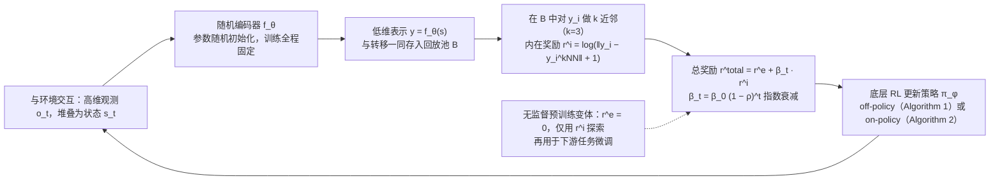

---

type: entity
tags: [paper, bfm, behavior-foundation-model, awesome-bfm-papers, berkeley]
status: complete
updated: 2026-06-25
arxiv: "2102.09430"
venue: "2021 · ICML"
code: https://github.com/younggyoseo/RE3
summary: "在固定随机编码器的表示空间上用 k 近邻估计状态熵作内在奖励，提升探索样本效率（依据 arXiv:2102.09430v4 摘要与 §3）。"
related:
  - ../concepts/behavior-foundation-model.md
  - ../overview/bfm-41-papers-technology-map.md
  - ../overview/bfm-category-03-intrinsic-reward-pretraining.md
  - ../methods/reinforcement-learning.md
sources:
  - ../../sources/papers/bfm_awesome_re3_icml_2020.md
  - ../../sources/papers/bfm_awesome_41_catalog.md
  - ../../sources/blogs/wechat_embodied_ai_lab_bfm_41_papers_survey.md
---

# State Entropy Maximization with Random Encoders for Efficient Exploration

**State Entropy Maximization with Random Encoders for Efficient Exploration** 收录于 [awesome-bfm-papers](https://github.com/friedrichyuan/awesome-bfm-papers) **第 28/41** 篇，归类为 **03 Intrinsic reward 预训练**（论文 ICML 2021；awesome-bfm 清单标注 2020）。

> **方法背景：** [reinforcement-learning](../methods/reinforcement-learning.md) — 通用方法页（非本文专属深读）；本文机制与实验以原文为准，本页保留 survey 坐标与交叉引用。

## 一句话定义

在固定随机编码器的表示空间上用 k 近邻估计状态熵作内在奖励，提升探索样本效率（依据 arXiv:2102.09430v4 摘要与 §3）。

## 英文缩写速查

| 缩写 | 英文全称 | 简要说明 |
|------|----------|----------|
| OOD | Out-of-Distribution | 分布外样本/未见场景，泛化评测关注点 |
| BFM | Behavior Foundation Model | 大规模行为数据预训练的可复用全身行为先验 |
| AMP | Adversarial Motion Prior | 用对抗判别约束状态转移接近专家运动分布的先验 |

## 为什么重要

- 在固定随机编码器的表示空间上用 k 近邻估计状态熵作内在奖励，提升探索样本效率（依据 arXiv:2102.09430v4 摘要与 §3）。
- 在 [BFM 41 篇技术地图](../overview/bfm-41-papers-technology-map.md) 中属于 **03 Intrinsic reward 预训练**（#28/41）。

## 流程总览

图依据：论文 §3.1 / §3.2（随机编码器、k-NN 熵估计内在奖励、RE3 目标，Eq.(3)(4)）与 Algorithm 1 / 2。

## 核心信息

| 字段 | 内容 |
|------|------|
| 编号 | 28/41 |
| 分组 | 03 Intrinsic reward 预训练 |
| 出处 | 2021 · ICML（arXiv 2021-02，PMLR 38th；awesome-bfm 清单标注 2020） |
| 论文 | <https://arxiv.org/abs/2102.09430> |
- **代码/项目：** <https://github.com/younggyoseo/RE3>

## 核心机制（归纳）

### 1）策展导读要点

无明确外部任务时，用 **intrinsic reward**（探索、多样性、后继态等）预训练身体策略。

### 2）策展导读要点

论文（§4）实验在 DeepMind Control Suite、MiniGrid、Atari 上进行，并有「无外部奖励预训练再下游微调」的变体；未涉及 goal-conditioned 或 imitation，也没有人形机器人实验。

## 结论

**RE3 站在 BFM 的「冷启动」一侧：用随机编码器上的状态熵最大化去买探索覆盖，而不是直接解某个任务。**

- 归位在 **03 Intrinsic reward 预训练**（#28/41）：无外部奖励时用状态熵内在奖励预训练策略，再下游微调可提升样本效率（论文 Fig.9，Hopper 等 DMControl 任务）。
- 论文实验环境为 DMControl / MiniGrid / Atari，无人形实验；「人形需覆盖更多姿态」属策展延伸，论文未验证。
- 边界很明确——intrinsic 预训练 **不替代任务奖励**，下游仍需任务奖励；代码见 <https://github.com/younggyoseo/RE3>，量化结果以原文为准。

## 常见误区

1. Intrinsic 预训练不替代任务奖励；它提供 **探索覆盖**，下游仍需任务奖励。

## 实验与评测

- 本页在公众号/survey **策展编译**基础上补充机制归纳；**量化 benchmark、消融与实机指标以原文 PDF / 项目页为准**（链接见 [参考来源](#参考来源)）。
- 与同栈姊妹篇对照时，请回到对应 **技术地图 / 42 篇栈 / BFM 地图 / VLN 地图** 总览中的实验段落。

## 与其他页面的关系

- 技术地图：[bfm-41-papers-technology-map.md](../overview/bfm-41-papers-technology-map.md)
- BFM 概念：[behavior-foundation-model.md](../concepts/behavior-foundation-model.md)
- 原始 source：[bfm_awesome_re3_icml_2020.md](../../sources/papers/bfm_awesome_re3_icml_2020.md)

## 参考来源

- [bfm_awesome_re3_icml_2020.md](../../sources/papers/bfm_awesome_re3_icml_2020.md) — awesome-bfm 策展摘录
- [bfm_awesome_41_catalog.md](../../sources/papers/bfm_awesome_41_catalog.md) — 41+10 总表
- [wechat_embodied_ai_lab_bfm_41_papers_survey.md](../../sources/blogs/wechat_embodied_ai_lab_bfm_41_papers_survey.md) — 微信公众号编译导读
- 论文：<https://arxiv.org/abs/2102.09430>
- 核对（2026-11-02）：对照 arXiv:2102.09430v4（Proceedings of the 38th ICML）摘要、§3、§4：venue 改为 2021；删去「人形需覆盖更多姿态/OOD」（论文实验为 DMControl、MiniGrid、Atari）及 goal-conditioned/imitation 表述。流程图与论文一致，未改。
- [arXiv PDF](https://arxiv.org/pdf/2102.09430)：已通读方法部分（实验与附录以略读为准）：§3 Method（§3.1 预备知识、§3.2 随机编码器探索）、§4.1 实验设定

## 推荐继续阅读

- [awesome-bfm-papers](https://github.com/friedrichyuan/awesome-bfm-papers) — 完整列表与数据集表
- [A Survey of Behavior Foundation Model](https://arxiv.org/abs/2506.20487) — TPAMI 2025 综述
