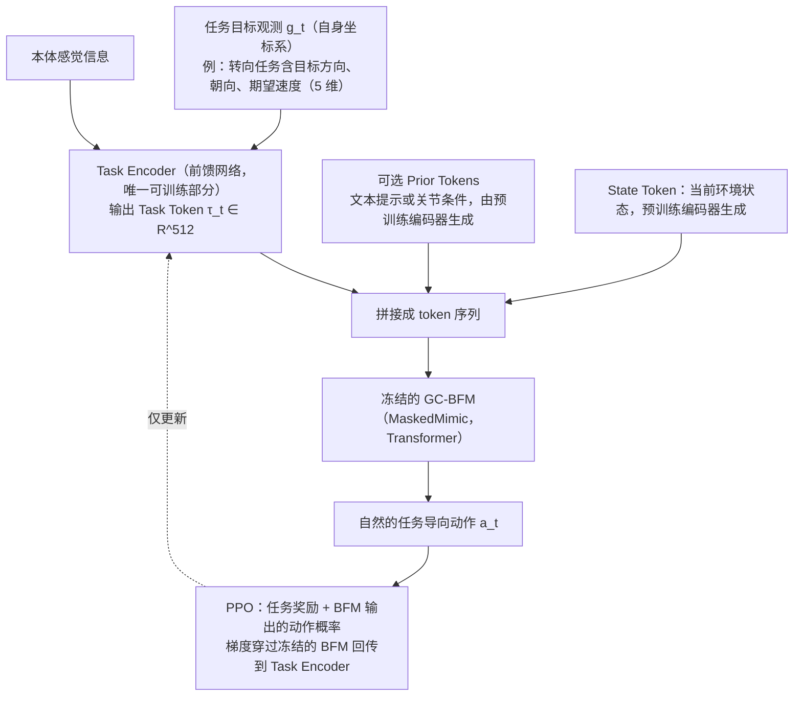

---

type: entity
tags: [paper, bfm, behavior-foundation-model, awesome-bfm-papers, meta]
status: complete
updated: 2026-06-25
arxiv: "2503.22886"
venue: "2025 · arXiv"
summary: "轻量 task token 适配，把重训身体转为换任务条件。"
related:
  - ../concepts/behavior-foundation-model.md
  - ../overview/bfm-41-papers-technology-map.md
  - ../overview/bfm-category-04-adaptation.md
sources:
  - ../../sources/papers/bfm_awesome_task_tokens_arxiv_2503_22886.md
  - ../../sources/papers/bfm_awesome_41_catalog.md
  - ../../sources/blogs/wechat_embodied_ai_lab_bfm_41_papers_survey.md
---

# Task Tokens

**Task Tokens** 收录于 [awesome-bfm-papers](https://github.com/friedrichyuan/awesome-bfm-papers) **第 31/41** 篇，归类为 **04 Adaptation**（2025 · arXiv）。

## 一句话定义

轻量 task token 适配，把重训身体转为换任务条件。

## 英文缩写速查

| 缩写 | 英文全称 | 简要说明 |
|------|----------|----------|
| BFM | Behavior Foundation Model | 大规模行为数据预训练的可复用全身行为先验 |
| AMP | Adversarial Motion Prior | 用对抗判别约束状态转移接近专家运动分布的先验 |

## 为什么重要

- 轻量 task token 适配，把重训身体转为换任务条件。
- 在 [BFM 41 篇技术地图](../overview/bfm-41-papers-technology-map.md) 中属于 **04 Adaptation**（#31/41）。

## 流程总览

图依据：论文 §3.1–§3.3（Fig. 1）

## 核心信息

| 字段 | 内容 |
|------|------|
| 编号 | 31/41 |
| 分组 | 04 Adaptation |
| 出处 | 2025 · arXiv |
| 论文 | <https://arxiv.org/abs/2503.22886> |

## 核心机制（归纳）

### 1）策展导读要点

在预训练 BFM 上通过 **task token、动力学适配或少量示范** 快速迁移到新任务/新机体。

### 2）策展导读要点

核心问题是 **保留基座能力的同时** 以低成本吸收新约束，而非从零重训。

## 结论

**Task Tokens 把适配成本从「重训身体」挪到「换任务条件」：新任务只学一小段 token，基座保持不动。**

- 它与同组 adaptation 路线共享同一命题：在预训练 BFM 上用 **task token、动力学适配或少量示范** 迁移到新任务/新机体，核心是在 **保留基座能力** 的同时低成本吸收新约束。
- 适用前提是决定性的：这类方法默认已有 **强预训练基座**；基座弱时 adapter 收益有限——先评估基座覆盖面，再谈适配技巧。
- 本页为清单坐标（awesome-bfm #31/41，**04 Adaptation**，2025 · arXiv）；量化 benchmark、消融与实机指标以原文 PDF 为准。

## 常见误区

1. Fast adaptation 论文通常假设 **已有强预训练基座**；弱基座上 adapter 收益有限。

## 实验与评测

- 本页在公众号/survey **策展编译**基础上补充机制归纳；**量化 benchmark、消融与实机指标以原文 PDF / 项目页为准**（链接见 [参考来源](#参考来源)）。
- 与同栈姊妹篇对照时，请回到对应 **技术地图 / 42 篇栈 / BFM 地图 / VLN 地图** 总览中的实验段落。

## 与其他页面的关系

- 技术地图：[bfm-41-papers-technology-map.md](../overview/bfm-41-papers-technology-map.md)
- BFM 概念：[behavior-foundation-model.md](../concepts/behavior-foundation-model.md)
- 原始 source：[bfm_awesome_task_tokens_arxiv_2503_22886.md](../../sources/papers/bfm_awesome_task_tokens_arxiv_2503_22886.md)

## 参考来源

- [bfm_awesome_task_tokens_arxiv_2503_22886.md](../../sources/papers/bfm_awesome_task_tokens_arxiv_2503_22886.md) — awesome-bfm 策展摘录
- [bfm_awesome_41_catalog.md](../../sources/papers/bfm_awesome_41_catalog.md) — 41+10 总表
- [wechat_embodied_ai_lab_bfm_41_papers_survey.md](../../sources/blogs/wechat_embodied_ai_lab_bfm_41_papers_survey.md) — 微信公众号编译导读
- 论文：<https://arxiv.org/abs/2503.22886>
- [arXiv PDF](https://arxiv.org/pdf/2503.22886)：已通读方法部分（实验与附录以略读为准）：§3 方法（3.1 Task Tokens、3.2 Task Encoder、3.3 Training，含 Fig. 1）；§4 实验与附录仅略读

## 推荐继续阅读

- [awesome-bfm-papers](https://github.com/friedrichyuan/awesome-bfm-papers) — 完整列表与数据集表
- [A Survey of Behavior Foundation Model](https://arxiv.org/abs/2506.20487) — TPAMI 2025 综述
