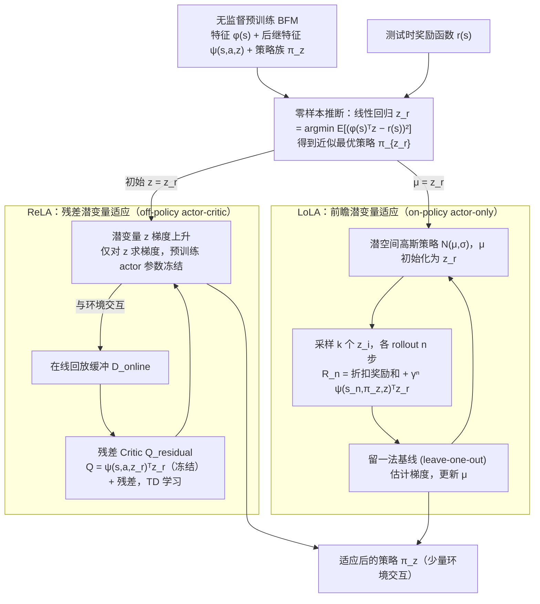

---

type: entity
tags: [paper, bfm, behavior-foundation-model, awesome-bfm-papers, meta]
status: complete
updated: 2026-06-25
arxiv: "2504.07896"
venue: "2025 · CoRL"
summary: "适配速度决定 BFM 工程价值：新任务样本与开发成本。"
related:
  - ../concepts/behavior-foundation-model.md
  - ../overview/bfm-41-papers-technology-map.md
  - ../overview/bfm-category-04-adaptation.md
sources:
  - ../../sources/papers/bfm_awesome_fast_adaptation_bfm_corl_2025.md
  - ../../sources/papers/bfm_awesome_41_catalog.md
  - ../../sources/blogs/wechat_embodied_ai_lab_bfm_41_papers_survey.md
---

# Fast Adaptation With Behavioral Foundation Models

**Fast Adaptation With Behavioral Foundation Models** 收录于 [awesome-bfm-papers](https://github.com/friedrichyuan/awesome-bfm-papers) **第 33/41** 篇，归类为 **04 Adaptation**（2025 · CoRL）。

## 一句话定义

适配速度决定 BFM 工程价值：新任务样本与开发成本。

## 英文缩写速查

| 缩写 | 英文全称 | 简要说明 |
|------|----------|----------|
| BFM | Behavior Foundation Model | 大规模行为数据预训练的可复用全身行为先验 |
| AMP | Adversarial Motion Prior | 用对抗判别约束状态转移接近专家运动分布的先验 |

## 为什么重要

- 适配速度决定 BFM 工程价值：新任务样本与开发成本。
- 在 [BFM 41 篇技术地图](../overview/bfm-41-papers-technology-map.md) 中属于 **04 Adaptation**（#33/41）。

## 流程总览

图依据：论文 §3.1 ReLA、§3.2 LoLA（Fig. 1、Eq. 5–7）

## 核心信息

| 字段 | 内容 |
|------|------|
| 编号 | 33/41 |
| 分组 | 04 Adaptation |
| 出处 | 2025 · CoRL |
| 论文 | <https://arxiv.org/abs/2504.07896> |

## 核心机制（归纳）

### 1）策展导读要点

在预训练 BFM 上通过 **task token、动力学适配或少量示范** 快速迁移到新任务/新机体。

### 2）策展导读要点

核心问题是 **保留基座能力的同时** 以低成本吸收新约束，而非从零重训。

## 结论

**这篇把 BFM 的评价重心从「基座有多强」挪到「换一个任务要花多少」：适配速度才是 BFM 工程价值的计价单位。**

- 机制上走 **task token、动力学适配或少量示范** 三条路，目标是**保留基座能力的同时**低成本吸收新约束，而不是从零重训。
- 前提条件不可忽略：这类工作默认**已有强预训练基座**，弱基座上 adapter 的收益有限——所以它衡量的是基座的可用性，而非替代基座本身。
- 本页为清单索引策展编译，且未记录代码/项目入口；量化 benchmark 与消融以 arXiv:2504.07896 原文为准。

## 常见误区

1. Fast adaptation 论文通常假设 **已有强预训练基座**；弱基座上 adapter 收益有限。

## 实验与评测

- 本页在公众号/survey **策展编译**基础上补充机制归纳；**量化 benchmark、消融与实机指标以原文 PDF / 项目页为准**（链接见 [参考来源](#参考来源)）。
- 与同栈姊妹篇对照时，请回到对应 **技术地图 / 42 篇栈 / BFM 地图 / VLN 地图** 总览中的实验段落。

## 与其他页面的关系

- 技术地图：[bfm-41-papers-technology-map.md](../overview/bfm-41-papers-technology-map.md)
- BFM 概念：[behavior-foundation-model.md](../concepts/behavior-foundation-model.md)
- 原始 source：[bfm_awesome_fast_adaptation_bfm_corl_2025.md](../../sources/papers/bfm_awesome_fast_adaptation_bfm_corl_2025.md)

## 参考来源

- [bfm_awesome_fast_adaptation_bfm_corl_2025.md](../../sources/papers/bfm_awesome_fast_adaptation_bfm_corl_2025.md) — awesome-bfm 策展摘录
- [bfm_awesome_41_catalog.md](../../sources/papers/bfm_awesome_41_catalog.md) — 41+10 总表
- [wechat_embodied_ai_lab_bfm_41_papers_survey.md](../../sources/blogs/wechat_embodied_ai_lab_bfm_41_papers_survey.md) — 微信公众号编译导读
- 论文：<https://arxiv.org/abs/2504.07896>
- [arXiv PDF](https://arxiv.org/pdf/2504.07896)：已通读方法部分（实验与附录以略读为准）：§1 引言（Fig. 1）、§2 预备知识、§3 ReLA 与 LoLA 方法；§4 实验仅略读

## 推荐继续阅读

- [awesome-bfm-papers](https://github.com/friedrichyuan/awesome-bfm-papers) — 完整列表与数据集表
- [A Survey of Behavior Foundation Model](https://arxiv.org/abs/2506.20487) — TPAMI 2025 综述
