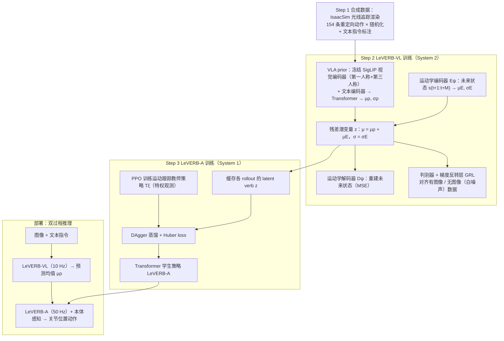

---

type: entity
tags: [paper, bfm, behavior-foundation-model, awesome-bfm-papers, berkeley, cmu]
status: complete
updated: 2026-11-22
arxiv: "2506.13751"
venue: "2025 · arXiv"
summary: "视觉-语言指令压成适合全身的 latent；语义到身体接口。"
related:
  - ../concepts/behavior-foundation-model.md
  - ../overview/bfm-41-papers-technology-map.md
  - ../overview/bfm-category-05-hierarchical-control.md
  - ../methods/vla.md
  - ../entities/paper-daji-anticipatory-joint-intent.md
sources:
  - ../../sources/papers/bfm_awesome_leverb_arxiv_2506_13751.md
  - ../../sources/papers/bfm_awesome_41_catalog.md
  - ../../sources/blogs/wechat_embodied_ai_lab_bfm_41_papers_survey.md
original:
  - ../../sources/papers/bfm_awesome_leverb_arxiv_2506_13751.md
---

# LeVerb

**LeVerb** 收录于 [awesome-bfm-papers](https://github.com/friedrichyuan/awesome-bfm-papers) **第 36/41** 篇，归类为 **05 Hierarchical control**（2025 · arXiv）。

> **方法背景：** [vla](../methods/vla.md) — 通用方法页（非本文专属深读）；本文机制与实验以原文为准，本页保留 survey 坐标与交叉引用。

## 一句话定义

视觉-语言指令压成适合全身的 latent；语义到身体接口。

## 英文缩写速查

| 缩写 | 英文全称 | 简要说明 |
|------|----------|----------|
| BFM | Behavior Foundation Model | 大规模行为数据预训练的可复用全身行为先验 |
| AMP | Adversarial Motion Prior | 用对抗判别约束状态转移接近专家运动分布的先验 |

## 为什么重要

- 视觉-语言指令压成适合全身的 latent；语义到身体接口。
- 在 [BFM 41 篇技术地图](../overview/bfm-41-papers-technology-map.md) 中属于 **05 Hierarchical control**（#36/41）。

## 流程总览

图依据：论文 §3、§4.1–4.3 / Fig.3（训练流水线）与式(1)(2)。

## 核心信息

| 字段 | 内容 |
|------|------|
| 编号 | 36/41 |
| 分组 | 05 Hierarchical control |
| 出处 | 2025 · arXiv |
| 论文 | <https://arxiv.org/abs/2506.13751> |

## 核心机制（归纳）

### 1）策展导读要点

语言、VLA、扩散或规划器作为上层，**调用** 已封装的底层全身能力（tracking / WBC / latent skill）。

### 2）策展导读要点

接口设计（命令空间、时序、安全层）决定上层智能能否稳定使用身体。

## 结论

**LeVerb 占的是「语义到身体」的接口位：把视觉-语言指令压成适合全身执行的 latent，而不是让上层直接吐控制量。**

- 分组共性是语言、VLA、扩散或规划器作为上层 **调用** 已封装的底层全身能力（tracking / WBC / latent skill）；LeVerb 的贡献落在这层 latent 命令的表示上。
- 真正决定可用性的是 **接口设计**——命令空间、时序与安全层，而非上层模型本身有多强。
- 常见误读是把瓶颈归给上层 token 设计；实际更常卡在 **底层跟踪鲁棒性**。
- 本页保留 survey 坐标（**#36/41，05 Hierarchical control**）与交叉引用，方法背景见通用方法页 [vla](../methods/vla.md)；机制细节与量化实验以原文为准。

## 工程实践

- **上下层分布重采样对齐（LeVERB-A 训练关键）：** System 2 运行于 10 Hz 而 System 1 跑在 50 Hz，蒸馏 LeVERB-A 时须每 5 步从 System 2 高斯分布重采样潜变量并移除历史观测（原文发现带观测历史会旁路 latent 指令）。
- **纯合成光追视觉数据 + GRL 跨模态对齐：** 通过梯度反转判别器对齐含视觉与纯文本数据分布，在 G1 机载 CPU C++ ONNX 跑 50 Hz 下层、外接 RTX 4090 ROS2 跑 10 Hz 上层实现零样本迁移。

## 常见误区或局限

- 语言/VLA 调用身体时，瓶颈往往在 **底层跟踪鲁棒性**，而非上层 token 设计 alone。
- **有限未来视域与缺少快视觉闭环：** 原文 §6 指出 LeVERB 仅预测未来数秒短视域且 LeVERB-A 无快速视觉直接闭环；高敏捷灵巧交互还需后训练对齐。

## 实验与评测

- **LeVERB-Bench（>150 任务 / 10 大类）：** 原文 §5.1 在未见材质/物体组合场景测得 **58.9%** 平均成功率（摘要汇总口径 **58.5%**；简单视觉导航 **80%**），较朴素分层 VLA（NS 消融）提升 **7.8 倍**；去掉 GRL 判别器（ND）或低层 latent 重采样（NLS）均明显掉点。
- **真机：** 在 Unitree G1 上展示视觉导航、转身与坐下等零样本词表泛化；与同栈姊妹篇对照请见 [BFM 技术地图](../overview/bfm-41-papers-technology-map.md)。

## 与其他工作对比

| 对比维度 / 工作 | LeVerb（本文） | 朴素分层 VLA（NS 消融）/ 内部消融（ND、NLS） | [LangWBC](./paper-bfm-37-langwbc.md)（#37/41） |
|---|---|---|---|
| 感知与命令接口 | 双系统异步：10 Hz **LeVERB-VL**（第一/第三人称 SigLIP + 文本 → 残差潜变量 $z$）+ 50 Hz **LeVERB-A**（无视觉、纯本体） | 朴素分层（NS）缺少本文残差潜空间接口与训练对齐；ND 去 GRL、NLS 去低层每 5 步重采样 | **无视觉输入**，CLIP 文本嵌入 + 2s 本体历史直接输入 CVAE 端到端 WBC，由外部 LLM 拆解带秒数文本指令 |
| 跨模态对齐与训练数据 | 纯合成光追渲染（154 条动作 × 随机化）+ 梯度反转判别器（GRL）对齐有图/无图分布 | 未对齐跨模态分布或未阻断历史观测旁路，导致潜指令失效 | 依赖 HumanML3D 重定向 + PPO 教师与域随机化蒸馏 |
| 评测与局限边界 | LeVERB-Bench 未见材质/物体组合均值 **58.9%**（超 NS **7.8 倍**），Unitree G1 零样本真机迁移；仅短视域且下层缺快视觉闭环 | 消融对比均显著低于完整 LeVerb | 验证数十条语言条件动作与抗踹击，受限于缺视觉感知与 VAE 表达力 |

> **核对边界**：对比依据为已通读归档 [bfm_awesome_leverb_arxiv_2506_13751.md](../../sources/papers/bfm_awesome_leverb_arxiv_2506_13751.md)（`arXiv:2506.13751v3` §3–§7）及站内 [LangWBC](./paper-bfm-37-langwbc.md) 实体页；LeVerb 无公开源码，Benchmark 对比限于原文自建 LeVERB-Bench 与消融变体。

## 关联页面

- 技术地图：[bfm-41-papers-technology-map.md](../overview/bfm-41-papers-technology-map.md)
- BFM 概念：[behavior-foundation-model.md](../concepts/behavior-foundation-model.md)
- 原始 source：[bfm_awesome_leverb_arxiv_2506_13751.md](../../sources/papers/bfm_awesome_leverb_arxiv_2506_13751.md)

## 参考来源

- [bfm_awesome_leverb_arxiv_2506_13751.md](../../sources/papers/bfm_awesome_leverb_arxiv_2506_13751.md) — awesome-bfm 策展摘录
- [bfm_awesome_41_catalog.md](../../sources/papers/bfm_awesome_41_catalog.md) — 41+10 总表
- [wechat_embodied_ai_lab_bfm_41_papers_survey.md](../../sources/blogs/wechat_embodied_ai_lab_bfm_41_papers_survey.md) — 微信公众号编译导读
- 论文：<https://arxiv.org/abs/2506.13751>
- [arXiv PDF](https://arxiv.org/pdf/2506.13751)：已通读方法部分（实验与附录以略读为准）：§3 数据集、§4 双过程控制（4.1–4.3）

## 推荐继续阅读

- [awesome-bfm-papers](https://github.com/friedrichyuan/awesome-bfm-papers) — 完整列表与数据集表
- [A Survey of Behavior Foundation Model](https://arxiv.org/abs/2506.20487) — TPAMI 2025 综述
