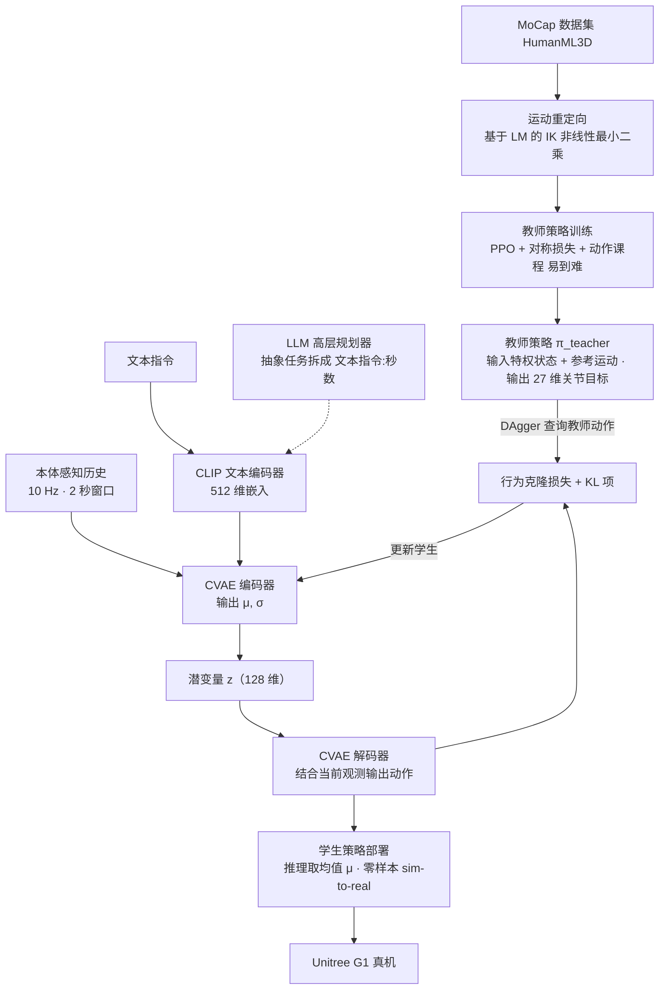

---

type: entity
tags: [paper, bfm, behavior-foundation-model, awesome-bfm-papers, berkeley]
status: complete
updated: 2026-10-06
arxiv: "2504.21738"
venue: "2025 · arXiv"
summary: "语言直接进入端到端 WBC；难在语义进入身体后不打散稳定性。"
related:
  - ../concepts/behavior-foundation-model.md
  - ../overview/bfm-41-papers-technology-map.md
  - ../overview/bfm-category-05-hierarchical-control.md
  - ../methods/vla.md
sources:
  - ../../sources/papers/bfm_awesome_langwbc_arxiv_2504_21738.md
  - ../../sources/papers/bfm_awesome_41_catalog.md
  - ../../sources/blogs/wechat_embodied_ai_lab_bfm_41_papers_survey.md
---

# LangWBC

**LangWBC** 收录于 [awesome-bfm-papers](https://github.com/friedrichyuan/awesome-bfm-papers) **第 37/41** 篇，归类为 **05 Hierarchical control**（2025 · arXiv）。

> **方法背景：** [vla](../methods/vla.md) — 通用方法页（非本文专属深读）；本文机制与实验以原文为准，本页保留 survey 坐标与交叉引用。

## 一句话定义

语言直接进入端到端 WBC；难在语义进入身体后不打散稳定性。

## 英文缩写速查

| 缩写 | 英文全称 | 简要说明 |
|------|----------|----------|
| WBC | Whole-Body Control | 协调全身关节满足多任务/约束的控制基础设施 |
| BFM | Behavior Foundation Model | 大规模行为数据预训练的可复用全身行为先验 |
| AMP | Adversarial Motion Prior | 用对抗判别约束状态转移接近专家运动分布的先验 |

## 为什么重要

- 语言直接进入端到端 WBC；难在语义进入身体后不打散稳定性。
- 在 [BFM 41 篇技术地图](../overview/bfm-41-papers-technology-map.md) 中属于 **05 Hierarchical control**（#37/41）。

## 流程总览

图依据：论文 §III-A 教师策略、§III-B 语言引导学生策略、§IV-G LLM 集成 / Fig. 2。

## 核心信息

| 字段 | 内容 |
|------|------|
| 编号 | 37/41 |
| 分组 | 05 Hierarchical control |
| 出处 | 2025 · arXiv |
| 论文 | <https://arxiv.org/abs/2504.21738> |

## 核心机制（归纳）

### 1）策展导读要点

语言、VLA、扩散或规划器作为上层，**调用** 已封装的底层全身能力（tracking / WBC / latent skill）。

### 2）策展导读要点

接口设计（命令空间、时序、安全层）决定上层智能能否稳定使用身体。

## 结论

**LangWBC 走的是「语言直接进入端到端 WBC」这条最短路径，而它真正暴露的问题是：语义进了身体之后，如何不把稳定性打散。**

- 它归在 **05 Hierarchical control**：语言、VLA、扩散或规划器作为上层 **调用** 已封装的底层全身能力，而接口设计（命令空间、时序、安全层）决定上层智能能否稳定使用身体。
- 最常见的归因错误也在这里：语言调用身体不顺时，瓶颈往往在 **底层跟踪鲁棒性**，而不只是上层 token 设计——先看 WBC，再调 prompt。
- 本页保留 survey 坐标（#37/41，2025 · arXiv）与交叉引用，方法背景见通用方法页 [vla](../methods/vla.md)；本文机制与实验以原文为准，量化指标不在本页。

## 常见误区

1. 语言/VLA 调用身体时，瓶颈往往在 **底层跟踪鲁棒性**，而非上层 token 设计 alone。

## 实验与评测

- 本页在公众号/survey **策展编译**基础上补充机制归纳；**量化 benchmark、消融与实机指标以原文 PDF / 项目页为准**（链接见 [参考来源](#参考来源)）。
- 与同栈姊妹篇对照时，请回到对应 **技术地图 / 42 篇栈 / BFM 地图 / VLN 地图** 总览中的实验段落。

## 与其他页面的关系

- 技术地图：[bfm-41-papers-technology-map.md](../overview/bfm-41-papers-technology-map.md)
- BFM 概念：[behavior-foundation-model.md](../concepts/behavior-foundation-model.md)
- 原始 source：[bfm_awesome_langwbc_arxiv_2504_21738.md](../../sources/papers/bfm_awesome_langwbc_arxiv_2504_21738.md)
- 后续对照：[ADAPT（文本驱动人形）](./paper-adapt-text-driven-humanoid.md) — 同样端到端语言控制，但用帧级扩散先验 + 残差；论文表里 LangWBC Success 0.923 / R@1 40.9%

## 参考来源

- [bfm_awesome_langwbc_arxiv_2504_21738.md](../../sources/papers/bfm_awesome_langwbc_arxiv_2504_21738.md) — awesome-bfm 策展摘录
- [bfm_awesome_41_catalog.md](../../sources/papers/bfm_awesome_41_catalog.md) — 41+10 总表
- [wechat_embodied_ai_lab_bfm_41_papers_survey.md](../../sources/blogs/wechat_embodied_ai_lab_bfm_41_papers_survey.md) — 微信公众号编译导读
- 论文：<https://arxiv.org/abs/2504.21738>
- [arXiv PDF](https://arxiv.org/pdf/2504.21738)：已通读方法部分（实验与附录以略读为准）：§III 方法（A 教师、B 学生，含 Fig. 2）、§IV-G LLM 集成；其余实验与附录略读

## 推荐继续阅读

- [awesome-bfm-papers](https://github.com/friedrichyuan/awesome-bfm-papers) — 完整列表与数据集表
- [A Survey of Behavior Foundation Model](https://arxiv.org/abs/2506.20487) — TPAMI 2025 综述
