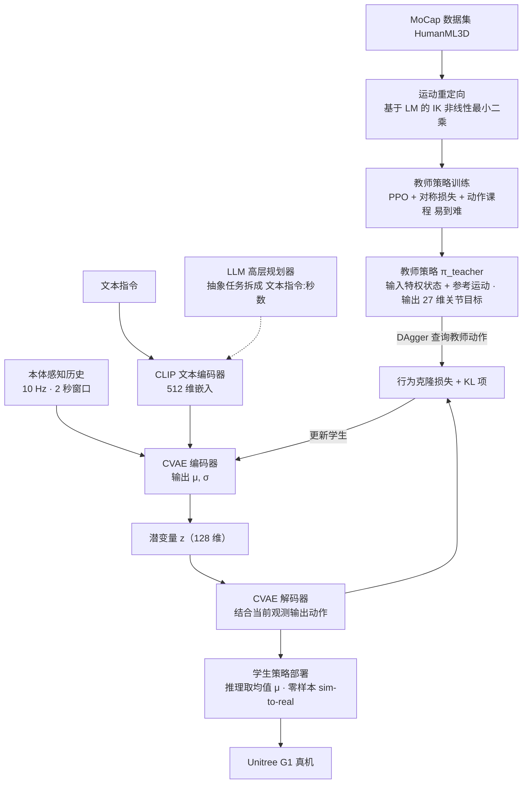

---

type: entity
tags: [paper, bfm, behavior-foundation-model, awesome-bfm-papers, berkeley]
status: complete
updated: 2026-11-22
arxiv: "2504.21738"
venue: "2025 · arXiv"
summary: "语言直接进入端到端 WBC；难在语义进入身体后不打散稳定性。"
related:
  - ../concepts/behavior-foundation-model.md
  - ../overview/bfm-41-papers-technology-map.md
  - ../overview/bfm-category-05-hierarchical-control.md
  - ../methods/vla.md
sources:
  - ../../sources/papers/bfm_awesome_langwbc_arxiv_2504_21738.md
  - ../../sources/papers/bfm_awesome_41_catalog.md
  - ../../sources/blogs/wechat_embodied_ai_lab_bfm_41_papers_survey.md
original:
  - ../../sources/papers/bfm_awesome_langwbc_arxiv_2504_21738.md
---

# LangWBC

**LangWBC** 收录于 [awesome-bfm-papers](https://github.com/friedrichyuan/awesome-bfm-papers) **第 37/41** 篇，归类为 **05 Hierarchical control**（2025 · arXiv）。

> **方法背景：** [vla](../methods/vla.md) — 通用方法页（非本文专属深读）；本文机制与实验以原文为准，本页保留 survey 坐标与交叉引用。

## 一句话定义

语言直接进入端到端 WBC；难在语义进入身体后不打散稳定性。

## 英文缩写速查

| 缩写 | 英文全称 | 简要说明 |
|------|----------|----------|
| WBC | Whole-Body Control | 协调全身关节满足多任务/约束的控制基础设施 |
| BFM | Behavior Foundation Model | 大规模行为数据预训练的可复用全身行为先验 |
| AMP | Adversarial Motion Prior | 用对抗判别约束状态转移接近专家运动分布的先验 |

## 为什么重要

- 语言直接进入端到端 WBC；难在语义进入身体后不打散稳定性。
- 在 [BFM 41 篇技术地图](../overview/bfm-41-papers-technology-map.md) 中属于 **05 Hierarchical control**（#37/41）。

## 流程总览

图依据：论文 §III-A 教师策略、§III-B 语言引导学生策略、§IV-G LLM 集成 / Fig. 2。

## 核心信息

| 字段 | 内容 |
|------|------|
| 编号 | 37/41 |
| 分组 | 05 Hierarchical control |
| 出处 | 2025 · arXiv |
| 论文 | <https://arxiv.org/abs/2504.21738> |

## 核心机制（归纳）

### 1）策展导读要点

语言、VLA、扩散或规划器作为上层，**调用** 已封装的底层全身能力（tracking / WBC / latent skill）。

### 2）策展导读要点

接口设计（命令空间、时序、安全层）决定上层智能能否稳定使用身体。

## 结论

**LangWBC 走的是「语言直接进入端到端 WBC」这条最短路径，而它真正暴露的问题是：语义进了身体之后，如何不把稳定性打散。**

- 它归在 **05 Hierarchical control**：语言、VLA、扩散或规划器作为上层 **调用** 已封装的底层全身能力，而接口设计（命令空间、时序、安全层）决定上层智能能否稳定使用身体。
- 最常见的归因错误也在这里：语言调用身体不顺时，瓶颈往往在 **底层跟踪鲁棒性**，而不只是上层 token 设计——先看 WBC，再调 prompt。
- 本页保留 survey 坐标（#37/41，2025 · arXiv）与交叉引用，方法背景见通用方法页 [vla](../methods/vla.md)；本文机制与实验以原文为准，量化指标不在本页。

## 工程实践

- **冻结低频 CLIP 文本特征，高频控制循环复用嵌入：** 部署时以低频运行 CLIP 文本编码器生成 512 维特征并跨控制步缓存，CVAE 学生策略在 10 Hz / 2 s 本体历史窗口下直接推理输出。
- **教师训练先用对称损失 + 由易到难动作课程：** 在教师 RL 阶段启用关节位置/角速度对称正则与 Table IV 物理随机化，避免 CVAE 蒸馏阶段出现非对称步态或抗扰崩塌。

## 常见误区或局限

1. 语言/VLA 调用身体时，瓶颈往往在 **底层跟踪鲁棒性**，而非上层 token 设计 alone。
2. **缺少视觉感知与词表覆盖规模有限（原文 §V）：** 原版仅验证数十条语言条件全身行走与上肢动作，受限于缺视觉闭环及 VAE 表达力（难覆盖大型复杂接触域随机化）。

## 实验与评测

- 原文通过 Table III 验证完整 CLIP+CVAE+相对跟踪目标显著优于 No-Rel 及 MLP 基线（CLIP+CVAE 隐空间插值可生成平滑过渡步态，单纯 CLIP+MLP 出现抖动），并在 G1 真机完成抗踹击及 LLM 长任务拆解演示（如先快走 4 s 再挥手 5 s）；另见后续 [ADAPT](./paper-adapt-text-driven-humanoid.md) 对照。

## 与其他工作对比

| 对比维度 / 工作 | LangWBC（本文） | No-Rel / CLIP+MLP（原文消融） | [ADAPT](./paper-adapt-text-driven-humanoid.md) | [LeVerb](./paper-bfm-36-leverb.md)（#36/41） |
|---|---|---|---|---|
| 语义到身体接口 | **CLIP 文本 + 128 维 CVAE** 直接条件端到端 WBC（10 Hz / 2s 本体历史） | 无相对跟踪目标（No-Rel）或直接 CLIP+MLP（插值易抖动） | 帧级扩散先验 + 残差动作控制 | 双系统：10 Hz 视觉-语言潜变量 + 50 Hz DAgger 底层策略 |
| 视觉感知与任务拆解 | **无视觉闭环**；长程任务依赖外部 LLM 拆分为「文本指令:秒数」序列 | 同无视觉接口 | 文本驱动端到端人形全身控制 | 接入第一/第三人称视觉（SigLIP）与 GRL 跨模态对齐 |
| 性能与边界对照 | Table III 显著优于 No-Rel 与 CLIP+MLP；后续 ADAPT 论文表中记其 Success 0.923 / R@1 40.9% | 隐空间平滑度与跟踪表现均弱于完整 CVAE 方案 | 同表作为后续文本控制迭代对照 | 面向视觉-语言导航与交互，G1 零样本词表泛化 |

> **核对边界**：据 [bfm_awesome_langwbc_arxiv_2504_21738.md](../../sources/papers/bfm_awesome_langwbc_arxiv_2504_21738.md) 与本页参考文献说明，已通读 `arXiv:2504.21738v1` §III–§IV-G（实验部分以略读为主）；Success 0.923 / R@1 40.9% 口径引自站内后续页 [ADAPT](./paper-adapt-text-driven-humanoid.md) 的同表对照，且 LangWBC 无公开代码可供独立复现。

## 关联页面

- 技术地图：[bfm-41-papers-technology-map.md](../overview/bfm-41-papers-technology-map.md)
- BFM 概念：[behavior-foundation-model.md](../concepts/behavior-foundation-model.md)
- 原始 source：[bfm_awesome_langwbc_arxiv_2504_21738.md](../../sources/papers/bfm_awesome_langwbc_arxiv_2504_21738.md)
- 后续对照：[ADAPT（文本驱动人形）](./paper-adapt-text-driven-humanoid.md) — 同样端到端语言控制，但用帧级扩散先验 + 残差；论文表里 LangWBC Success 0.923 / R@1 40.9%

## 参考来源

- [bfm_awesome_langwbc_arxiv_2504_21738.md](../../sources/papers/bfm_awesome_langwbc_arxiv_2504_21738.md) — awesome-bfm 策展摘录
- [bfm_awesome_41_catalog.md](../../sources/papers/bfm_awesome_41_catalog.md) — 41+10 总表
- [wechat_embodied_ai_lab_bfm_41_papers_survey.md](../../sources/blogs/wechat_embodied_ai_lab_bfm_41_papers_survey.md) — 微信公众号编译导读
- 论文：<https://arxiv.org/abs/2504.21738>
- [arXiv PDF](https://arxiv.org/pdf/2504.21738)：已通读方法部分（实验与附录以略读为准）：§III 方法（A 教师、B 学生，含 Fig. 2）、§IV-G LLM 集成；其余实验与附录略读

## 推荐继续阅读

- [awesome-bfm-papers](https://github.com/friedrichyuan/awesome-bfm-papers) — 完整列表与数据集表
- [A Survey of Behavior Foundation Model](https://arxiv.org/abs/2506.20487) — TPAMI 2025 综述
