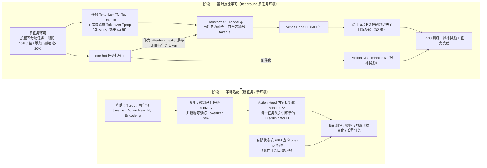

---

type: entity
tags: [paper, bfm, behavior-foundation-model, awesome-bfm-papers, nus]
status: complete
updated: 2026-09-15
arxiv: "2503.19901"
venue: "2025 · CVPR"
code: https://github.com/liangpan99/TokenHSI
summary: "人-场景交互 task token 化；坐下/跨越等是结构化事件。"
related:
  - ../concepts/behavior-foundation-model.md
  - ../overview/bfm-41-papers-technology-map.md
  - ../overview/bfm-category-05-hierarchical-control.md
  - ./paper-coins-compositional-human-scene-interaction.md
  - ./paper-lucid.md
sources:
  - ../../sources/papers/bfm_awesome_tokenhsi_arxiv_2503_19901.md
  - ../../sources/papers/bfm_awesome_41_catalog.md
  - ../../sources/blogs/wechat_embodied_ai_lab_bfm_41_papers_survey.md
  - ../../sources/papers/lucid_arxiv_2608_07746.md
---

# Tokenhsi

**Tokenhsi** 收录于 [awesome-bfm-papers](https://github.com/friedrichyuan/awesome-bfm-papers) **第 38/41** 篇，归类为 **05 Hierarchical control**（2025 · CVPR）。

## 一句话定义

人-场景交互 task token 化；坐下/跨越等是结构化事件。

## 英文缩写速查

| 缩写 | 英文全称 | 简要说明 |
|------|----------|----------|
| BFM | Behavior Foundation Model | 大规模行为数据预训练的可复用全身行为先验 |
| AMP | Adversarial Motion Prior | 用对抗判别约束状态转移接近专家运动分布的先验 |

## 为什么重要

- 人-场景交互 task token 化；坐下/跨越等是结构化事件。
- 在 [BFM 41 篇技术地图](../overview/bfm-41-papers-technology-map.md) 中属于 **05 Hierarchical control**（#38/41）。

## 流程总览

图依据：论文 §3.3 Foundational Skill Learning、§3.4 Transformer-based Policy Adaptation / Fig.2。

## 核心信息

| 字段 | 内容 |
|------|------|
| 编号 | 38/41 |
| 分组 | 05 Hierarchical control |
| 出处 | 2025 · CVPR |
| 论文 | <https://arxiv.org/abs/2503.19901> |
- **代码/项目：** <https://github.com/liangpan99/TokenHSI>

## 核心机制（归纳）

### 1）统一 Transformer 多任务策略

本体感觉 token 与各任务 token（跟随、坐、攀爬、搬运）由 Transformer 编码器自注意力融合，one-hot 任务标签作 attention mask 屏蔽非目标任务 token，MLP Action Head 输出 32 维 PD 目标；用 PPO + 条件化的 motion discriminator（AMP 风格奖励）训练（依据 arXiv:2503.19901 §3.3）。

### 2）适配：冻结主体 + 零初始化 adapter

冻结 Tprop、可学习 token e、Action Head H、Encoder φ，在 Action Head 加零初始化 adapter，新增 / 微调任务 tokenizer，每个新任务从头训练新的 discriminator；长程任务由有限状态机（FSM）切换 one-hot 标签（依据 §3.4）。论文无「上层语言 / VLA 调用底层 WBC / latent skill」的分层结构。

## 结论

**TokenHSI 的立场是用一个 Transformer 多任务策略统一多种人–场景交互技能：任务 token 化 + 掩码，再以零初始化 adapter 和任务 tokenizer 适配新任务，而不是分层调用底层控制器。**

- 起作用的是架构：共享本体感觉 token + 可变长度任务 token，使技能可组合、可适配到新物体 / 地形形状（依据 arXiv:2503.19901 摘要、§3.4）。
- 归位在 awesome-bfm 的 **05 Hierarchical control** 是策展分类；论文策略本身是单一 Transformer 策略，长程任务靠 FSM 切换任务标签。
- 与 [COINS](./paper-coins-compositional-human-scene-interaction.md) 的对照定位：后者做静态语义姿态生成，本文是 **task token 驱动的控制**；代码见 <https://github.com/liangpan99/TokenHSI>。

## 常见误区

1. 不要把 TokenHSI 读成「语言 / VLA 上层 + WBC 下层」的分层系统：它是仿真角色上的 Transformer 多任务策略与 adapter 适配（依据 §3.3–§3.4）。

## 实验与评测

- 本页在公众号/survey **策展编译**基础上补充机制归纳；**量化 benchmark、消融与实机指标以原文 PDF / 项目页为准**（链接见 [参考来源](#参考来源)）。
- 与同栈姊妹篇对照时，请回到对应 **技术地图 / 42 篇栈 / BFM 地图 / VLN 地图** 总览中的实验段落。

## 与其他页面的关系

- 技术地图：[bfm-41-papers-technology-map.md](../overview/bfm-41-papers-technology-map.md)
- BFM 概念：[behavior-foundation-model.md](../concepts/behavior-foundation-model.md)
- 人–场景交互合成对照：[COINS](./paper-coins-compositional-human-scene-interaction.md)（静态语义姿态生成 vs TokenHSI 的 task token 控制）
- 原始 source：[bfm_awesome_tokenhsi_arxiv_2503_19901.md](../../sources/papers/bfm_awesome_tokenhsi_arxiv_2503_19901.md)

## 参考来源

- [bfm_awesome_tokenhsi_arxiv_2503_19901.md](../../sources/papers/bfm_awesome_tokenhsi_arxiv_2503_19901.md) — awesome-bfm 策展摘录
- [bfm_awesome_41_catalog.md](../../sources/papers/bfm_awesome_41_catalog.md) — 41+10 总表
- [wechat_embodied_ai_lab_bfm_41_papers_survey.md](../../sources/blogs/wechat_embodied_ai_lab_bfm_41_papers_survey.md) — 微信公众号编译导读
- 论文：<https://arxiv.org/abs/2503.19901>
- 核对（2026-11-02）：对照 arXiv:2503.19901 摘要、§3.3–§3.4，把「核心机制 / 结论 / 常见误区」中的上层语言 / VLA 调用 WBC 分层套话改为论文的 Transformer 多任务策略 + 零初始化 adapter；流程图与论文一致，未改。
- [arXiv PDF](https://arxiv.org/pdf/2503.19901)：已通读方法部分（实验与附录以略读为准）：§1 引言与 §2.2 中的方法概述、§3.2–3.4（物理角色控制、基础技能学习、策略适配）、§4.1 实验设定

## 推荐继续阅读

- [awesome-bfm-papers](https://github.com/friedrichyuan/awesome-bfm-papers) — 完整列表与数据集表
- [A Survey of Behavior Foundation Model](https://arxiv.org/abs/2506.20487) — TPAMI 2025 综述
