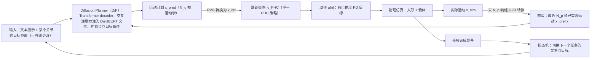

---

type: entity
tags: [paper, bfm, behavior-foundation-model, awesome-bfm-papers, meta]
status: complete
updated: 2026-06-25
arxiv: "2410.03441"
venue: "2024 · ICLR"
code: https://github.com/GuyTevet/CLoSD
summary: "扩散生成与仿真闭环校正；生成动作须经物理检验。"
related:
  - ../concepts/behavior-foundation-model.md
  - ../overview/bfm-41-papers-technology-map.md
  - ../overview/bfm-category-05-hierarchical-control.md
sources:
  - ../../sources/papers/bfm_awesome_closd_arxiv_2410_03441.md
  - ../../sources/papers/bfm_awesome_41_catalog.md
  - ../../sources/blogs/wechat_embodied_ai_lab_bfm_41_papers_survey.md
---

# CloSD

**CloSD** 收录于 [awesome-bfm-papers](https://github.com/friedrichyuan/awesome-bfm-papers) **第 39/41** 篇，归类为 **05 Hierarchical control**（2024 · ICLR）。

## 一句话定义

扩散生成与仿真闭环校正；生成动作须经物理检验。

## 英文缩写速查

| 缩写 | 英文全称 | 简要说明 |
|------|----------|----------|
| BFM | Behavior Foundation Model | 大规模行为数据预训练的可复用全身行为先验 |
| AMP | Adversarial Motion Prior | 用对抗判别约束状态转移接近专家运动分布的先验 |

## 为什么重要

- 扩散生成与仿真闭环校正；生成动作须经物理检验。
- 在 [BFM 41 篇技术地图](../overview/bfm-41-papers-technology-map.md) 中属于 **05 Hierarchical control**（#39/41）。

## 流程总览

图依据：论文 §4（4.1 DiP、4.2 通用跟踪策略、4.3 闭环、4.4 状态机）、Fig. 2。

## 核心信息

| 字段 | 内容 |
|------|------|
| 编号 | 39/41 |
| 分组 | 05 Hierarchical control |
| 出处 | 2024 · ICLR |
| 论文 | <https://arxiv.org/abs/2410.03441> |
- **代码/项目：** <https://github.com/GuyTevet/CLoSD>

## 核心机制（归纳）

### 1）策展导读要点

语言、VLA、扩散或规划器作为上层，**调用** 已封装的底层全身能力（tracking / WBC / latent skill）。

### 2）策展导读要点

接口设计（命令空间、时序、安全层）决定上层智能能否稳定使用身体。

## 结论

**CloSD 属于分层控制那一层：扩散负责生成动作、仿真负责闭环校正，生成与执行被绑成一个回路——生成动作必须过物理这一关才算数。**

- 机制定位是「上层调用身体」：语言、VLA、扩散或规划器作上层，**调用**已封装的底层全身能力（tracking / WBC / latent skill）。
- 真正决定成败的是接口而非上层模型：**命令空间、时序与安全层**的设计决定上层智能能否稳定使用身体。
- 瓶颈常在下面而不在上面——限制多来自**底层跟踪鲁棒性**，而非上层 token 设计本身。
- 本页为清单索引策展编译，量化 benchmark、消融与实机指标以 arXiv:2410.03441 原文及 `GuyTevet/CLoSD` 为准。

## 常见误区

1. 语言/VLA 调用身体时，瓶颈往往在 **底层跟踪鲁棒性**，而非上层 token 设计 alone。

## 实验与评测

- 本页在公众号/survey **策展编译**基础上补充机制归纳；**量化 benchmark、消融与实机指标以原文 PDF / 项目页为准**（链接见 [参考来源](#参考来源)）。
- 与同栈姊妹篇对照时，请回到对应 **技术地图 / 42 篇栈 / BFM 地图 / VLN 地图** 总览中的实验段落。

## 与其他页面的关系

- 技术地图：[bfm-41-papers-technology-map.md](../overview/bfm-41-papers-technology-map.md)
- BFM 概念：[behavior-foundation-model.md](../concepts/behavior-foundation-model.md)
- 原始 source：[bfm_awesome_closd_arxiv_2410_03441.md](../../sources/papers/bfm_awesome_closd_arxiv_2410_03441.md)

## 参考来源

- [bfm_awesome_closd_arxiv_2410_03441.md](../../sources/papers/bfm_awesome_closd_arxiv_2410_03441.md) — awesome-bfm 策展摘录
- [bfm_awesome_41_catalog.md](../../sources/papers/bfm_awesome_41_catalog.md) — 41+10 总表
- [wechat_embodied_ai_lab_bfm_41_papers_survey.md](../../sources/blogs/wechat_embodied_ai_lab_bfm_41_papers_survey.md) — 微信公众号编译导读
- 论文：<https://arxiv.org/abs/2410.03441>
- [arXiv PDF](https://arxiv.org/pdf/2410.03441)：已通读方法部分（实验与附录以略读为准）：§4 CLoSD（4.1 至 4.4）与 §5.1 实现细节

## 推荐继续阅读

- [awesome-bfm-papers](https://github.com/friedrichyuan/awesome-bfm-papers) — 完整列表与数据集表
- [A Survey of Behavior Foundation Model](https://arxiv.org/abs/2506.20487) — TPAMI 2025 综述
