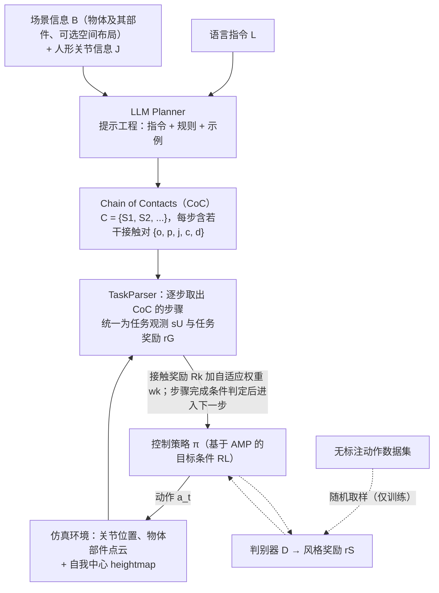

---

type: entity
tags: [paper, bfm, behavior-foundation-model, awesome-bfm-papers, shanghai-ai-lab]
status: complete
updated: 2026-06-25
arxiv: "2309.07918"
venue: "2023 · ICLR"
code: https://github.com/OpenRobotLab/UniHSI
summary: "contact chain 组织交互；任务难在接触顺序而非单姿态。"
related:
  - ../concepts/behavior-foundation-model.md
  - ../overview/bfm-41-papers-technology-map.md
  - ../overview/bfm-category-05-hierarchical-control.md
sources:
  - ../../sources/papers/bfm_awesome_unihsi_arxiv_2309_07918.md
  - ../../sources/papers/bfm_awesome_41_catalog.md
  - ../../sources/blogs/wechat_embodied_ai_lab_bfm_41_papers_survey.md
---

# Unified Human-Scene Interaction via Prompted Chain-of-Contacts

**Unified Human-Scene Interaction via Prompted Chain-of-Contacts** 收录于 [awesome-bfm-papers](https://github.com/friedrichyuan/awesome-bfm-papers) **第 41/41** 篇，归类为 **05 Hierarchical control**（2023 · ICLR）。

## 一句话定义

contact chain 组织交互；任务难在接触顺序而非单姿态。

## 英文缩写速查

| 缩写 | 英文全称 | 简要说明 |
|------|----------|----------|
| BFM | Behavior Foundation Model | 大规模行为数据预训练的可复用全身行为先验 |
| AMP | Adversarial Motion Prior | 用对抗判别约束状态转移接近专家运动分布的先验 |

## 为什么重要

- contact chain 组织交互；任务难在接触顺序而非单姿态。
- 在 [BFM 41 篇技术地图](../overview/bfm-41-papers-technology-map.md) 中属于 **05 Hierarchical control**（#41/41）。

## 流程总览

图依据：论文 §3.1 / §3.2 / §3.3、Fig. 2、Fig. 4。

## 核心信息

| 字段 | 内容 |
|------|------|
| 编号 | 41/41 |
| 分组 | 05 Hierarchical control |
| 出处 | 2023 · ICLR |
| 论文 | <https://arxiv.org/abs/2309.07918> |
- **代码/项目：** <https://github.com/OpenRobotLab/UniHSI>

## 核心机制（归纳）

### 1）策展导读要点

语言、VLA、扩散或规划器作为上层，**调用** 已封装的底层全身能力（tracking / WBC / latent skill）。

### 2）策展导读要点

接口设计（命令空间、时序、安全层）决定上层智能能否稳定使用身体。

## 结论

**UniHSI 的关键判断是：人–场景交互的难点在接触发生的顺序，而不是某个静态姿态；把交互写成 prompted chain-of-contacts，交互任务才拿到统一的描述接口。**

- 它归在 **05 Hierarchical control**：上层（语言/规划器/扩散）调用已封装的底层全身能力，contact chain 就是这里的命令空间；命令空间、时序与安全层的设计决定上层能否稳定用身体。
- 归因提醒同样适用：链条描述得再好，执行不下去时瓶颈通常在 **底层跟踪鲁棒性**，而非上层 token 或链式表示本身。
- 本页为清单坐标（awesome-bfm #41/41，2023 · ICLR，代码 <https://github.com/OpenRobotLab/UniHSI>）；量化 benchmark、消融与实机指标以原文 PDF / 项目页为准。

## 常见误区

1. 语言/VLA 调用身体时，瓶颈往往在 **底层跟踪鲁棒性**，而非上层 token 设计 alone。

## 实验与评测

- 本页在公众号/survey **策展编译**基础上补充机制归纳；**量化 benchmark、消融与实机指标以原文 PDF / 项目页为准**（链接见 [参考来源](#参考来源)）。
- 与同栈姊妹篇对照时，请回到对应 **技术地图 / 42 篇栈 / BFM 地图 / VLN 地图** 总览中的实验段落。

## 与其他页面的关系

- 技术地图：[bfm-41-papers-technology-map.md](../overview/bfm-41-papers-technology-map.md)
- BFM 概念：[behavior-foundation-model.md](../concepts/behavior-foundation-model.md)
- 原始 source：[bfm_awesome_unihsi_arxiv_2309_07918.md](../../sources/papers/bfm_awesome_unihsi_arxiv_2309_07918.md)

## 参考来源

- [bfm_awesome_unihsi_arxiv_2309_07918.md](../../sources/papers/bfm_awesome_unihsi_arxiv_2309_07918.md) — awesome-bfm 策展摘录
- [bfm_awesome_41_catalog.md](../../sources/papers/bfm_awesome_41_catalog.md) — 41+10 总表
- [wechat_embodied_ai_lab_bfm_41_papers_survey.md](../../sources/blogs/wechat_embodied_ai_lab_bfm_41_papers_survey.md) — 微信公众号编译导读
- 论文：<https://arxiv.org/abs/2309.07918>
- [arXiv PDF](https://arxiv.org/pdf/2309.07918)：已通读方法部分（实验与附录以略读为准）：§3 Methodology 概述、§3.1 Chain of Contacts、§3.2 LLM Planner、§3.3 Unified Controller（TaskParser、自适应接触权重、heightmap）

## 推荐继续阅读

- [awesome-bfm-papers](https://github.com/friedrichyuan/awesome-bfm-papers) — 完整列表与数据集表
- [A Survey of Behavior Foundation Model](https://arxiv.org/abs/2506.20487) — TPAMI 2025 综述
