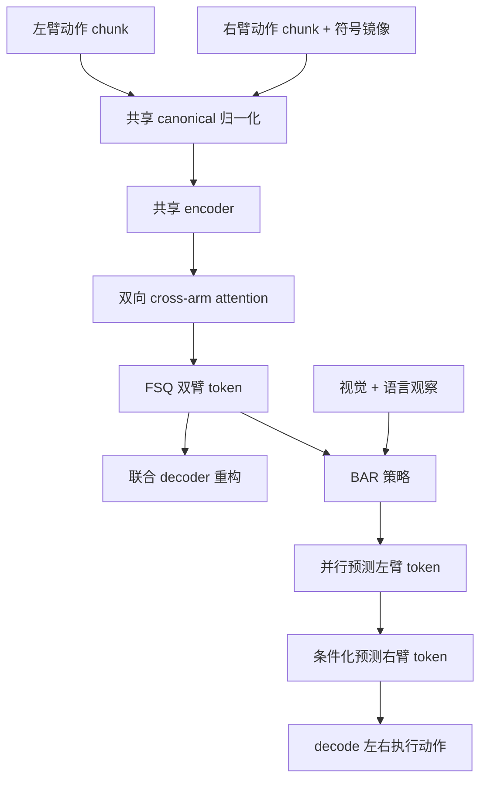
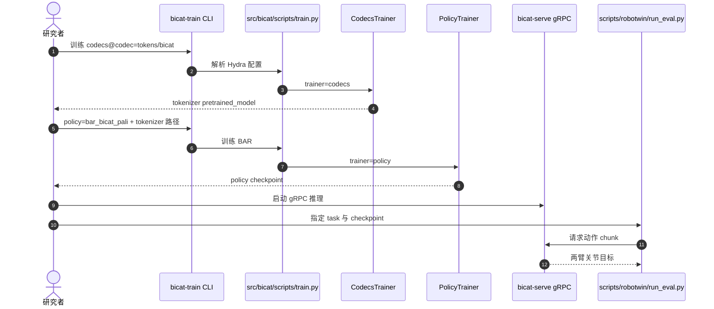

# BiCAT：双臂协调动作分词（BiCAT: Bimanual Coordination Action Tokenization）

## 一句话定义

把双臂动作对齐到共享 canonical 空间，并通过对称跨臂注意力形成伙伴感知 token；策略以左臂、右臂两块顺序预测。

## 英文缩写速查

| 缩写 | 英文全称 | 简要说明 |
|---|---|---|
| VLA | Vision-Language-Action | 视觉语言动作策略 |
| FSQ | Finite Scalar Quantization | 有限标量量化生成动作词表 |
| BAR | Blockwise Autoregressive | 按块自回归动作策略 |
| OAT | One Action Tokenizer | 论文对照的动作分词基线 |

## 为什么重要

双臂动作并非两条互不相干的单臂序列。传统 tokenizer 把两臂维度拼接成单流，左右镜像动作难共享表征，握持–交接等协作依赖也可能被 token 隐藏。

## 核心原理

通过右臂关节符号镜像和共同极值把左右动作映射进共享 canonical 范围；共享编码器与**对称 cross-arm attention** 建立两臂互相关照，再用 FSQ 量化、联合 decoder 重建。BAR 策略推理时先**并行生成全部左臂 token**，再条件化生成全部右臂 token；因此是 2 个 block，不是 2 臂完全独立并发。

### 流程总览

## 源码运行时序图

依据官方 README 的真实入口及其代码目录绘制**运行路径示意**；未在本环境实际训练或部署。

## 实验与评测（作者报告，未独立复现）

| 数据/指标 | BiCAT | 对照 |
|---|---:|---:|
| RoboTwin 2.0 10 项平均成功率 | **69.3%** | NAC 51.7% |
| 6 项真机 150 次成功次数 | **113** | OAT 74；FAST 25 |
| H200 每 action chunk token 生成 | 40.5 ms | 两块预测；非闭环总时延 |

论文指出特定 Handover Mic 任务 BiCAT 88% 低于某 OAT 94%，不应解读成各任务全面占优。

## 与其他工作对比

- FAST 等侧重一般动作压缩/词表，BiCAT 的贡献是**共享左右臂原语 + 显式伙伴条件**。
- 两块生成延迟小于逐 token 自回归，但不同部署 backbone、RPC、控制环时延仍必须另测。

## 工程实践

输入 LeRobot v3。检查 `right_arm_sign`、共享动作区间与关节排列；先运行 `bicat-train --config-name train_codecs` 验证 held-out reconstruction，再训练 BAR；用 `bicat-serve` 提供 gRPC 服务，调用 `scripts/robotwin/run_eval.py`。README 规定策略 checkpoint **不内含冻结 tokenizer**，输出目录默认 overwrite 需谨慎。

## 局限与风险

canonicalization 的镜像符号和量纲依机器人而异，跨不同左右臂硬件并非自动适配。真实平台限制在论文测试三种 embodiment 和六任务；重构好不代表控制成功。HTML 全文附录尚未完全核对。

## 结论

**在双臂高耦合操作上，tokenizer 应显式编码“另一只手在做什么”。**

1. 先把左右关节符号、界限和动作维度对齐，避免伪共享。
2. 重构误差与任务成功率分开监测。
3. 两块解码的算时必须加上感知、解码、通信和真机伺服总延迟。

## 关联页面

- [paper-hint-wam ](./paper-hint-wam.md)
- [google-deepmind-robotics-antigravity-plugin ](./google-deepmind-robotics-antigravity-plugin.md)
- [bimanual-manipulation ](../tasks/bimanual-manipulation.md)
- [manipulation ](../tasks/manipulation.md)
- [action-chunking ](../methods/action-chunking.md)
- [vla ](../methods/vla.md)

## 参考来源

- [论文原文摘录与验证范围](../../sources/papers/bicat_arxiv_2611_23499.md)
- [源码与运行入口](../../sources/repos/bicat.md)
- [官方项目页归档](../../sources/sites/bicat.md)

## 推荐继续阅读

- [论文 HTML](https://arxiv.org/html/2611.23499)
- [官方项目主页](https://magiclab-nus.github.io/BiCAT/)
- [官方源码](https://github.com/MAGICLAB-NUS/BiCAT)
