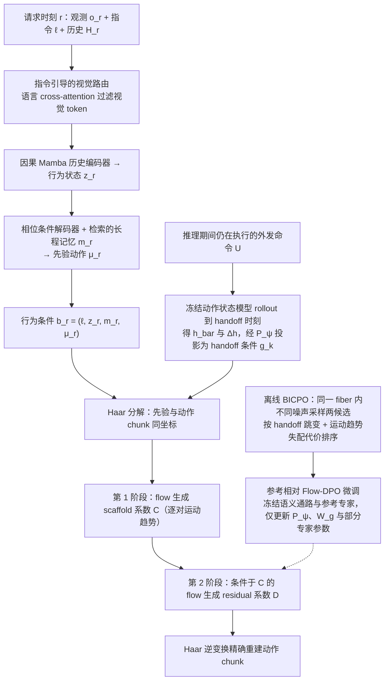

# BICPO-VLA（arXiv:2608.13924）

**BICPO-VLA**（[arXiv:2608.13924](https://arxiv.org/abs/2608.13924)）收录于 [多模空间 · 一周 VLA 研究趋势简析（2026.08.10–08.16）第三篇](../../sources/blogs/wechat_duomo_vla_weekly_trends_2026-08-10_part3.md) **架构/异步** 段。

## 一句话定义

**新指令下 VLA 常因行为意图不清与状态漂移导致切换延迟；先据指令与进度确定应继续的行为，再拆主要走势与细节修正分阶段合成，并按真实切换位姿调整新动作。**

## 英文缩写速查

| 缩写 | 英文全称 | 简要说明 |
|------|----------|----------|
| VLA | Vision-Language-Action | 视觉–语言–动作策略 |
| VLM | Vision-Language Model | 视觉–语言多模态模型 |
| VLN | Vision-Language Navigation | 视觉–语言导航 |
| GRPO | Group Relative Policy Optimization | 组内相对策略优化（FIRE-VLA / Temporal GRPO 语境） |
| RL | Reinforcement Learning | 强化学习后训练 |

## 为什么重要

- 新指令下 VLA 常因行为意图不清与状态漂移导致切换延迟；先据指令与进度确定应继续的行为，再拆主要走势与细节修正分阶段合成，并按真实切换位姿调整新动作。
- 策展机构：北航、北理工、中科院自动化所等
- 与 [第三篇技术地图](../overview/vla-weekly-trends-2026-08-10-part3-technology-map.md) 同批工作可横向对照。

## 流程总览

图依据：论文 §3.1–3.5、Fig. 2。

## 核心机制

| 项 | 内容 |
|----|------|
| **arXiv** | [2608.13924](https://arxiv.org/abs/2608.13924) |
| **文内评测** | CALVIN ABC→D、RoboTwin 2.0（10 困难任务）、LIBERO；实机 6 双臂任务 |
| **开源** | **待核实**（2026-09-26） |

## 源码运行时序图

**不适用**（截至入库日未提供可运行官方代码入口，或仓库尚未公开）。

## 实验与评测

- **文内口径：** CALVIN ABC→D、RoboTwin 2.0（10 困难任务）、LIBERO；实机 6 双臂任务
- **读法：** 本页为 [公众号策展](../../sources/blogs/wechat_duomo_vla_weekly_trends_2026-08-10_part3.md) 摘要；逐项指标以 **原文 PDF** 为准。

## 与其他工作对比

| 对照 | 差异读法 |
|------|----------|
| [Temporal GRPO](./paper-temporal-grpo.md) | 同周「训练范式」线：阶段信用 vs 失败驱动 teacher（若适用） |
| [VLA 方法页](../methods/vla.md) | 本页为单篇索引；机制细节以原文为准 |

## 结论

**BICPO-VLA 适合作为本期「架构/异步」路线的快速索引页。**

1. 核心贡献：新指令下 VLA 常因行为意图不清与状态漂移导致切换延迟；先据指令与进度确定应继续的行为，再拆主要走势与细节修正分阶段合成，并按真实切换位姿调整新动作。
2. 开源结论：**待核实** — 以项目页/仓库实际链接为准。
3. 横向对照见 [第三篇技术地图](../overview/vla-weekly-trends-2026-08-10-part3-technology-map.md)。

## 关联页面

- [VLA（Vision-Language-Action）](../methods/vla.md)
- [一周 VLA 趋势技术地图（第三篇）](../overview/vla-weekly-trends-2026-08-10-part3-technology-map.md)

## 参考来源

- [wechat_duomo_vla_weekly_trends_2026-08-10_part3.md](../../sources/blogs/wechat_duomo_vla_weekly_trends_2026-08-10_part3.md)
- [arXiv:2608.13924](https://arxiv.org/abs/2608.13924)
- [arXiv PDF](https://arxiv.org/pdf/2608.13924)：已通读方法部分（实验与附录以略读为准）：§3.1–3.5（含 Fig. 2）

## 推荐继续阅读

- [VLA 方法页](../methods/vla.md)
- [arXiv PDF](https://arxiv.org/pdf/2608.13924)
