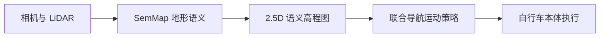
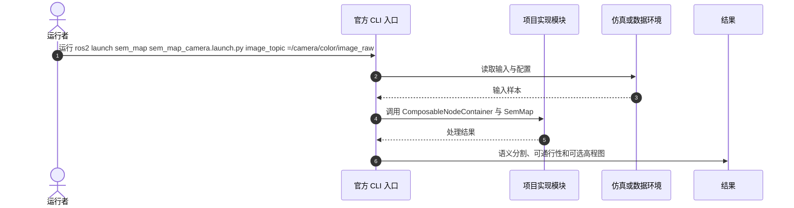

# Autonomous Trail Racing with a Bicycle Robot｜自行车机器人自主林间赛道竞速

## 一句话定义

**自行车机器人自主林间赛道竞速**：将可通行林道语义编码进地形并联合训练局部导航与骑行控制。

## 英文缩写速查

| 缩写 | 英文全称 | 简要说明 |
|---|---|---|
| RL | Reinforcement Learning | 强化学习 |
| LiDAR | Light Detection and Ranging | 激光测距传感器 |
| SemMap | Semantic Traversability Map | 语义可通行高程图 |

## 为什么重要

将可通行林道语义编码进地形并联合训练局部导航与骑行控制。 本项目的机制、指标和开放边界需要分开理解，不能把单个结果推广到所有机器人平台。

## 核心信息

| 项 | 一手来源 |
|---|---|
| 论文 | [arXiv:2611.15280v1](https://arxiv.org/abs/2611.15280) |
| 项目 | [官方项目](https://pages.rai-inst.com/autonomous-trail-racing/) |
| 代码 | [官方仓库](https://github.com/rai-opensource/sem_map)；开放范围见源码归档 |

## 核心原理

训练时在程序化地形叠加 trail 语义与难度课程；部署时 SemMap 把 RGB 可通行性与 LiDAR 高程融合成语义地形图，策略直接以局部地图驱动骑行控制与行进路径选择。

### 流程总览

该图表示论文机制的主要数据或控制方向，不表示已经运行作者模型。

## 源码运行时序图

已核对 [官方代码归档](../../sources/repos/bicycle-trail-racing-2611-15280.md) 的 README 与公开运行入口（仅说明所发布组件，不代表实机复现）：

## 工程实践

1. 核实数据许可、训练/测试切分、时序观测和动作坐标系，建立与原文一致的对照协议。
2. 参照[官方源码归档](../../sources/repos/bicycle-trail-racing-2611-15280.md)核实入口、依赖及模型数据权限。
3. 分别统计训练预算、模拟指标、真机成功率与执行延迟，记录失败模式和软硬件约束。

## 实验与评测

官方项目报告 959 米真实山地林道、平均 3.26 m/s；不同模拟竞速与实地道路指标不能混读。

## 结论

**将可通行林道语义编码进地形并联合训练局部导航与骑行控制。**

1. 对照同数据与同测评协议，不混淆不同平台/样本统计口径。
2. 在复现前单列训练数据、预训练、控制接口和硬件依赖。
3. 验证边界是研究结论的必要组成，不能由示例直接推出可量产部署。

## 局限与风险

高草和植被可能制造虚假障碍，岔路选错与轮胎失去抓地力会影响安全；公开 SemMap 感知仓不是整个骑行控制栈。

## 关联页面

- [2026-11-16 具身研究论文阅读地图](../overview/embodied-frontier-29-papers-2026-11-16.md)
- [ActionCodec2：流式动作编解码](./paper-actioncodec2-streaming-action-tokenizer.md)

## 参考来源

- [论文原文核对归档](../../sources/papers/bicycle-trail-racing-2611-15280.md)
- [项目核查归档](../../sources/sites/bicycle-trail-racing-2611-15280.md)
- [源代码归档](../../sources/repos/bicycle-trail-racing-2611-15280.md)

## 推荐继续阅读

- [arXiv HTML v1](https://arxiv.org/html/2611.15280v1)
- [官方代码](https://github.com/rai-opensource/sem_map)
