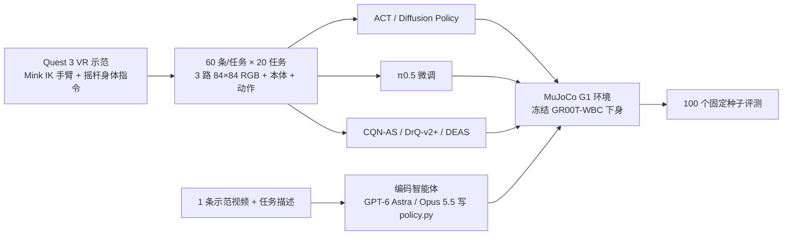
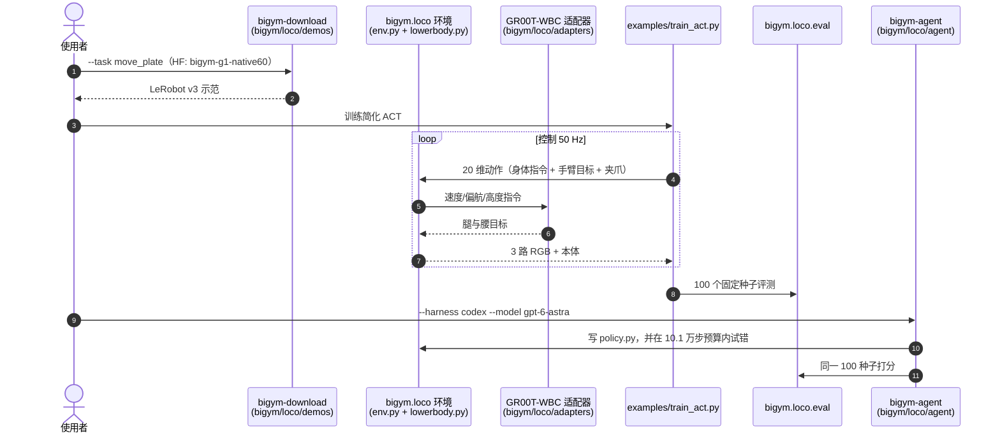

# BiGym 2.0：人形家庭操作基准

**BiGym 2.0**（[arXiv:2610.07594](https://arxiv.org/abs/2610.07594)，Imperial College London 的 Zhang、Zhu、Chen、Tuya、James；[代码](https://github.com/swirl-uk/BiGym2)）把 [原版 BiGym](./paper-notebook-bigym-a-demo-driven-mobile-bi-manual-manipulatio.md)（H1 浮动基座、40 任务）改造成 **Unitree G1 真正行走的家庭操作基准**：20 项任务、每项 60 条 VR 示范，统一评测 VLA 微调、模仿学习、示范强化学习和 **冷启动编码智能体**（LLM 写 `policy.py`）。注意它与 2024 年的 BiGym（arXiv:2407.07788）是不同论文，二者不合并。

## 英文缩写速查

| 缩写 | 英文全称 | 简要说明 |
|------|----------|----------|
| WBC | Whole-Body Controller | 冻结的 GR00T-WBC，把身体指令映射为腿/腰目标 |
| VLA | Vision-Language-Action model | 本文以 π0.5 微调为代表 |
| ACT | Action Chunking Transformer | 模仿学习基线 |
| DP | Diffusion Policy | 模仿学习基线 |
| CQN-AS | Coarse-to-fine Q-Network with Action Sequence | 在线示范驱动 RL 基线 |
| DEAS | Offline demo-driven RL baseline | 离线示范驱动 RL 基线，10.1 万次更新 |

## 为什么重要

- **腿是真的在走**：原版 BiGym 腿只是回放动画；这里冻结的 GR00T-WBC 在每个 50 Hz 环境步里行走并平衡，步态和平衡会影响操作。
- **一把尺子比四类方法**：IL、VLA、示范 RL 与编码智能体共用同一任务集与 100 个固定评测种子。
- **完全开放**：环境、1,200 条 LeRobot v3 示范、5,400 条智能体评测回合（含每步执行的程序行）全部公开。

## 流程总览

## 方法

**环境**：MuJoCo，1 ms 物理步、每个 50 Hz 控制步 20 个子步；29-DoF G1 配两个 Dex1 平行夹爪；GR00T-WBC 接收前向/侧向速度、偏航率、高度（可选躯干俯仰）；重置后 200 步预热。任务几何相对原版调整（餐盘架降低内移，洗碗机置于 0.25 m 底座，取箱边桌与台面高 0.50 m 与 0.71 m）。

**20 个任务**：Reaching 3、Tabletop 5（含 move plate、move two plates、flip cup、flip cutlery、stack blocks）、Dishwasher 4、Kitchen counter 8（抽屉/吊柜开关、pick box、put cups、saucepan to hob、remove sandwich）。九任务主比较集：pick box、reach multi-modal、reach dual、drawer close、drawer open、move plate、move two plates、dishwasher close、dishwasher load cups。

**示范与接口**：每任务 60 条成功示范（共 1,200）；观测为头/左腕/右腕三路 84×84 RGB 叠 4 帧 + 50 维本体（躯干俯仰任务 56 维）；动作 20 维（4 个身体指令 + 14 个手臂关节绝对目标 + 2 个夹爪指令，躯干俯仰时 21 维）。

**被测方法**：π0.5（每任务一次，3 万次更新）；ACT、DP（各 10.1 万次更新）；CQN-AS、DrQ-v2+（在线 10.1 万环境步）；DEAS（离线 10.1 万次更新）；编码智能体 GPT-6 Astra（Codex CLI）与 Claude Opus 5.5（Claude Code），高推理强度，每会话 10.1 万环境步（每次重置计 200），每任务 3 个会话、任务间无记忆、每任务只给 1 条示范视频。

## 源码运行时序图

官方仓库 [swirl-uk/BiGym2](https://github.com/swirl-uk/BiGym2)（归档 [sources/repos/bigym2.md](../../sources/repos/bigym2.md)）已开源，`pyproject.toml` 提供 `bigym-download`、`bigym-view`、`bigym-collect`、`bigym-rerender-lerobot`、`bigym-agent` 等入口：

要点：`examples/train_act.py` 是简化 ACT，README 明说不复现论文 ACT 数字；复现论文基线需另外实现。`bigym-collect` 在 Linux 上用 Quest 3 采集新示范。

## 工程实践

- **开源状态（2026-10-12 核查）**：项目页可访问；GitHub 仓库含环境、评测协议与 CLI（Apache-2.0）；Hugging Face 上示范与智能体回合可访问。GR00T-WBC 权重以 NVIDIA Open Model License 再分发。README 路线图未完成：WebXR 遥操作、PyPI、公开榜单。
- **数据体量**：全部 20 任务示范约 29 GB；仅下载智能体所需文件（`--agent`）约 68 MB。
- **评测实践**：论文预先固定报告最后五个检查点的均值，避免峰值检查点偏高。

## 实验与评测

**九任务均值成功率（%）**

| 方法 | 均值 |
|------|------|
| π0.5 | 75 |
| ACT | 68 |
| GPT-6 Astra（strict） | 65 |
| Claude Opus 5.5（strict） | 61 |
| Diffusion Policy | 56 |
| CQN-AS | 50 |
| DEAS | 41 |
| DrQ-v2+ | 11 |

**部分单任务**：Pick box——Opus 71±16、ACT 61±4、Astra 54±22、CQN-AS 48±2、π0.5 19、DP 10±3。Reach dual——Astra 89±7、Opus 78±10、π0.5 58、DEAS 34、ACT 30。Move two plates——π0.5 68、ACT 39、CQN-AS 21、DP 18、Astra 16、Opus 15。Dishwasher close——Astra 100、ACT 93、π0.5 79、CQN-AS 78。Stack blocks——ACT 与 CQN-AS 均低于 1%，π0.5 未评测。

**工具增强接口（Astra 预发布版）**：九任务均值 53% → 76%，每会话成本 12.1 → 8.7 美元，跨工作区堆叠仅 19% / 0% / 0%（三个会话）。

**观察**：严格智能体会从公开描述回忆 G1 运动学，Opus 5.5 在 27 个程序里有 24 个数值求解 IK。

## 结论

**BiGym 2.0 的价值是首个把「会走的 G1」放进统一家庭操作基准，并把编码智能体当作与学习方法同台的基线；π0.5 均值最高，但智能体在双臂独立 reach 上领先，多物体搬运与跨工作区堆叠仍是开放问题。**

1. **VLA 微调均值最高** — π0.5 75%，但 pick box 仅 19%，不要读成全面领先。
2. **经典 IL 仍强** — ACT 68%，高于 DP 56% 与全部示范 RL。
3. **智能体靠结构先验赢在 dual reach** — Astra 89 / Opus 78 超过所有学习策略，因其分别控制两臂；但每任务只有 1 条示范。
4. **多物体搬运难** — move two plates 上智能体仅 15–16，π0.5 68；stack blocks ACT 与 CQN-AS 低于 1%。
5. **工具与接口影响巨大** — 同一智能体严格接口 53% vs 工具增强 76%，评测协议必须写清。
6. **选用建议** — 做对比时沿用 100 固定种子与最后五检查点均值；注意 `train_act.py` 不复现论文 ACT。

## 与其他工作对比

| 对照 | 差异读法 |
|------|----------|
| [BiGym（2024）](./paper-notebook-bigym-a-demo-driven-mobile-bi-manual-manipulatio.md) | 前作：H1 浮动基座、40 任务；本文 G1 真行走、20 任务、加入编码智能体 |
| [RoboCasa365](./paper-notebook-robocasa365-a-large-scale-simulation-framework-f.md) | 大规模家庭仿真框架；BiGym 2.0 更小而专注人形全身 + 统一控制器 |
| [GR00T-WholeBodyControl](./gr00t-wholebodycontrol.md) | 本文冻结使用其下身控制器，不做低层训练 |
| [VLA](../methods/vla.md)、[Action Chunking](../methods/action-chunking.md)、[Diffusion Policy](../methods/diffusion-policy.md) | 本文基线对应的方法族 |

## 局限与风险

- **适用边界**：仅仿真，仅一个冻结全身控制器；84×84 低分辨率观测（π0.5 需重渲染到 224×224，仓库提供 `bigym-rerender-lerobot`）。
- **统计风险**：π0.5 部分分数来自单次训练，部分结果来自小规模预发布样本；抓取的 HTML 超过 10 万字符，尾部（可能为附录）未读。
- **解释风险**：智能体结果是冷启动参考而非上限，且可能受 G1 公开资料的预训练先验影响。
- **开源状态**：代码、示范、智能体回合均已发布；公开榜单与 PyPI 未发布。

## 关联页面

- [人形/四足周报汇总（2026-10-05 至 10-09）](../overview/frontier-humanoid-quadruped-2026-10-05-10-09.md)
- [Manipulation 周报汇总（2026-10-05 至 10-09）](../overview/frontier-manipulation-2026-10-05-10-09.md)
- [BiGym 原版笔记](./paper-notebook-bigym-a-demo-driven-mobile-bi-manual-manipulatio.md)
- [操作任务](../tasks/manipulation.md)
- [双臂操作](../tasks/bimanual-manipulation.md)
- [移动操作与行走操作](../tasks/loco-manipulation.md)

## 参考来源

- [bigym2_arxiv_2610_07594.md](../../sources/papers/bigym2_arxiv_2610_07594.md) — 论文来源归档
- [bigym2-project.md](../../sources/sites/bigym2-project.md) — 项目页核查
- [bigym2.md](../../sources/repos/bigym2.md) — 仓库归档
- [frontier_humanoid_quadruped_2026_10_05_10_09.md](../../sources/blogs/frontier_humanoid_quadruped_2026_10_05_10_09.md)、[frontier_manipulation_2026_10_05_10_09.md](../../sources/blogs/frontier_manipulation_2026_10_05_10_09.md) — 周报线索
- 论文：<https://arxiv.org/abs/2610.07594>

## 推荐继续阅读

- [项目页与文档](https://bigym2.github.io/)
- [GitHub 仓库](https://github.com/swirl-uk/BiGym2)
- [BiGym 原版（arXiv:2407.07788）](https://arxiv.org/abs/2407.07788)
- [示范数据集（Hugging Face）](https://huggingface.co/datasets/SWIRL-Lab/bigym-g1-native60)
