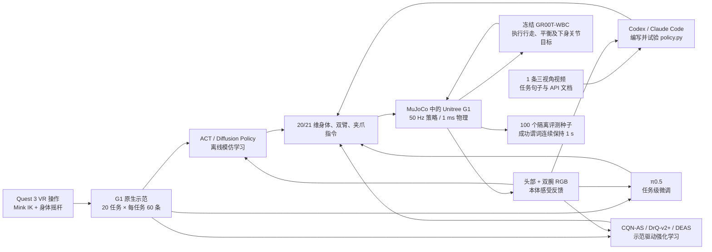
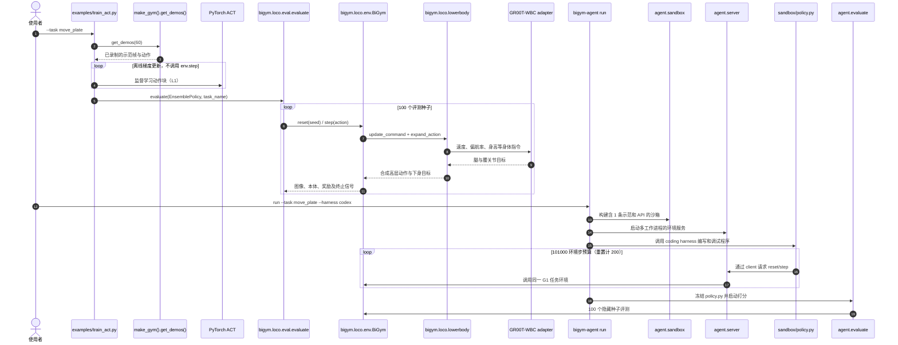

# BiGym 2.0：学习策略与编程智能体的人形家庭操作基准（Benchmarking Learned and Agent-Developed Policies for Humanoid Household Manipulation）

## 一句话定义

**BiGym 2.0**（[arXiv:2610.07594](https://arxiv.org/abs/2610.07594)，Imperial College London 的 Zhang、Zhu、Chen、Tuya、James；[代码](https://github.com/swirl-uk/BiGym2)）把 [原版 BiGym](./paper-notebook-bigym-a-demo-driven-mobile-bi-manual-manipulatio.md)（H1 浮动基座、40 任务）改造成 **Unitree G1 真正行走的家庭操作基准**：20 项任务、每项 60 条 VR 示范，统一评测 VLA 微调、模仿学习、示范强化学习和 **冷启动编码智能体**（LLM 写 `policy.py`）。注意它与 2024 年的 BiGym（arXiv:2407.07788）是不同论文，二者不合并。

**机构：** 帝国理工学院计算机系（Department of Computing, Imperial College London）。论文 [arXiv:2610.07594v2](https://arxiv.org/html/2610.07594v2) 的正文 I–VII 与附录 A–G 已于 2026-11-11 通读复核；见 [论文原文归档](../../sources/papers/bigym2_arxiv_2610_07594.md)。

## 英文缩写速查

| 缩写 | 英文全称 | 简要说明 |
|------|----------|----------|
| WBC | Whole-Body Controller | 冻结的 GR00T-WBC，把身体指令映射为腿/腰目标 |
| VLA | Vision-Language-Action model | 本文以 π0.5 微调为代表 |
| ACT | Action Chunking Transformer | 模仿学习基线 |
| DP | Diffusion Policy | 模仿学习基线 |
| CQN-AS | Coarse-to-fine Q-Network with Action Sequence | 在线示范驱动 RL 基线 |
| DEAS | Offline demo-driven RL baseline | 离线示范驱动 RL 基线，10.1 万次更新 |

## 为什么重要

- **腿是真的在走**：原版 BiGym 腿只是回放动画；这里冻结的 GR00T-WBC 在每个 50 Hz 环境步里行走并平衡，步态和平衡会影响操作。
- **一把尺子比四类方法**：IL、VLA、示范 RL 与编码智能体共用同一任务集与 100 个固定评测种子。
- **完全开放**：环境、1,200 条 LeRobot v3 示范、5,400 条智能体评测回合（含每步执行的程序行）全部公开。

## 流程总览

## 方法

**环境**：MuJoCo，1 ms 物理步、每个 50 Hz 控制步 20 个子步；29-DoF G1 配两个 Dex1 平行夹爪；GR00T-WBC 接收前向/侧向速度、偏航率、高度（可选躯干俯仰）；重置后 200 步预热。任务几何相对原版调整（餐盘架降低内移，洗碗机置于 0.25 m 底座，取箱边桌与台面高 0.50 m 与 0.71 m）。

**20 个任务**：Reaching 3、Tabletop 5（含 move plate、move two plates、flip cup、flip cutlery、stack blocks）、Dishwasher 4、Kitchen counter 8（抽屉/吊柜开关、pick box、put cups、saucepan to hob、remove sandwich）。九任务主比较集：pick box、reach multi-modal、reach dual、drawer close、drawer open、move plate、move two plates、dishwasher close、dishwasher load cups。

**示范与接口**：每任务 60 条成功示范（共 1,200）；观测为头/左腕/右腕三路 84×84 RGB 叠 4 帧 + 50 维本体（躯干俯仰任务 56 维）；动作 20 维（4 个身体指令 + 14 个手臂关节绝对目标 + 2 个夹爪指令，躯干俯仰时 21 维）。

**被测方法**：π0.5（每任务一次，3 万次更新）；ACT、DP（各 10.1 万次更新）；CQN-AS、DrQ-v2+（在线 10.1 万环境步）；DEAS（离线 10.1 万次更新）；编码智能体 GPT-6 Astra（Codex CLI）与 Claude Opus 5.5（Claude Code），高推理强度，每会话 10.1 万环境步（每次重置计 200），每任务 3 个会话、任务间无记忆、每任务只给 1 条示范视频。

## 源码运行时序图

官方仓库 [swirl-uk/BiGym2](https://github.com/swirl-uk/BiGym2)（归档 [sources/repos/bigym2.md](../../sources/repos/bigym2.md)）已开源，`pyproject.toml` 提供 `bigym-download`、`bigym-view`、`bigym-collect`、`bigym-rerender-lerobot`、`bigym-agent` 等入口：

要点：已逐行核对 `examples/train_act.py`：`train()` 仅从 `get_demos(60)` 离线做 L1 训练，训练完成后 `evaluate()` 才调用 `reset/step`；它**不是在线 RL 训练脚本**，也不是论文 ACT 模型（论文含 CVAE、ResNet-18）。`bigym-agent run` 由 `agent/launch.py` 依次构建沙箱、启动服务、调用编程 harness，最后由 `agent/evaluate.py` 评测冻结程序。`bigym-collect` 用 Quest 3 采集新示范。

## 论文附录核验：接口、确定性与失败模式

- **动作细节（Appendix B，Table A2）**：身体指令为 `vx` ±0.35 m/s、`vy` ±0.25 m/s、`base height` 0.40–1.00 m、`yaw rate` ±0.50 rad/s；支持躯干俯仰的 14 项任务另有 `pitch` −0.20–0.80 rad。14 个手臂关节的绝对位置目标，加双夹爪命令，组成 20/21 维动作。例外：`π0.5` 的手臂以 action chunk 起点为基准预测相对增量。
- **成功与初态（Appendix A）**：成功谓词要连续成立 50 个控制步（1 s）；17 项任务按 seed 随机化，`dishwasher_close` 和 `wall_cupboard_open/close` 采用固定初态。这三项不应被解读为广泛初态泛化。
- **可靠性（Appendix C/E）**：录像回放必须恢复 `init_qpos/init_qvel/init_ctrl/init_qacc_warmstart` 和 `lb_state.*` 等 engage 快照，不能只用 seed；评测种子是 `620000–620099`。非 VLA 采用 3 次训练、每次最后 5 个 checkpoint × 100 episodes；`π0.5` 只有 1 次训练、最后 5 点 × 50 episodes。
- **接触物理（Appendix F）**：步态脚端冲击使抓握中的盘子在 Dex1 指垫上逐渐滑移；作者将 torsional friction 由 0.01 提至 0.05，修正 `solref/solimp`，在特定放大扰动试验中将 6 s 滑移从 0.745 mm 降至近零，**未使用 weld**。DrQ-v2+ 在分析的 20 个 reaching 回合均偏离工作区超时，但论文并未将失败因果归结为缺少 action chunking。
- **严格接口与模型先验（Appendix G）**：智能体开发只有一条 3 视角示范视频、`low_dim_obs` 和控制 API；无 IK、相机标定与物体真值。Opus 5.5 在 27 个程序中 24 个自行求数值 IK，其中 22 个使用从旧版公开 G1 URDF 回忆的连杆尺寸，不能视为对未知机器人具有零先验。

## 工程实践

- **开源状态（2026-11-11 复核）**：项目页、GitHub 环境与 CLI（Apache-2.0）、Hugging Face 示范与智能体回合均可访问；GR00T-WBC 权重另受 NVIDIA Open Model License 约束。作者已上线[实时榜单](https://bigym2.github.io/leaderboard/)，其模型和样本集会更新，应与论文 v2 的 Table II 分开引用。
- **数据体量**：全部 20 任务示范约 29 GB；仅下载智能体所需文件（`--agent`）约 68 MB。
- **评测实践**：论文预先固定报告最后五个检查点的均值，避免峰值检查点偏高。

## 实验与评测

**九任务均值成功率（%）**

| 方法 | 均值 |
|------|------|
| π0.5 | 75 |
| ACT | 68 |
| GPT-6 Astra（strict） | 65 |
| Claude Opus 5.5（strict） | 61 |
| Diffusion Policy | 56 |
| CQN-AS | 50 |
| DEAS | 41 |
| DrQ-v2+ | 11 |

**部分单任务**：Pick box——Opus 71±16、ACT 61±4、Astra 54±22、CQN-AS 48±2、π0.5 19、DP 10±3。Reach dual——Astra 89±7、Opus 78±10、π0.5 58、DEAS 34、ACT 30。Move two plates——π0.5 68、ACT 39、CQN-AS 21、DP 18、Astra 16、Opus 15。Dishwasher close——Astra 100、ACT 93、π0.5 79、CQN-AS 78。Stack blocks——ACT 与 CQN-AS 均低于 1%，π0.5 未评测。

**工具增强接口（Astra 预发布版）**：九任务均值 53% → 76%，每会话成本 12.1 → 8.7 美元，跨工作区堆叠仅 19% / 0% / 0%（三个会话）。

**观察**：严格智能体会从公开描述回忆 G1 运动学，Opus 5.5 在 27 个程序里有 24 个数值求解 IK。

**版本说明：** 上表严格使用 arXiv v2（2026-10-08）Table II 的九任务结果；[作者维护的实时榜单](https://bigym2.github.io/leaderboard/)可能显示不同的模型、任务集或追加训练结果，不能直接代替论文原始对照。

## 结论

**BiGym 2.0 的价值是首个把「会走的 G1」放进统一家庭操作基准，并把编码智能体当作与学习方法同台的基线；π0.5 均值最高，但智能体在双臂独立 reach 上领先，多物体搬运与跨工作区堆叠仍是开放问题。**

1. **VLA 微调均值最高** — π0.5 75%，但 pick box 仅 19%，不要读成全面领先。
2. **经典 IL 仍强** — ACT 68%，高于 DP 56% 与全部示范 RL。
3. **智能体靠结构先验赢在 dual reach** — Astra 89 / Opus 78 超过所有学习策略，因其分别控制两臂；但每任务只有 1 条示范。
4. **多物体搬运难** — move two plates 上智能体仅 15–16，π0.5 68；stack blocks ACT 与 CQN-AS 低于 1%。
5. **工具与接口影响巨大** — 同一智能体严格接口 53% vs 工具增强 76%，评测协议必须写清。
6. **选用建议** — 做对比时沿用 100 固定种子与最后五检查点均值；注意 `train_act.py` 不复现论文 ACT。

## 与其他工作对比

| 对照 | 差异读法 |
|------|----------|
| [BiGym（2024）](./paper-notebook-bigym-a-demo-driven-mobile-bi-manual-manipulatio.md) | 前作：H1 浮动基座、40 任务；本文 G1 真行走、20 任务、加入编码智能体 |
| [RoboCasa365](./paper-notebook-robocasa365-a-large-scale-simulation-framework-f.md) | 大规模家庭仿真框架；BiGym 2.0 更小而专注人形全身 + 统一控制器 |
| [GR00T-WholeBodyControl](./gr00t-wholebodycontrol.md) | 本文冻结使用其下身控制器，不做低层训练 |
| [VLA](../methods/vla.md)、[Action Chunking](../methods/action-chunking.md)、[Diffusion Policy](../methods/diffusion-policy.md) | 本文基线对应的方法族 |

## 局限与风险

- **适用边界**：仅仿真，仅一个冻结全身控制器；84×84 低分辨率观测（π0.5 需重渲染到 224×224，仓库提供 `bigym-rerender-lerobot`）。
- **统计风险**：π0.5 每任务只有单次训练，无跨随机种子的 SE；工具增强与严格接口对照来自单独的预发布构建，不能和主表中的严格接口成绩混成同一组实验。论文 v2 正文和附录 A–G 已补读。
- **解释风险**：智能体结果是冷启动参考而非上限，且可能受 G1 公开资料的预训练先验影响。
- **开源状态**：代码、示范与智能体评测回合已发布；作者已推出实时榜单。PyPI 发布是否完成不以旧 README 路线图作当前事实。

## 关联页面

- [人形/四足周报汇总（2026-10-05 至 10-09）](../overview/frontier-humanoid-quadruped-2026-10-05-10-09.md)
- [Manipulation 周报汇总（2026-10-05 至 10-09）](../overview/frontier-manipulation-2026-10-05-10-09.md)
- [BiGym 原版笔记](./paper-notebook-bigym-a-demo-driven-mobile-bi-manual-manipulatio.md)
- [操作任务](../tasks/manipulation.md)
- [双臂操作](../tasks/bimanual-manipulation.md)
- [移动操作与行走操作](../tasks/loco-manipulation.md)
- [具身大模型评测基准选型闭环](../queries/embodied-eval-benchmark-selection-loop.md) — 本页属③策略任务成功率层：人形全身家庭操作仿真基准，同协议横比模仿学习、VLA 与编码智能体

## 参考来源

- [bigym2_arxiv_2610_07594.md](../../sources/papers/bigym2_arxiv_2610_07594.md) — 论文来源归档
- [bigym2-project.md](../../sources/sites/bigym2-project.md) — 项目页核查
- [bigym2.md](../../sources/repos/bigym2.md) — 仓库归档
- [frontier_humanoid_quadruped_2026_10_05_10_09.md](../../sources/blogs/frontier_humanoid_quadruped_2026_10_05_10_09.md)、[frontier_manipulation_2026_10_05_10_09.md](../../sources/blogs/frontier_manipulation_2026_10_05_10_09.md) — 周报线索
- 论文 v2 全文：<https://arxiv.org/html/2610.07594v2>（含正文与附录 A–G）
- 作者论文结果页：<https://bigym2.github.io/paper/>；实时榜单：<https://bigym2.github.io/leaderboard/>（滚动更新，与论文数表分别标注）

## 推荐继续阅读

- [项目页与文档](https://bigym2.github.io/)
- [GitHub 仓库](https://github.com/swirl-uk/BiGym2)
- [BiGym 原版（arXiv:2407.07788）](https://arxiv.org/abs/2407.07788)
- [示范数据集（Hugging Face）](https://huggingface.co/datasets/SWIRL-Lab/bigym-g1-native60)
