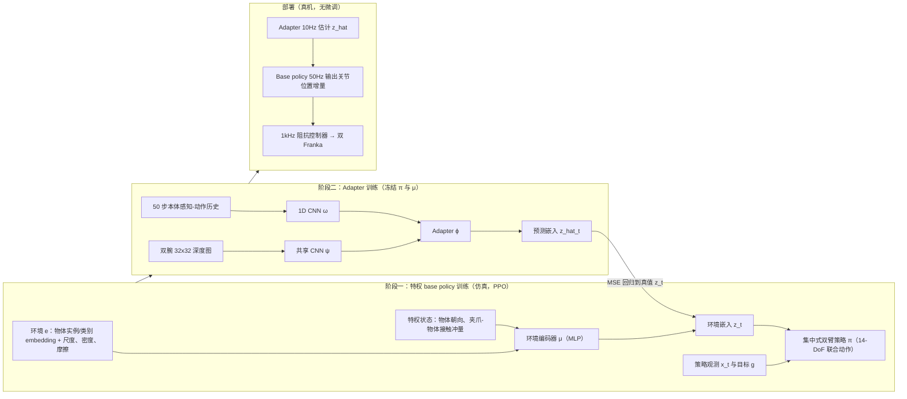

# 将潜在运动适应扩展到协调双臂操作

**这篇工作检验 RMA 式的历史推断能否从单臂扩展到双臂：双臂策略需要从交互历史中推断物体质量、摩擦与形状等未观测属性。**

## 英文缩写速查

| 缩写 | 英文全称 | 简要说明 |
|------|----------|----------|
| RMA | Rapid Motor Adaptation | 通过交互历史推断环境潜在变量并据此调整动作的方法 |
| YCB | Yale-CMU-Berkeley Object Set | 常用的物体数据集，本文用于随机化物体属性 |
| DoF | Degree of Freedom | 自由度 |

## 为什么重要

摘要指出，双臂协作带来更高维控制、耦合接触和共享物体受力，RMA 能否在这种设定下成立需要验证。

## 流程总览

图依据：论文 §III（Fig. 2）、§III-A/B/C、§IV、§V（部署设定）。

## 核心信息

| 项目 | 内容 |
|------|------|
| arXiv | [2610.14833](https://arxiv.org/abs/2610.14833) |
| 作者 | Seung-Bin Joo, Alessandro Albini, Luca Wiehe, Perla Maiolino, Daniel Olmeda Reino, João F. Henriques（arXiv 作者列表） |
| 机构 | 未核实（公众号标注"待核实"） |
| 会议 | 据公众号转述：IROS 2026 Bimanual Manipulation Workshop 接收 |
| 开源状态 | **未核查代码**（摘要页未列代码链接） |

## 核心原理

- **设定：** 三个 ManiSkill 接触丰富任务，物体质量、摩擦、尺度与形状随机化（YCB 物体）。
- **输入：** 观测–动作历史与双腕深度图。
- **结论（摘要）：** 双臂 RMA 在双臂抓取与抬起上保持特权策略性能；摘要还与一个缺少历史推断的对照做了比较（摘要截断，具体结果以原文为准）。

## 工程实践

- 仿真实验基于 ManiSkill；源码运行时序图：**不适用**（未核查到官方代码）。

## 评测与结果

ManiSkill 仿真三任务（YCB 物体质量、摩擦、尺度、形状随机化），成功率为四个随机种子的 mean±std（论文 Table I）：

| 方法 | Bimanual Pick YCB | Bimanual Lift YCB | Bimanual Stack YCB |
|------|-------------------|-------------------|--------------------|
| 特权策略（oracle，直接读取真实物体参数） | 66.17 ± 0.74 | 87.60 ± 5.40 | 5.93 ± 3.97 |
| PPO + 域随机化（无潜变量条件） | 1.16 ± 0.98 | 0.00 ± 0.00 | 2.73 ± 3.04 |
| Bimanual RMA（本文） | 65.74 ± 0.88 | 85.13 ± 4.58 | 3.81 ± 4.42 |

- **抓取与抬起：** 适配器从观测–动作历史与双腕深度推断的潜变量，基本保住了特权策略的性能。
- **长程堆叠：** 三种方法都很低，摘要据此认为更长程的任务还需要额外的时间结构。
- **真机：** 双 Franka 抬起任务直接 sim-to-real 迁移，未做真实世界微调（摘要；真机成功率以原文为准）。

## 与其他工作对比

| 路线 | 环境参数从哪来 | 与本文的差异 |
|------|----------------|--------------|
| [RMA](./paper-rma-rapid-motor-adaptation.md)（单体运动控制） | 适配器从本体历史推断潜变量 | 本文沿用两阶段（特权编码器 → 适配器）流程，把它扩展到双臂耦合接触，并加入双腕深度作为适配器输入 |
| 特权策略（论文 oracle） | 仿真中直接读取真实物体参数 | 性能上界，无法部署；本文用推断的潜变量逼近它 |
| PPO + 域随机化（论文基线） | 不推断，只靠随机化训练出"平均"策略 | 同样的随机化范围下几乎失效，说明双臂设定中潜变量条件不可省略 |
| [特权训练](../concepts/privileged-training.md) 的教师–学生蒸馏 | 学生模仿教师动作 | 思想同源；RMA 的适配器回归的是环境嵌入而不是动作 |

前三行来自论文同一 ManiSkill 设定；与教师–学生蒸馏的对比是方法层面的定性区分。

## 结论

**一句话总判：潜在运动适应可以从单臂扩展到双臂协调操作，但依赖交互历史与深度观测的组合。**

1. **历史推断仍是核心** — 双臂设定中，历史信息用于估计未观测的物体属性。
2. **腕部深度有实际作用** — 摘要把双腕深度图列为输入之一。
3. **仿真结论需真机验证** — 实验主要在 ManiSkill 中完成。

## 局限与风险

- 数字来自论文 Table I 的仿真结果；真机仅一个双 Franka 抬起任务，样本量有限。
- 随机化范围之外的物体与接触模型，泛化性未知。

## 关联页面

- [强化学习](../methods/reinforcement-learning.md)
- [Sim2Real](../concepts/sim2real.md)
- [接触丰富操作](../concepts/contact-rich-manipulation.md)

## 参考来源

- [论文归档](../../sources/papers/bimanual-rma_arxiv_2610_14833.md)
- [公众号综述摘录（33 篇 Manipulation）](../../sources/raw/wechat_senlanke_manipulation_33_papers_2026-10-12_16.md)
- 论文 PDF：<https://arxiv.org/pdf/2610.14833>（已通读方法部分（实验与附录以略读为准）：方法 §III、实验设定 §IV、结果 §V 及真机部署）

## 推荐继续阅读

- [arXiv:2610.14833](https://arxiv.org/abs/2610.14833)
