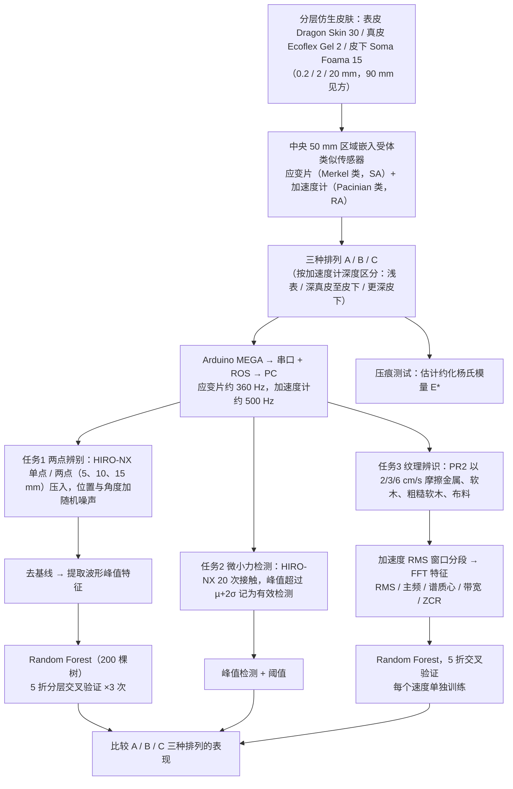

# Biomimetic Skin Sensory Arrangements（arXiv:2610.26680）

**Biomimetic Skin Sensory Arrangements**（*Robotic Physical Comparison of Biologically Motivated and Counterfactual Sensory Arrangements using Biomimetic Skin*，[arXiv:2610.26680](https://arxiv.org/abs/2610.26680)，[项目页](https://poyotamu000.github.io/biomimetic-skin-sensory-arrangements/)）来自 [具身智能小站 2026-10-31 盘点](../../sources/blogs/wechat_embodied_station_50_papers_scenerig_photo_to_sim_2026-10-31.md)，属「触觉与精细操作」组。

## 一句话定义

**在柔性材料内布置不同传感器，比较仿生与反事实排列的弱接触、两点辨别和纹理感知；结果为布局设计提供依据，范围限于所测试的被动触觉任务。**

## 英文缩写速查

| 缩写 | 英文全称 | 简要说明 |
|------|----------|----------|
| Biomimetic Skin Sensory Arrangements | Robotic Physical Comparison of Biologically Motivated and Counterfactual Sensory Arrangements using Biomimetic Skin | 本文方法 / 基准的简称 |

## 为什么重要

- 用机器皮肤检验触觉传感器布局。
- 开源结论：**项目页未列 GitHub**（步骤 2.5，2026-10-31）。项目页 HTTP 200，未见 GitHub 链接或 coming soon 字样。
- 同期同组工作见 [单图重建仿真、VLA 适配评测与跨形态世界模型：具身智能小站 10-31 期 50 篇阅读坐标](../overview/embodied-station-2026-10-31-50-papers-technology-map.md)。

## 流程总览

图依据：论文 §2 Material and Methods（§2.1–2.5、Fig.1–3）。

## 核心机制

| 项 | 内容 |
|----|------|
| **arXiv** | [2610.26680](https://arxiv.org/abs/2610.26680) |
| **开源** | **项目页未列 GitHub** |
| **要点** | 在柔性材料内布置不同传感器，比较仿生与反事实排列的弱接触、两点辨别和纹理感知；结果为布局设计提供依据，范围限于所测试的被动触觉任务。 |
| **文内指标** | 公众号未给具体数字，本页不引用。 |

## 源码运行时序图

**不适用（项目页未列 GitHub）** — 项目页 HTTP 200，未见 GitHub 链接或 coming soon 字样。 不编造运行脚本；代码公开后再补。

## 实验与评测

- 公众号未给具体数字，本页不引用。
- **读法：** 本页为索引级摘要，依据公众号转述的官方摘要与仓库信息整理；逐项数字与 baseline 以原文 PDF 为准。

## 与其他工作对比

- 横向索引见 [单图重建仿真、VLA 适配评测与跨形态世界模型：具身智能小站 10-31 期 50 篇阅读坐标](../overview/embodied-station-2026-10-31-50-papers-technology-map.md)；同 arXiv 不重复造页。

## 结论

**用机器皮肤检验触觉传感器布局：在柔性材料内布置不同传感器，比较仿生与反事实排列的弱接触、两点辨别和纹理感知；结果为布局设计提供依据，范围限于所测试的被动触觉任务。**

1. 开源边界：**项目页未列 GitHub** — 项目页 HTTP 200，未见 GitHub 链接或 coming soon 字样。
2. 核心机制：在柔性材料内布置不同传感器，比较仿生与反事实排列的弱接触、两点辨别和纹理感知；结果为布局设计提供依据，范围限于所测试的被动触觉任务。
3. 复现与选型前核对任务协议、硬件与基准口径，勿直接横比公众号摘录数字。

## 关联页面

- [tactile-sensing](../concepts/tactile-sensing.md)
- [contact-rich-manipulation](../concepts/contact-rich-manipulation.md)
- [manipulation](../tasks/manipulation.md)
- [embodied-station-2026-10-31-50-papers-technology-map](../overview/embodied-station-2026-10-31-50-papers-technology-map.md)

## 参考来源

- [biomimetic_skin_sensory_arrangements_arxiv_2610_26680.md](../../sources/papers/biomimetic_skin_sensory_arrangements_arxiv_2610_26680.md)
- [wechat_embodied_station_50_papers_scenerig_photo_to_sim_2026-10-31.md](../../sources/blogs/wechat_embodied_station_50_papers_scenerig_photo_to_sim_2026-10-31.md)
- [arXiv:2610.26680](https://arxiv.org/abs/2610.26680)
- [arXiv PDF](https://arxiv.org/pdf/2610.26680)：已通读方法部分（实验与附录以略读为准）：§1 引言（节选）、§2 Material and Methods（2.1 皮肤设计与实现、2.2 压痕测试、2.3 两点辨别、2.4 微小力检测、2.5 摩擦纹理辨识）；§3 结果以略读为准

## 推荐继续阅读

- [arXiv PDF](https://arxiv.org/pdf/2610.26680)
- [项目页](https://poyotamu000.github.io/biomimetic-skin-sensory-arrangements/)
