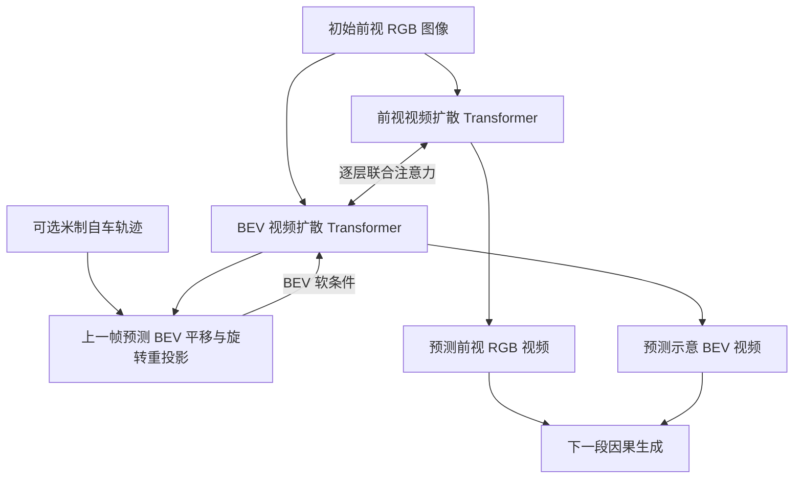

# BirdDreams：联合前视与 BEV 视频生成的可响应驾驶世界模型

## 一句话定义

BirdDreams 是 NVIDIA 与 KAIST 提出的自回归驾驶世界模型：从单张前视图联合生成前视 RGB 和示意 BEV 视频，允许使用米制自车轨迹进行条件控制，并预测周围车辆的运动。

## 英文缩写速查

| 缩写 | 英文全称 | 简要说明 |
|---|---|---|
| BEV | Bird's-Eye View | 固定米制尺度的俯视场景表示 |
| RGB | Red Green Blue | 前视彩色视频 |
| DiT | Diffusion Transformer | 扩散视频生成主干 |
| ADE | Average Displacement Error | 轨迹平均位移误差 |

## 为什么重要

以往部分驾驶视频世界模型将道路与其他车辆未来布局作为输入；这会使周围车辆按既定轨迹回放。BirdDreams 把 BEV 布局变成预测目标，使模型在不同自车动作下能够生成不同的交通演化。注意：生成合理行为不等于保证真实交通行为。

## 流程总览

图示依据：arXiv:2611.14815v1 §3.1–3.2 / Figure 2。轨迹条件是可选的；没有轨迹输入时，自车运动也由模型预测。

## 核心机制

- 两路因果视频 DiT 分别处理 RGB 和 BEV；逐层 joint attention 使交通几何和视觉线索互补。
- 采用 Diffusion Forcing，并为两路流独立采样噪声水平。
- 训练 BEV 由地图与三维物体标注渲染，强调车道关系、车辆位置与朝向；推理只需初始 RGB 图像，不需要高精地图或周围车辆状态。
- 轨迹控制将最近预测 BEV 沿给定自车位置与朝向重投影，再作为软条件指导下一段生成。

## 评测与指标

官方项目页在 PhysicalAI-AV 报告：

| 设置 | 对照基线 | BirdDreams | 指标 |
|---|---:|---:|---|
| 给定自车轨迹 | 5.88 m | 3.83 m | ADE，越低越好 |
| 无动作输入 | 7.76 m | 6.15 m | minADE，三次采样取最优，越低越好 |

人类评价：25 名参与者、375 次成对比较；57% 偏好 BirdDreams、24% 偏好基线、19% 认为相近。该对照使用相同初始图像、轨迹及道路地图的 HD-map-conditioned 变体，不能混同于完全无地图推理设置。

## 结论

BirdDreams 的核心贡献是把交通布局从外部给定条件转为与 RGB 视频共同预测的 BEV 动态状态。

- 将道路相对运动与外观生成分开监督，缓解遮挡与像素运动尺度歧义。
- BEV 重投影提供米制轨迹控制接口，而非仅用相机射线条件。
- 周围车辆行为由模型生成，适合研究反事实交通场景。
- 指标来自指定数据集和对照实验，不能直接推断闭环驾驶安全性。
- 完整实验及附录仍待核对，故本节点保留 draft。

## 源码运行时序图

不适用：截至 2026-11-16，官方项目页未提供可核验的 BirdDreams 可运行源码入口，不能编造运行时序。

## 局限与风险

训练阶段依赖数据集地图和 3D 物体标注制作 BEV 监督，不能把「推理不需要 HD map」误写成「训练不需要地图」。官方展示的车辆反应属于生成结果，尚不能代替真实道路交互验证。代码、权重及全量实验细节需后续核实。

## 关联页面

- [生成式世界模型](../methods/generative-world-models.md)
- [OmniDreams](./paper-sa-2606-03159-nvidia-omnidreams-real-time-generative-world-mod.md)

## 参考来源

- [论文原始资料归档](../../sources/papers/birddreams-2611-14815.md)
- [官方项目页归档](../../sources/sites/birddreams.md)
- [arXiv v1 全文](https://arxiv.org/html/2611.14815v1)
- [NVIDIA 官方项目页](https://research.nvidia.com/labs/sil/projects/birddreams/)

## 推荐继续阅读

- [OmniDreams 基线论文](https://arxiv.org/abs/2606.03159)
