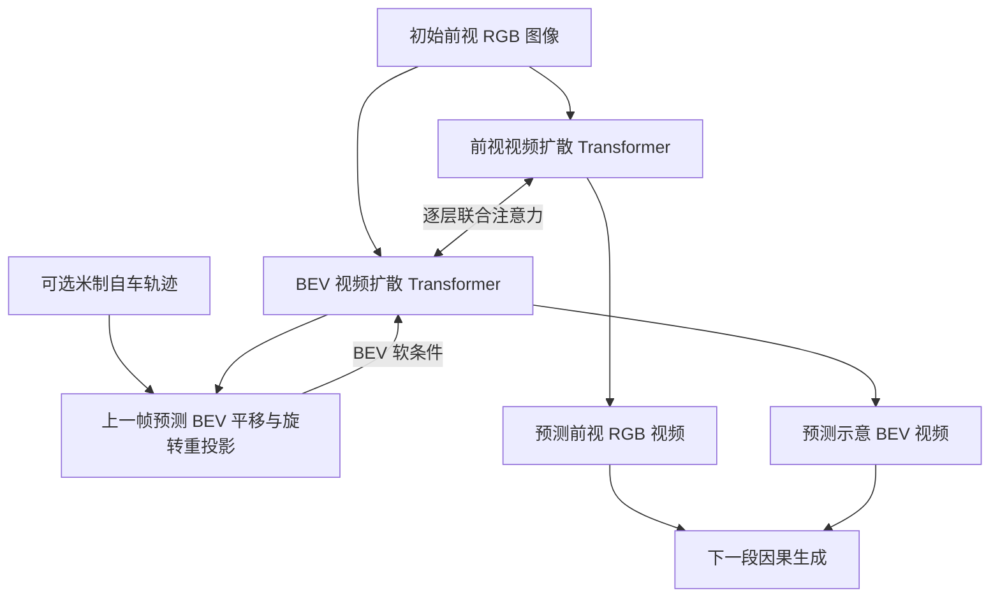

# BirdDreams：联合前视与 BEV 视频生成的可响应驾驶世界模型

## 一句话定义

BirdDreams 是 NVIDIA 与 KAIST 提出的自回归驾驶世界模型：从单张前视图联合生成前视 RGB 和示意 BEV 视频，允许使用米制自车轨迹进行条件控制，并预测周围车辆的运动。

## 英文缩写速查

| 缩写 | 英文全称 | 简要说明 |
|---|---|---|
| BEV | Bird's-Eye View | 固定米制尺度的俯视场景表示 |
| RGB | Red Green Blue | 前视彩色视频 |
| DiT | Diffusion Transformer | 扩散视频生成主干 |
| ADE | Average Displacement Error | 轨迹平均位移误差 |

## 为什么重要

以往部分驾驶视频世界模型将道路与其他车辆未来布局作为输入；这会使周围车辆按既定轨迹回放。BirdDreams 把 BEV 布局变成预测目标，使模型在不同自车动作下能够生成不同的交通演化。注意：生成合理行为不等于保证真实交通行为。

## 流程总览

图示依据：arXiv:2611.14815v1 §3.1–3.2 / Figure 2。轨迹条件是可选的；没有轨迹输入时，自车运动也由模型预测。

## 核心机制

- 两路因果视频 DiT 分别处理 RGB 和 BEV；逐层 joint attention 使交通几何和视觉线索互补。
- 采用 Diffusion Forcing，并为两路流独立采样噪声水平。
- 视频 VAE 使用冻结的 Cosmos-Predict2.5 权重；chunk 内双向、chunk 间因果注意力；采用 Resampling Forcing 后训练以缓解自身历史误差累积。原文式（2）（3）对两路 latent 预测 flow velocity 并归一化后等权。
- 训练 BEV 由地图与三维物体标注渲染，强调车道关系、车辆位置与朝向；推理只需初始 RGB 图像，不需要高精地图或周围车辆状态。
- 轨迹控制将最近预测 BEV 沿给定自车位置与朝向重投影，再作为软条件指导下一段生成。
- 重投影条件用 VAE 编码后加入噪声（σ_cond=0.1），通过零初始化投影注入 BEV 分支；训练时随机丢弃动作条件，支持无动作自回归生成。

## 论文级实验与消融核对（§4.1–4.4）

- **训练**：OmniDreams 变体初始化、双路约 4B 参数；64×H100、总 batch 64。RDS-HQ-1M 子集约 670 小时；BEV 由地图与标注 3D box 生成。nuScenes train split 700 段约 3.9 小时用于额外后训练。
- **评测集**：PhysicalAI-AV 200 clips，nuScenes validation 150 scenes。有动作条件用单样本 ADE/DTW；无动作条件用三次采样的 minADE/minDTW；轨迹从生成视频借助 Depth Anything 3 重建。
- **双路噪声策略**：相较同一 chunk RGB/BEV 共用噪声，独立噪声采样得到更低的 FVD、FTD（论文 §4.4.1），但不能从论文图形估读未标出的具体数值。
- **WAM 扩展**：冻结 BEV 分支、给 RGB 主干加轨迹 head 并后训练 22,000 steps；100 条留出片段、3 秒预测的 best-of-six minADE，BirdDreams 为 0.295 m，对照 0.318 m。带额外 GT BEV 的 0.274 m 只属于特权输入诊断。
- **编辑实例**：从编辑过的初始 BEV 生成首帧 RGB 和后续双路视频；属于可视化展示，不代表已量化验证编辑精度。

## 评测与指标

官方项目页在 PhysicalAI-AV 报告：

| 设置 | 对照基线 | BirdDreams | 指标 |
|---|---:|---:|---|
| 给定自车轨迹 | 5.88 m | 3.83 m | ADE，越低越好 |
| 无动作输入 | 7.76 m | 6.15 m | minADE，三次采样取最优，越低越好 |

人类评价：25 名参与者、375 次成对比较；57% 偏好 BirdDreams、24% 偏好基线、19% 认为相近。该对照使用相同初始图像、轨迹及道路地图的 HD-map-conditioned 变体，不能混同于完全无地图推理设置。

nuScenes 上，表 1 的无动作条件 minADE 为 **6.20 m → 3.91 m**（OmniDreams Vanilla → BirdDreams）；表 2 的有动作条件 ADE 为 **5.38 m → 3.42 m**（OmniDreams Plücker → BirdDreams）。两数据集 FVD/FID 均有降低，但逐帧 Image Quality 不是所有设置都最优；不能把多指标描述成无条件全面领先。

## 与其他工作对比

- **与评测基线**：官方项目页在给定自车轨迹设置下报告 ADE 从 5.88 m 降至 3.83 m；无动作输入时 minADE 从 7.76 m 降至 6.15 m。两项采用不同评测设置和指标，不宜直接横向比较。
- **与 [OmniDreams](./paper-sa-2606-03159-nvidia-omnidreams-real-time-generative-world-mod.md)**：现有 OmniDreams 归档描述由仿真运行时提供地图与动态体状态、向驾驶策略返回生成画面的闭环路径；BirdDreams 则把示意 BEV 作为共同预测的生成状态，并用 BEV 重投影响应可选自车轨迹。两者输入条件及评价目标不同，不能据此判定统一性能优劣。

## 结论

BirdDreams 的核心贡献是把交通布局从外部给定条件转为与 RGB 视频共同预测的 BEV 动态状态。

- 将道路相对运动与外观生成分开监督，缓解遮挡与像素运动尺度歧义。
- BEV 重投影提供米制轨迹控制接口，而非仅用相机射线条件。
- 周围车辆行为由模型生成，适合研究反事实交通场景。
- 指标来自指定数据集和对照实验，不能直接推断闭环驾驶安全性。
- 已对照 arXiv v1 HTML 的 §1–§5、全部实验表及图注复核；v1 HTML 未列独立附录。页面 complete 仅表示文献笔记与来源核对完毕，不表示训练复现或源码开源。

## 工程实践与复现边界

- **数据准备**：论文所述训练 BEV 依赖地图与 3D 物体标注渲染；仅凭单张 RGB 的推理条件不等同于无需标注的训练流程。
- **运行接口**：论文方法描述了初始前视图、可选自车轨迹及 RGB/BEV 联合生成；本 PR 尚未验证模型权重、可运行代码和真实闭环部署，不提供未经核验的复现命令或性能保证。

## 源码运行时序图

不适用：截至 2026-11-16，官方项目页未提供可核验的 BirdDreams 可运行源码入口，不能编造运行时序。

## 局限与风险

训练阶段依赖数据集地图和 3D 物体标注制作 BEV 监督，不能把「推理不需要 HD map」误写成「训练不需要地图」。动作误差的轨迹依据 Depth Anything 3 从生成视频重建，受轨迹重建方法影响；人类偏好实验使用带 HD-map 的对照变体，不能直接泛化到完全无地图推理。演示中的车辆反应仍是生成结果，不能代替真实道路交互/安全验证。未公开可核验的 BirdDreams 专属训练和推理代码/权重，因此不能声称已复现。

## 关联页面

- [Trajectory Optimization（轨迹优化）](../methods/trajectory-optimization.md) — 米制自车轨迹是生成条件；轨迹由谁规划、是否可行需与 RGB/BEV 视频预测分层检查。

- [生成式世界模型](../methods/generative-world-models.md)
- [OmniDreams](./paper-sa-2606-03159-nvidia-omnidreams-real-time-generative-world-mod.md)

## 参考来源

- [论文原始资料归档](../../sources/papers/birddreams-2611-14815.md)
- [官方项目页归档](../../sources/sites/birddreams.md)
- [arXiv v1 全文](https://arxiv.org/html/2611.14815v1)
- [NVIDIA 官方项目页](https://research.nvidia.com/labs/sil/projects/birddreams/)

## 推荐继续阅读

- [OmniDreams 基线论文](https://arxiv.org/abs/2606.03159)
