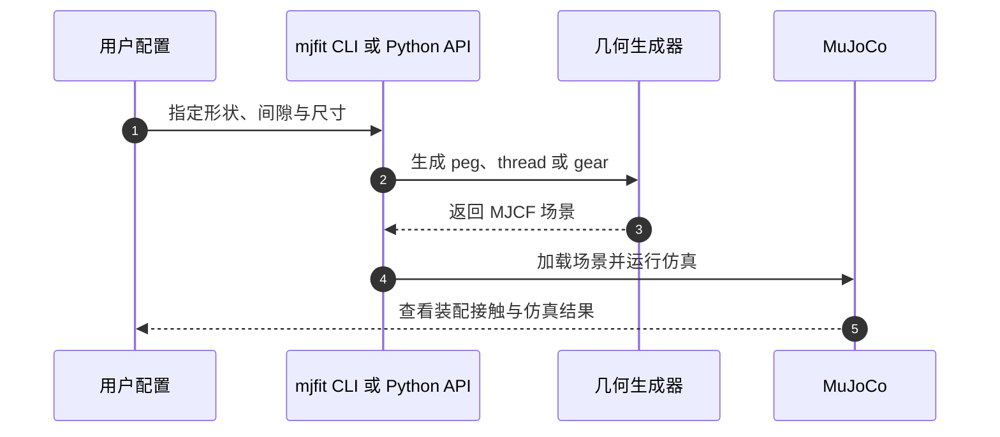

# Blind Precise Assembly：本体感知盲装配

**一句话定义：** 该工作在零件和夹具位姿未知时，仅用机器人自身关节状态及动作历史感知接触，学习精密插销、齿轮和螺纹装配策略。

## 英文缩写速查

| 缩写 | 英文全称 | 简要说明 |
|------|----------|----------|
| Sim-to-Real | Simulation to Reality | 策略全程仿真训练后直接迁移到实机 |
| RL | Reinforcement Learning | 用装配成功与接触过程训练策略 |
| DoF | Degrees of Freedom | 关节位置、速度构成的本体观测维度 |
| SDF | Signed Distance Field | 论文比较的 MuJoCo 网格碰撞表示，极小间隙下可能漏接触 |
| MJCF | MuJoCo XML Format | `mjfit` 生成并可载入 MuJoCo 的机器人场景格式 |

## 为什么重要

视觉被遮挡、力传感器难集成或接触力很轻时，机器人关节编码器仍能通过状态变化提供接触线索。该工作把这种本体信号从粗大而有力的足地接触扩展到毫米级装配，并直接比较了泛化能力与完成速度之间的取舍。

## 核心原理

策略观测只包含短时的关节位置、速度和过去动作。零件、孔位和抓取位姿不提供给策略；接触引起的关节运动变化帮助策略判断碰撞、对齐和插入进展。训练在仿真中覆盖随机零件形状、抓取和接触，任务包括插销入孔、齿轮啮合和螺母旋入。

论文同时强调仿真几何必须保留真实装配间隙。`mjfit` 将复杂零件拆成精确拼合的凸棱柱，使 MuJoCo 原生凸碰撞能够表达孔隙、螺纹和齿轮啮合，避免近似凸分解把孔隙填掉，也避免网格 SDF 在微小接触上慢或漏检。

## 源码运行时序图

该序列只覆盖已公开的 `mjfit` 几何工具。官方仓库 README 提供命令行生成模型、Python API 和随机装配采样示例；本次未发现盲策略本身的训练/推理/部署入口。

## 工程实践

| 环节 | 实践要点 | 边界 |
|------|----------|------|
| 观测设计 | 仅使用一段关节位置、速度与动作历史 | 不意味着能从本体状态恢复通用六维物体位姿 |
| 任务随机化 | 同时变化零件形状、尺寸、抓取和接触条件 | 对未见外形的泛化不等于对所有材料与摩擦都鲁棒 |
| 仿真碰撞 | `mjfit` 精确构造带装配间隙的凸几何 | 仓库是几何与场景工具，不是完整策略代码 |
| 实机验证 | 插销任务进行零样本迁移 | 报告的 73% 是论文所测零件和试验条件下的成功率 |

## 实验与评测

- 论文报告在真实机器人上插入不同形状和尺寸的插销，成功率为 73%。
- 仿真中的匹配对照显示，本体感知策略对未见零件外形和尺寸泛化更好，但可能耗时更长。
- `mjfit` 的公开基准比较精确凸几何与 CoACD、V-HACD、网格 SDF 在小间隙下的几何准确度和仿真步进速度。

## 结论

**一句话总判：** 本体感知可支撑精密接触任务，但零样本迁移的基础是既覆盖形态变化、又不抹掉微小间隙的仿真训练环境。

1. “盲”指策略不读取视觉、力、力矩或触觉输入；不能据此假定系统完全没有外部感知用于示范采集或任务配置。
2. 插销策略的 73% 实机成功率证明可行性，不代表所有装配品类都完成了实机迁移；齿轮与螺纹的摘要结果主要是学习任务能力。
3. 本体信号对未见零件形状的泛化强于匹配视觉基线，但速度可能更慢，效率与形状泛化需按任务优先级选择。
4. `mjfit` 解决的是碰撞几何与多样化场景生成问题；项目页没有提供盲策略训练或部署代码，复现闭环仍不完整。
5. 20 μm 级间隙等精度结论需要结合仓库给定的 MuJoCo 版本、时间步、接触参数和基准条件理解。

## 与其他工作对比

| 策略观测 | 优势 | 代价或限制 |
|----------|------|------------|
| 本体感知（关节位置、速度、动作历史） | 对未见零件形状与尺寸泛化更强，不需要策略读取视觉/力/触觉 | 可能更慢，接触线索依赖关节和传动特性 |
| 视觉策略 | 仿真内执行更直接，拥有显式图像信息 | 匹配条件下对未见形状/尺寸的泛化较弱 |

这里的比较来自论文控制实验，不应外推为本体感知在所有操作任务上都优于视觉。

## 局限与风险

策略以关节运动变化作为接触信号，观测能力依赖具体机器人机构、关节传动、摩擦和控制器；不能直接替代触觉或力传感器在滑移检测、力估计等任务中的功能。实机成功率来自论文设定的插销测试集。开源范围目前只确认包括 `mjfit` 几何生成器，不能据此复现论文策略。

## 关联页面

- [Contact-rich manipulation](../concepts/contact-rich-manipulation.md) — 精密接触与装配背景
- [Contact estimation](../concepts/contact-estimation.md) — 从机器人传感信号推断接触
- [Reinforcement learning](../methods/reinforcement-learning.md) — 仿真中的策略训练方法
- [Manipulation](../tasks/manipulation.md) — 操作任务类别与评价

## 参考来源

- [论文来源归档](../../sources/papers/blind_precise_assembly_arxiv_2610_23849.md)
- [官方项目页归档](../../sources/sites/blind-proprioceptive-assembly.md)
- [mjfit 仓库归档](../../sources/repos/mjfit.md)

## 推荐继续阅读

- [论文 arXiv:2610.23849](https://arxiv.org/abs/2610.23849)
- [mjfit 仓库](https://github.com/younghyopark/mjfit)
- [Contact-rich manipulation](../concepts/contact-rich-manipulation.md)
