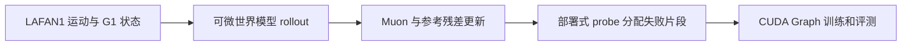
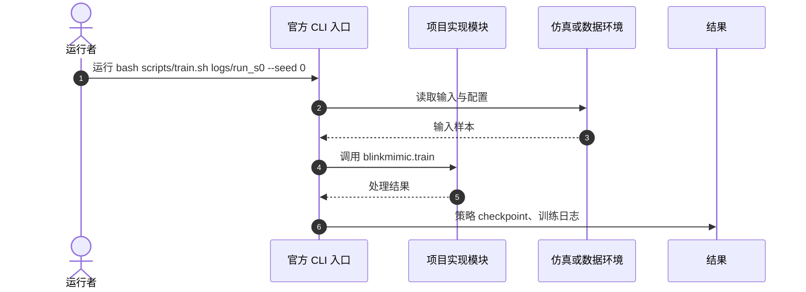

# BlinkMimic: Training a Humanoid Motion Tracker in Minutes on a Single GPU｜BlinkMimic：单卡分钟级人形动作跟踪

## 一句话定义

**BlinkMimic：单卡分钟级人形动作跟踪**：围绕 G1 的 40 段 LAFAN1 动作，将拟合速度、尾部失败练习与单迭代 GPU 运行开销分别优化。

## 英文缩写速查

| 缩写 | 英文全称 | 简要说明 |
|---|---|---|
| BPTT | Backpropagation Through Time | 时间展开梯度 |
| WM | World Model | 环境动力学预测模型 |
| EMA | Exponential Moving Average | 参数指数平滑 |

## 为什么重要

围绕 G1 的 40 段 LAFAN1 动作，将拟合速度、尾部失败练习与单迭代 GPU 运行开销分别优化。 本项目的机制、指标和开放边界需要分开理解，不能把单个结果推广到所有机器人平台。

## 核心信息

| 项 | 一手来源 |
|---|---|
| 论文 | [arXiv:2611.16422v1](https://arxiv.org/abs/2611.16422) |
| 代码 | [官方仓库](https://github.com/fuyichen0725/blinkmimic)；开放范围见源码归档 |

## 核心原理

可微世界模型的 rollout 上通过 BPTT 更新策略；使用 Muon、参考动作残差与随训练进度衰减的步长；定期以部署条件 probe 定位真实尾部失败，并用 CUDA Graph 捕捉包含物理仿真和重置的整个迭代。

### 流程总览

该图表示论文机制的主要数据或控制方向，不表示已经运行作者模型。

## 源码运行时序图

已核对 [官方代码归档](../../sources/repos/blinkmimic-2611-16422.md) 的 README 与公开运行入口（仅说明所发布组件，不代表实机复现）：

## 工程实践

1. 核实数据许可、训练/测试切分、时序观测和动作坐标系，建立与原文一致的对照协议。
2. 参照[官方源码归档](../../sources/repos/blinkmimic-2611-16422.md)核实入口、依赖及模型数据权限。
3. 分别统计训练预算、模拟指标、真机成功率与执行延迟，记录失败模式和软硬件约束。

## 实验与评测

RTX 4090、40 段 LAFAN1，达到 return≥0.82 平均 2.94 分钟，连续三个无失败 checkpoint 约 3.38 分钟（三个种子，官方报告）。

## 结论

**围绕 G1 的 40 段 LAFAN1 动作，将拟合速度、尾部失败练习与单迭代 GPU 运行开销分别优化。**

1. 对照同数据与同测评协议，不混淆不同平台/样本统计口径。
2. 在复现前单列训练数据、预训练、控制接口和硬件依赖。
3. 验证边界是研究结论的必要组成，不能由示例直接推出可量产部署。

## 局限与风险

验证来自仿真 Unitree G1 与固定动作库，没有真实机器人部署证据；耗时受 GPU 型号和评测口径制约。

## 关联页面

- [2026-11-16 具身研究论文阅读地图](../overview/embodied-frontier-29-papers-2026-11-16.md)
- [ActionCodec2：流式动作编解码](./paper-actioncodec2-streaming-action-tokenizer.md)

## 参考来源

- [论文原文核对归档](../../sources/papers/blinkmimic-2611-16422.md)
- [源代码归档](../../sources/repos/blinkmimic-2611-16422.md)

## 推荐继续阅读

- [arXiv HTML v1](https://arxiv.org/html/2611.16422v1)
- [官方代码](https://github.com/fuyichen0725/blinkmimic)
