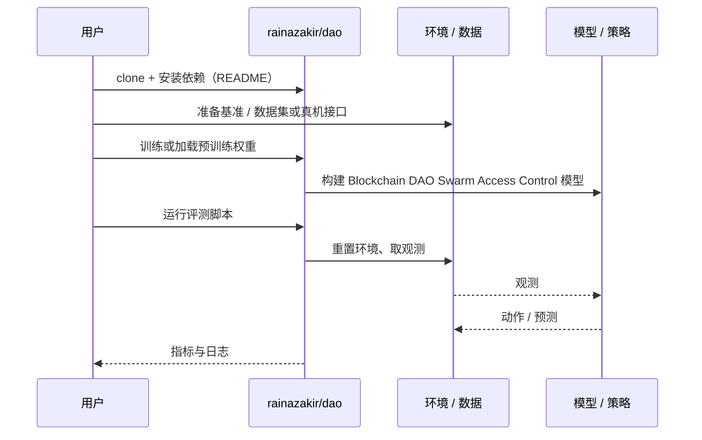

# Blockchain DAO Swarm Access Control（arXiv:2611.03975）

**Blockchain DAO Swarm Access Control**（*Self-governed access control in open robot swarms using a blockchain-based DAO*，[arXiv:2611.03975](https://arxiv.org/abs/2611.03975)，[代码](https://github.com/rainazakir/dao)）来自 [具身智能小站 2026-11-04 盘点](../../sources/blogs/wechat_embodied_station_57_papers_da_reward_model_failure_2026-11-04.md)，属「人形运动与教程」组。

## 一句话定义

**用智能合约规定机器人加入、移除与访问规则，研究开放集群治理；通过仿真和实物概念验证抑制恶意节点渗入，仍需结合通信和计算条件评估。**

## 英文缩写速查

| 缩写 | 英文全称 | 简要说明 |
|------|----------|----------|
| Blockchain DAO Swarm Access Control | Self-governed access control in open robot swarms using a blockchain-based DAO | 本文方法 / 基准的简称 |

## 为什么重要

- 让开放机器人集群管理成员资格。
- 开源结论：**部分开源**（步骤 2.5，2026-11-04）。公众号代码 rainazakir/dao 经 git ls-remote 失败（可能私有或已删除），不能当作已开源。
- 同期同组工作见 [VLM 奖励评估、动作动力学与开放权重机器人智能体：具身智能小站 11-04 期 57 篇阅读坐标](../overview/embodied-station-2026-11-04-57-papers-technology-map.md)。

## 核心机制

| 项 | 内容 |
|----|------|
| **arXiv** | [2611.03975](https://arxiv.org/abs/2611.03975) |
| **开源** | **部分开源** |
| **要点** | 用智能合约规定机器人加入、移除与访问规则，研究开放集群治理；通过仿真和实物概念验证抑制恶意节点渗入，仍需结合通信和计算条件评估。 |
| **文内指标** | 公众号未给具体数字，本页不引用。 |

## 源码运行时序图

以下为按仓库入口（`rainazakir/dao`）推断的通用运行链路；入库日仅核实仓库可达，未逐文件阅读，具体脚本名以 README 为准。

## 实验与评测

- 公众号未给具体数字，本页不引用。
- **读法：** 本页为索引级摘要，依据公众号转述的官方摘要与仓库信息整理；逐项数字与 baseline 以原文 PDF 为准。

## 与其他工作对比

- 横向索引见 [VLM 奖励评估、动作动力学与开放权重机器人智能体：具身智能小站 11-04 期 57 篇阅读坐标](../overview/embodied-station-2026-11-04-57-papers-technology-map.md)；同 arXiv 不重复造页。

## 结论

**让开放机器人集群管理成员资格：用智能合约规定机器人加入、移除与访问规则，研究开放集群治理；通过仿真和实物概念验证抑制恶意节点渗入，仍需结合通信和计算条件评估。**

1. 开源边界：**部分开源** — 公众号代码 rainazakir/dao 经 git ls-remote 失败（可能私有或已删除），不能当作已开源。
2. 核心机制：用智能合约规定机器人加入、移除与访问规则，研究开放集群治理；通过仿真和实物概念验证抑制恶意节点渗入，仍需结合通信和计算条件评估。
3. 复现与选型前核对任务协议、硬件与基准口径，勿直接横比公众号摘录数字。

## 关联页面

- [locomotion](../tasks/locomotion.md)
- [motion-retargeting](../concepts/motion-retargeting.md)
- [manipulation](../tasks/manipulation.md)
- [embodied-station-2026-11-04-57-papers-technology-map](../overview/embodied-station-2026-11-04-57-papers-technology-map.md)

## 参考来源

- [blockchain_dao_swarm_access_control_arxiv_2611_03975.md](../../sources/papers/blockchain_dao_swarm_access_control_arxiv_2611_03975.md)
- [wechat_embodied_station_57_papers_da_reward_model_failure_2026-11-04.md](../../sources/blogs/wechat_embodied_station_57_papers_da_reward_model_failure_2026-11-04.md)
- [arXiv:2611.03975](https://arxiv.org/abs/2611.03975)

## 推荐继续阅读

- [arXiv PDF](https://arxiv.org/pdf/2611.03975)
- [https://github.com/rainazakir/dao](https://github.com/rainazakir/dao)
