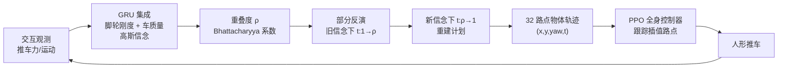

---

type: entity
tags: [paper, humanoid, loco-manipulation, flow-matching, online-estimation, replanning, cart-pushing, mjlab, northwestern, multiply-labs]
status: complete
updated: 2026-10-12
arxiv: "2610.13087"
project_id: bopi
project: https://bopi-loco.github.io/
related:
  - ../overview/embodied-station-34-papers-spatial-grounding-technology-map.md
  - ../tasks/loco-manipulation.md
  - ./mjlab.md
  - ./paper-loco-manip-161-109-falcon.md
  - ./unitree-g1.md
  - ../methods/reinforcement-learning.md
sources:
  - ../../sources/blogs/wechat_embodied_station_34_papers_spatial_grounding_2026-10-12.md
  - ../../sources/papers/bopi_arxiv_2610_13087.md
  - ../../sources/sites/bopi.md
summary: "BOPI（arXiv:2610.13087，Northwestern/Multiply Labs）：人形推未知推车时，用新旧高斯信念的重叠度 ρ 决定对流匹配计划做多深的部分反演（d=1-ρ）；18 个仿真目标位置误差 0.179 m 对固定深度 RDM 的 0.267 m，真机推车位置误差 5.78 cm 对 8.59 cm；代码待发布。"
---

# BOPI：按新旧信念的一致程度修订人形推车计划

**BOPI**（*Belief-Overlap Partial Inversion*；论文 *Belief-Overlap Partial Inversion: Object-Centric Flow Replanning for Humanoid Loco-Manipulation*，[arXiv:2610.13087](https://arxiv.org/abs/2610.13087)，[项目页](https://bopi-loco.github.io/)）由 **西北大学（Northwestern）与 Multiply Labs** 提出：人形机器人推一辆质量与后轮脚轮刚度未知的推车，一边在线估计物性、一边用流匹配规划物体轨迹、一边用全身控制器执行；信念更新时不整体重规划，而是按新旧信念重叠度决定把旧计划沿流反演多深再重建。

## 一句话定义

**把「计划是否该改、改多少」变成一个由信念重叠度 ρ 控制的流反演深度 d=1−ρ：信念几乎没变就几乎不改，信念大变才接近从头生成。**

## 英文缩写速查

| 缩写 | 英文全称 | 简要说明 |
|------|----------|----------|
| BOPI | Belief-Overlap Partial Inversion | 本文重规划方法 |
| RDM | 论文中的固定重启深度重规划基线 | 固定深度 λ=0.25 重启；全称原文摘要未展开（未核实） |
| FM | Flow Matching | 条件整流流作为轨迹生成器；Fresh FM 指每次信念变化都从噪声全新生成 |
| GRU | Gated Recurrent Unit | 在线估计网络的循环单元（集成） |
| WBC | Whole-Body Control | 人形全身控制器，执行物体路点 |
| SE(2) | Special Euclidean group in 2D | 平面位置加偏航的目标空间 |

## 为什么重要

- 在线适应的两难：每次信念变化就重新生成会打断正在执行的机动，保留旧计划则继续走已被证据排除的路径。BOPI 给出一个连续的折中而不是二选一。
- 方法不改生成模型，只改推理时「从哪个流时间点重新积分」，因此可套在任何流/扩散规划器上（推测，论文只在推车任务验证）。
- 把估计、规划、控制闭环连接到人形真机，是 [Loco-Manipulation](../tasks/loco-manipulation.md) 里「接触物体物性未知」的一个具体案例。

## 核心信息

| 项 | 内容 |
|----|------|
| 机构 | Northwestern University（第一作者为 Multiply Labs 实习生）；Multiply Labs |
| 仿真平台 | [mjlab](./mjlab.md) 中的 G1–Dex3 人形；真机型号原文未明确 |
| 任务 | 推非完整约束购物车做平面平移与转向 |
| 在线估计 | GRU 集成预测后脚轮摆动刚度与车质量（对数坐标高斯信念） |
| 开源 | **待发布**：项目页标注 Code Release soon，论文称完整奖励规格与训练配置随代码发布；ICRA 2027 under review |

## 方法栈与流程总览

## 方法

- **在线估计：** GRU 集成输出后脚轮摆动刚度与车质量的均值/不确定度（对数坐标），信念为高斯。交互 4 s 后区分自由/受限后轮准确率 91.5%–98.4%，质量平均绝对误差约 1 kg（留出轨迹）。
- **流规划器：** 条件整流流生成 32 个带时间的物体路点（平面位置、偏航、时间），条件为目标与信念均值，主干为带 FiLM 的时序 U-Net，训练加条件平滑损失（权重 0.1）；训练数据来自解析教师，在力、加速度、打滑代价下优化推车系速度与偏航率。
- **BOPI 规则：** 重叠度取新旧信念的 Bhattacharyya 系数 ρ（高斯下为各物性重叠之积）；对旧计划在旧信念下从流时间 1 反向积分到 ρ，再在新信念下从 ρ 正向积分到 1，不加新噪声。ρ=1 计划不变；ρ=0 为完整反演重建。命题 1 给出编码计划变化的上界 min{2Vd, dΔv·exp(Ld)}，依赖一致 Lipschitz、有界等假设。重采样后保留前 4 个路点以减小突变。
- **全身控制器：** mjlab 中用 PPO 训练，输出除手指外所有关节目标；输入含关节状态、基座角速度、重力方向、上一动作、步态相位、手与把手几何、8 步历史；主要奖励为相对插值目标路点的位置与朝向误差，辅以抓握、平衡、轮接触、稳定项，并包含 [FALCON](./paper-loco-manip-161-109-falcon.md) 的运动奖励。

## 源码运行时序图

**不适用**：截至 2026-10-12 项目页写 Code Release soon，没有公开仓库，无可对齐的入口脚本。

## 工程实践

| 项 | 建议 |
|----|------|
| 重规划频率 | 仿真 5 Hz；真机为安全降到 1 Hz |
| 重叠度 | 用概率分布重叠而非点估计差，才能随不确定度自动缩放修订幅度 |
| 基线 | 固定深度 RDM（λ=0.25）经开发集扫参；换任务需重新扫 |
| 平滑 | 保留重采样后前 4 个路点，避免执行中突变 |
| 估计前置 | 交互约 4 s 后估计才足够可用，开局需小幅试推 |
| 复现 | 控制器奖励与训练配置未公开，当前无法复现 |

## 实验与评测

**仿真（18 个目标，每目标 32 种子，5 Hz）：** 目标含 1 m 左右平移、±60°/±90° 旋转、平移加转向，以及错误质量信念（假设 3.3 kg、真值 18.3 kg）下的 1 m 横移加 ±45° 转向。

| 方法 | 位置误差 (m) | 偏航误差 (rad) |
|------|-------------|---------------|
| BOPI | 0.179 | 0.152 |
| RDM | 0.267 | 0.286 |
| FlowEdit | 0.295 | 0.349 |
| Fresh FM | 0.936 | 1.149 |
| Retain | 0.465 | 0.277 |

相对 RDM，位置约降 33%、偏航约降 47%。

- **玩具问题（Duffing 振子，每流 256 次）：** 成功率 BOPI 54.9±14.6%，RDM 40.0±6.1%，FlowEdit 12.6±3.7%，Fresh FM 4.0±0.9%，Retain 2.4±0.3%；累计突变 BOPI 0.704 对 RDM 2.212。
- **真机（两任务：1 m 横移、顺时针 90° 转向后回位，每方法每目标 5 次）：** 横移位置误差 BOPI 6.48±3.48 cm，RDM 7.35 cm，FlowEdit 30.64 cm，Fresh FM 43.32 cm，Retain 85.48 cm；转向 BOPI 5.07 cm，RDM 9.83 cm，FlowEdit 8.29 cm，Fresh FM 8.80 cm，Retain 22.98 cm。两任务均值 BOPI 5.78 cm 对 RDM 8.59 cm。**真机偏航误差 RDM 更低**（横移 1.17° 对 1.64°，转向 3.11° 对 4.51°）。

## 结论

**信念更新后的计划修订应当「按证据一致度缩放」：既不全盘重来，也不死守旧计划。**

1. **位置/偏航综合最优。** 仿真位置 0.179 m、偏航 0.152 rad，均优于所有基线。
2. **全盘重生成代价大。** Fresh FM 位置误差 0.936 m，说明连续性比「最新信念」更重要。
3. **完全保留也不行。** Retain 真机横移 85.48 cm，说明旧计划被证据排除后必须改。
4. **并非全面赢。** 真机偏航误差上 RDM 更低；报告时要分指标看。
5. **证据量有限。** 真机每方法每目标 5 次、一辆车、一个平台。
6. **想落地先等代码。** 控制器与奖励配置未公开。

## 局限与风险

- 仅平面 SE(2) 推车；三维目标与非轮式物体留作未来工作。
- 真机评估小（5 次/方法/目标、一辆车），RDM 重启深度在开发集上扫参，对比可能偏向被调参的基线或反之，原文未分析。
- 命题 1 的上界依赖理想化假设；估计器在 4 s 后才可靠。
- **开源状态：** 截至 2026-10-12 未发布代码，项目页仅提供视频与论文 PDF。

## 与其他工作对比

| 对照 | 差异读法 |
|------|----------|
| [FALCON](./paper-loco-manip-161-109-falcon.md) | BOPI 的运动奖励借用 FALCON；FALCON 偏全身力自适应控制，BOPI 在其上加物性估计与计划修订 |
| [Loco-Manipulation 任务页](../tasks/loco-manipulation.md) | 多数方法假设物体属性已知；BOPI 把未知物性估计与计划修订放进闭环 |
| [强化学习](../methods/reinforcement-learning.md) | 控制器用 PPO；规划层是生成式流，不是 RL 策略 |
| 固定深度重规划（RDM） | 同样基于反演-重建，但深度固定，是最直接的消融对照 |

## 关联页面

- [34 篇空间落地技术图谱（汇总页）](../overview/embodied-station-34-papers-spatial-grounding-technology-map.md)
- [Loco-Manipulation](../tasks/loco-manipulation.md)
- [mjlab](./mjlab.md)
- [FALCON](./paper-loco-manip-161-109-falcon.md)
- [Unitree G1](./unitree-g1.md)

## 参考来源

- [具身智能小站 34 篇盘点（2026-10-12）](../../sources/blogs/wechat_embodied_station_34_papers_spatial_grounding_2026-10-12.md)
- [bopi_arxiv_2610_13087.md](../../sources/papers/bopi_arxiv_2610_13087.md) — 论文摘录与开源核查
- [bopi.md](../../sources/sites/bopi.md) — 项目页状态
- [arXiv:2610.13087](https://arxiv.org/abs/2610.13087)

## 推荐继续阅读

- [BOPI 项目页](https://bopi-loco.github.io/)
- [arXiv HTML 全文](https://arxiv.org/html/2610.13087v1)
- [mjlab 文档](https://mujocolab.github.io/mjlab/main/index.html)
