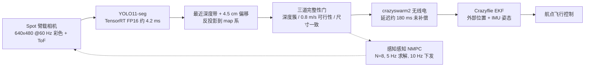

# Borrowed Eyes：四足主动观察者支持的无标记纳米无人机飞行

**论文：** *Borrowed Eyes: Markerless Nano-UAV Flight with an Active Quadruped Observer*（[arXiv:2610.09967](https://arxiv.org/abs/2610.09967)，cs.RO，2026-10，投稿 ICRA 2027）。作者 Lorite Mora、Arapis、Faíña；周报标注为哥本哈根信息技术大学（ITU）、Helix Lab、诺和诺德（arXiv 页面未列机构）。

## 一句话定义

**让一台 Spot 四足机器人用臂载 RGB-D 相机无标记地估计 Crazyflie 纳米无人机的三维位置，再用感知感知型 NMPC 主动移动机身和机械臂，把无人机一直留在可靠视场里，从而让一架没有任何定位传感器的 37 g 无人机完成起飞到降落的航点飞行。**

## 英文缩写速查

| 缩写 | 英文全称 | 简要说明 |
|------|----------|----------|
| NMPC | Nonlinear Model Predictive Control | 优化机身与臂速度以保持观测，N=8，5 Hz 求解 |
| UAV | Unmanned Aerial Vehicle | 被观测对象为 Crazyflie 纳米无人机 |
| ToF | Time of Flight | 夹爪相机的深度来源，有效距离约 2.3 m |
| EKF | Extended Kalman Filter | 无人机端融合外部位置与 IMU 姿态 |
| IMU | Inertial Measurement Unit | 无人机唯一机载传感器，视线丢失时续航 |
| SAM 2 | Segment Anything Model 2 | 用动捕投影提示自动生成检测器训练标签 |

## 为什么重要

- **纳米无人机的定位瓶颈：** 37 g 级载荷装不下视觉/激光定位；贴标记会增重增阻（论文实测加 1.8 g 哑光板使电机占空比从 53–55% 升到 80.5%，23 s 后紧急降落）。
- **把“传感器”挪到能载重的伙伴身上：** 四足的臂载相机可以跨过无人机进不去的空间，两者组合有望做联合巡检（论文愿景，未实现联合规划）。
- **主动观测量化：** 离轴角中位 0.54°（NMPC）对 10.7°（反应式），把“相机朝哪看”变成可优化的量。

## 核心信息

| 项 | 内容 |
|----|------|
| **机构** | 周报标注 ITU / Helix Lab / 诺和诺德（arXiv 页面未列） |
| **平台** | Boston Dynamics Spot（Jetson AGX Orin，臂载夹爪彩色+ToF 相机）；Bitcraze Crazyflie（BMI088 IMU）；OptiTrack 仅作真值与地图锚定 |
| **开源** | **未核实到**：arXiv 页面无项目页/仓库；正文称 MPC 权重在“开放仓库”但未给链接（截至 2026-10-12） |

## 方法栈与流程总览

## 方法

- **检测与 3D 定位：** YOLO11-seg 产生掩码；取掩码内“最近且有支撑的深度带”加固定偏移 δ=4.5 cm 指向机体中心，经 T_map→odom、odom→body、body→cam 链反投影。对比中位数聚合：最近带使 93–96% 的帧落在真值 250 mm 内（中位误差 20 mm），中位数聚合仅 12–17%（1.8–2.4 m）。
- **完整性门：** 深度簇支持度（至少 max(6 px, 6%) 的掩码内深度）、0.8 m/s 运动学可行性、尺寸一致性；门控使 5,539 个留出帧的错误发布从 4 降到 0。
- **检测器训练：** 7,306 正样本（6,025 自动标注 + 1,281 合成）+ 1,099 负样本；标签由动捕投影提示 SAM 2 产生；七次重训共 4.2 GPU 小时，部署模型微调 0.31 h，零人工标注。
- **无人机端：** EKF 融合无标记位置（测量噪声设 5 cm）与 IMU 姿态；仅位置模式与全姿态模式飞行相当，但偏航漂移 9–10°/min（全姿态 0.8°/min）。
- **感知感知 NMPC：** 决策变量为机身与机械臂速度；代价含光轴偏角 θ²（主导项，>30° 可靠性下降）、与目标 1.0 m 的距离误差、−log 有效发布概率、像面速度（运动模糊）、控制量（臂便宜机身贵）、40 px 软边界以及臂伸展/机身-臂对齐/手高度/指令平滑正则；臂仰角限 68°。部署版倾向侧移而非摇头，因为转动相机会引入背景杂波影响检测。具体权重原文未给。

## 实验与评测

- **静态：** 悬停 1.6–1.8 m，205 帧，检测率 89%，3D 中位误差 38.6 mm。
- **在线 8 次闭环飞行（1,069 s，17,363 个位置）：** 中位 49 mm，P95 119 mm，0.6% 的位置偏差超过 300 mm；门控后 99.4% 的发布位置在 300 mm 内。
- **主动观测（Table I，动捕供给）：** 反应式（22 Hz 视觉伺服）离轴角中位 10.7° / P95 13.7°；NMPC 低运动版 0.70° / 7.5°，部署版 0.54° / 2.7°，站位 1.25 m（论文推算同站位反应式约 7.4°，故称约十四倍）。代价是 NMPC 部署版机身/手运动量更大（1.72 / 1.61 m² 对 1.49 / 1.52 m²）。
- **纯视觉闭环：** 3 次 120 s 悬停横向误差 37–53 mm；3 次十航点轨迹各 124 s，起飞到降落零次安全接管，3D 中位误差 58–60 mm（P95 121–124 mm）；动捕基线中位 33 mm，纯视觉按高度分为 78 / 88 / 109 mm。
- **视线丢失：** 文本称 36 次 >0.5 s 的遮挡全部恢复（图 6 说明写 25 次，原文前后不一致）；最长 2.78 s；盲飞漂移约 0.14 m/s；恢复后首个样本中位误差 66 mm；4.0 s 无视觉则交还动捕，4.5 s 无位置流则降落。
- **飞行包线（Table II）：** 0.6–1.65 m 高度可用性 98.5–99.8%，10/10 航点；2.0 m 高度 1.3 m 距离可用性 63.4%（9/10 航点），放开腕俯仰至 1.8 m 距离提高到 77.7–84.5%；2.5 m 高度 0/10。
- **近场杂波：** 尺寸一致性阈值 2.0 曾锁定梯子横杆，拉偏 0.68 m；阈值 1.5 拒绝 48% 假前景（43/89）而仅损失 0.35% 有效帧。

## 源码运行时序图

**不适用**：论文未提供可核实的官方代码或项目页（正文提到的“开放仓库”无链接，截至 2026-10-12 未找到）。系统数据流见“流程总览”。

## 工程实践

| 项 | 建议 |
|----|------|
| 深度聚合 | 小而深色的机体 ToF 回波稀疏，取“最近支撑带”而非中位数 |
| 防误锁 | 尺寸一致性阈值取 1.5 而非 2.0，并保留运动学可行性门 |
| 延迟 | 管线+无线电约 180 ms 未补偿，是主要误差源之一；位置反馈 5 Hz 可稳定、1 Hz 失稳 |
| 观测站位 | 目标站位 1.0 m 左右，ToF 有效距离约 2.3 m，飞行高度超 1.65 m 要放开腕俯仰 |
| 安全 | 设 4.0 s 视觉丢失交还与 4.5 s 机载降落看门狗 |

## 结论

**可行性证据扎实但范围窄：在受控实验室、固定无人机型号和动捕标定下，外部四足相机足以替代标记完成十航点飞行；真正限制能力的是 ToF 距离、延迟和单视角。**

1. **深度聚合比检测更决定误差** — 最近带 vs 中位数的差距是 20 mm 对大范围失配。
2. **完整性门是安全的核心** — 99.4% 发布位置在 300 mm 内，误锁用尺寸一致性挡住。
3. **主动观测显著提高视角质量** — 离轴角 0.54° 对 10.7°，但机身运动量更大。
4. **IMU 续航可覆盖短遮挡** — 最长 2.78 s 全部恢复，4 s 以上需交还。
5. **高度包线有硬上限** — 2.0 m 可用性降到 63.4%，2.5 m 未达成。
6. **不要外推到室外/杂乱环境** — 检测器只在均匀背景实验室数据上训练。

## 与其他工作对比

| 对照 | 差异读法 |
|------|----------|
| 动捕/UWB 定位 | 精度更高（动捕基线中位 33 mm）但需要基础设施；本文用移动观察者换取免标定场地（仍用动捕作真值与锚定） |
| 贴标记（AprilTag） | 早期立体设置中标记精度 12–16 mm、无标记 71 mm（对齐后）；本文用门控代替增重 |
| [Crazyflie 固件](./crazyflie-firmware.md) | 本文使用其外部位置输入与 EKF 接口作为被控对象（推测，对接细节原文未展开） |
| [模型预测控制](../methods/model-predictive-control.md) | 本文把“保持被观测”写入代价，而非跟踪轨迹 |

## 局限与风险

- **开源状态：** 未核实到代码/项目页。
- **泛化：** 检测器仅用实验室均匀背景数据；单视角缺乏杂乱结构内的可观测性。
- **硬件：** Spot + Crazyflie + 动捕，成本高；最大有效 ToF 2.3 m。
- **统计：** 飞行活动展示可行性，非统计认证；延迟/噪声/丢包研究为初步。
- **原文不一致：** 遮挡次数 36 vs 25。

## 关联页面

- [人形/四足前沿周报（2026-10-05~10-09）](../overview/frontier-humanoid-quadruped-2026-10-05-10-09.md)
- [运动控制任务页](../tasks/locomotion.md)
- [模型预测控制](../methods/model-predictive-control.md)
- [Crazyflie 固件](./crazyflie-firmware.md)
- [Boston Dynamics](./boston-dynamics.md)

## 参考来源

- [borrowed_eyes_arxiv_2610_09967.md](../../sources/papers/borrowed_eyes_arxiv_2610_09967.md) — 论文摘录与开源核查
- [周报来源归档](../../sources/blogs/frontier_humanoid_quadruped_2026_10_05_10_09.md)
- [arXiv:2610.09967](https://arxiv.org/abs/2610.09967) — 原文

## 推荐继续阅读

- [arXiv HTML 全文](https://arxiv.org/html/2610.09967v1)
- [Crazyswarm2 文档](https://imrclab.github.io/crazyswarm2/)
- [Bitcraze Crazyflie](https://www.bitcraze.io/products/crazyflie-2-1/)
