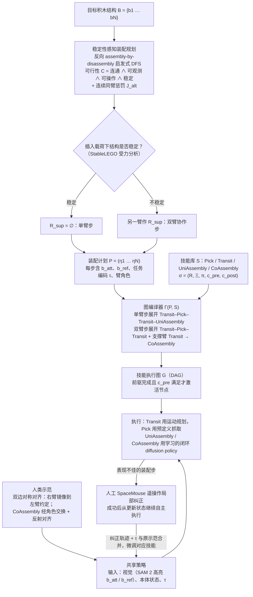

# BrickCraft-Duo（arXiv:2609.28281）

**BrickCraft-Duo: Efficient Dual-Arm Skill Learning and Refinement for Compositional Long-Horizon Assembly**（[项目页](https://jichuan-yu.github.io/BrickCraft-Duo/)，[arXiv:2609.28281](https://arxiv.org/abs/2609.28281)）来自 [具身智能小站 · 13 篇盘点](../../sources/blogs/wechat_embodied_13_papers_forgetmimic_2026-09-24.md)（2026-09-24）。

## 一句话定义

**互锁积木双臂装配：可复用单/双臂技能 + 稳定性感知组合 + 人机定向修正，最长 **9 步** 长时任务。**

## 英文缩写速查

| 缩写 | 英文全称 | 简要说明 |
|------|----------|----------|
| VLA | Vision-Language-Action | 视觉–语言–动作策略 |
| RL | Reinforcement Learning | 强化学习 |
| TO | Trajectory Optimization | 轨迹优化 |
| HITL | Human-in-the-Loop | 人在回路 |

## 为什么重要

- 互锁结构同时考双臂协作、支撑关系、插入容差与长时依赖，是接触丰富组装的浓缩测试床。
- 纳入 [13 篇技术地图](../overview/embodied-13-papers-technology-map.md) 阅读坐标。
- 开源结论（步骤 2.5，2026-09-24）：**待发布**。

## 流程总览

图依据：论文 §III-A–D 与 Fig. 1–4（规划、技能执行图、对称对齐学习、人类纠正微调）。

## 核心机制

| 项 | 内容 |
|----|------|
| **arXiv** | [2609.28281](https://arxiv.org/abs/2609.28281) |
| **开源** | **待发布** |
| **要点** | 对称共享与角色分配学 reusable skills；稳定性推理组合 skill graph；HITL 修正薄弱步骤。 |
| **文内指标** | 五任务长时成功率 **≥60%**、逐步完成率 **≥95%**；Scale/Eagle 9 步经 refine 后 completion **~97%** 量级。 |

## 源码运行时序图

**不适用**（截至 2026-09-24 项目页/论文未提供可运行官方代码；开源状态：**待发布**）。

## 实验与评测

- 五任务长时成功率 **≥60%**、逐步完成率 **≥95%**；Scale/Eagle 9 步经 refine 后 completion **~97%** 量级。
- **读法：** 公众号归纳；逐项 baseline 与协议以 arXiv PDF 为准。

## 与其他工作对比

- 横向索引见 [13 篇技术地图](../overview/embodied-13-papers-technology-map.md)。

## 结论

**组合式长时任务先拆 skill 再补 HITL** — 读 initial vs refined 成功率区分数据与修正贡献。

1. 开源边界：**待发布** — 以项目页/仓库实际链接为准（入库日 2026-09-24）。
2. 核心机制：对称共享与角色分配学 reusable skills；稳定性推理组合 skill graph；HITL 修正薄弱步骤。…
3. 部署前核对任务协议与硬件条件，勿直接横比公众号摘录数字。

## 关联页面

- [Manipulation](../tasks/manipulation.md)
- [Imitation Learning](../methods/imitation-learning.md)
- [Contact Dynamics](../concepts/contact-dynamics.md)
- [Embodied 13 Papers Technology Map](../overview/embodied-13-papers-technology-map.md)

## 参考来源

- [13 篇盘点（公众号）](../../sources/blogs/wechat_embodied_13_papers_forgetmimic_2026-09-24.md)
- [BrickCraft-Duo: Efficient Dual-Arm Skill Learning and Refinement for Compositional Long-Horizon Assembly](../../sources/papers/brickcraft-duo_arxiv_2609_28281.md)
- [arXiv PDF](https://arxiv.org/pdf/2609.28281)：已通读方法部分（实验与附录以略读为准）：摘要、§I 引言、§III 方法（A–D）、§IV-A 实现细节（略读其余实验）

## 推荐继续阅读

- [arXiv:2609.28281](https://arxiv.org/abs/2609.28281) — 原文
