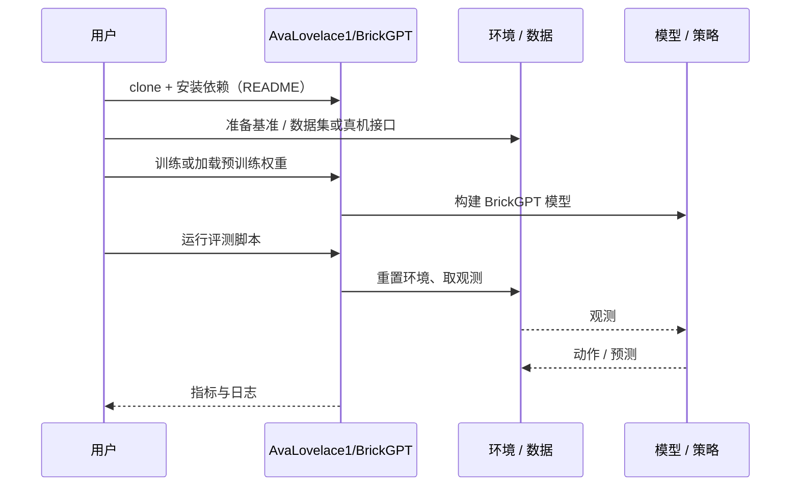

# BrickGPT（arXiv:2505.05469）

**BrickGPT**（*Generating Physically Stable and Buildable Brick Structures from Text*，[arXiv:2505.05469](https://arxiv.org/abs/2505.05469)，[项目页](https://avalovelace1.github.io/BrickGPT/)，[代码](https://github.com/AvaLovelace1/BrickGPT)）来自 [深蓝具身智能 2026-11-01 盘点](../../sources/blogs/wechat_shenlan_cv_best_papers_2023_2026_labs.md)，属「视觉推理与可控生成」组。

## 一句话定义

**BrickGPT 从文本生成物理稳定、可互锁搭建的积木结构：自回归 LLM 逐块预测下一块，并在推理时用物理与装配约束做有效性检查和回滚。**

## 英文缩写速查

| 缩写 | 英文全称 | 简要说明 |
|------|----------|----------|
| BrickGPT | Brick Generative Pre-trained Transformer | 积木结构自回归生成模型 |
| LLM | Large Language Model | 大语言模型 |

## 为什么重要

- 把物理可行性放进生成过程，生成结果可由人或机器人实际搭建（公众号归属：CMU 计算机科学系）。
- 开源结论：**已开源**（步骤 2.5，2026-11-01）。仓库 AvaLovelace1/BrickGPT 经 git ls-remote 可达；项目页 HTTP 200。
- 同期同组工作见 [从视觉编程到 4D 重建：CV 三大会 2023–2026 Best Paper 阅读坐标](../overview/cv-best-papers-2023-2026-technology-map.md)。

## 核心机制

| 项 | 内容 |
|----|------|
| **arXiv** | [2505.05469](https://arxiv.org/abs/2505.05469) |
| **开源** | **已开源** |
| **要点** | 构建大规模物理稳定积木数据集与配套文本描述，next-token 预测下一块，推理时用物理定律与装配约束剪除不可行的 token（arXiv 摘要）。 |
| **文内指标** | arXiv 摘要称生成结果稳定、多样、美观；具体数字未转录。 |

## 源码运行时序图

以下为按仓库入口（`AvaLovelace1/BrickGPT`）推断的通用运行链路；入库日仅核实仓库可达，未逐文件阅读，具体脚本名以 README 为准。

## 实验与评测

- arXiv 摘要称生成结果稳定、多样、美观；具体数字未转录。
- **读法：** 本页为索引级摘要，依据公众号转述的官方摘要与仓库信息整理；逐项数字与 baseline 以原文 PDF 为准。

## 与其他工作对比

- 横向索引见 [从视觉编程到 4D 重建：CV 三大会 2023–2026 Best Paper 阅读坐标](../overview/cv-best-papers-2023-2026-technology-map.md)；同 arXiv 不重复造页。

## 结论

**BrickGPT：生成式模型加物理校验回滚，让输出可搭建。**

1. 开源边界：**已开源** — 仓库 AvaLovelace1/BrickGPT 经 git ls-remote 可达；项目页 HTTP 200。
2. 核心机制：构建大规模物理稳定积木数据集与配套文本描述，next-token 预测下一块，推理时用物理定律与装配约束剪除不可行的 token（arXiv 摘要）。
3. 复现与选型前核对任务协议、硬件与基准口径，勿直接横比公众号摘录数字。

## 关联页面

- [generative-world-models](../methods/generative-world-models.md)
- [cv-best-papers-2023-2026-technology-map](../overview/cv-best-papers-2023-2026-technology-map.md)

## 参考来源

- [brickgpt_arxiv_2505_05469.md](../../sources/papers/brickgpt_arxiv_2505_05469.md)
- [wechat_shenlan_cv_best_papers_2023_2026_labs.md](../../sources/blogs/wechat_shenlan_cv_best_papers_2023_2026_labs.md)
- [arXiv:2505.05469](https://arxiv.org/abs/2505.05469)

## 推荐继续阅读

- [arXiv PDF](https://arxiv.org/pdf/2505.05469)
- [项目页](https://avalovelace1.github.io/BrickGPT/)
- [https://github.com/AvaLovelace1/BrickGPT](https://github.com/AvaLovelace1/BrickGPT)
