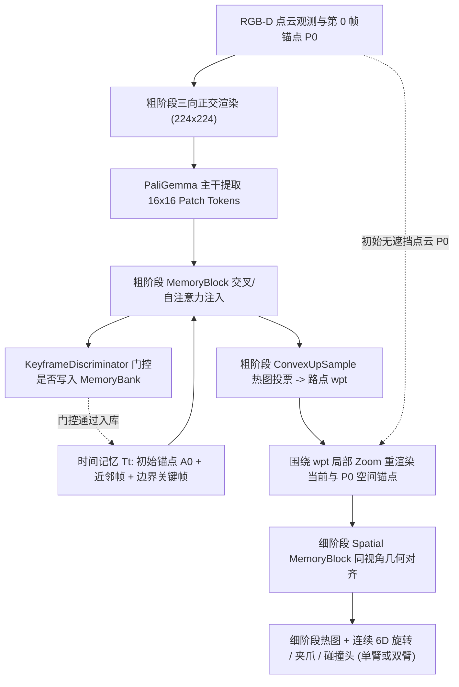
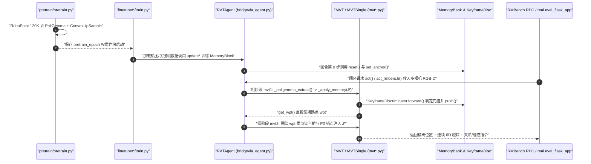

# BridgeVLA++（Memory-Augmented 3D VLA · arXiv:2608.05042）

**BridgeVLA++**（*BridgeVLA++: A Data-Efficient, Generalizable, and Memory-Augmented Vision-Language-Action Framework for 3D Manipulation*，[arXiv:2608.05042](https://arxiv.org/abs/2608.05042)，IEEE TPAMI 稿）由 **中科院自动化研究所 NLPR / 中国科学院大学 / 五纪元仿真（FiveAges）** 等提出（Peiyan Li\*、Yuze Zhu\*、…、Yan Huang†、Liang Wang、Tieniu Tan；Hongtao Wu、Xiao Ma、Tao Kong 贡献时隶属 **字节跳动 Seed**）：在 NeurIPS 2025 **BridgeVLA**（[arXiv:2506.07961](https://arxiv.org/abs/2506.07961)）的「点云正交投影 ↔ 2D heatmap」输入输出对齐底座上，新增仅占基座 **+9.2% 参数** 的 **统一时空记忆（Unified Spatio-Temporal Memory）**，并自然扩展到双臂操纵与未见真机本体。[项目页](https://bridgevla-plus.github.io/) · [代码](https://github.com/BridgeVLA/BridgeVLA) · [HF 权重](https://huggingface.co/datasets/LPY/BridgeVLA)。

## 一句话定义

**先把 3D 点云正交投影成多视图图像并用 2D heatmap 对齐 VLM 输入输出，再在 VLM patch-token 空间外挂粗阶段时间关键帧记忆与细阶段初始几何记忆，让 3D VLA 同时兼顾极低样本需求、强 OOD 泛化与长程历史/遮挡推理。**

## 英文缩写速查

| 缩写 | 英文全称 | 简要说明 |
|------|----------|----------|
| VLA | Vision-Language-Action | 视觉-语言-动作统一策略模型 |
| VLM | Vision-Language Model | 预训练视觉语言骨干（本工作基于 2.92B 参数 PaliGemma） |
| 6-DoF | Six Degrees of Freedom | 末端执行器三维平移与三维姿态自由度 |
| RGB-D | Red-Green-Blue and Depth | 彩色与深度对齐传感器输入，用于重建工作空间点云 |
| OOD | Out-of-Distribution | 物体外观、光照、相机视角与长程组合等分布外泛化 |
| TCP | Tool Center Point | 机械臂夹爪指尖操作中心点，热图投票与真机标定目标 |

## 为什么重要

- **直击 3D VLA 的「输入输出对齐税」：** 直接把 3D 坐标塞进 VLM 会破坏图文预训练分布（论文消融显示：将每像素 3D 位置喂给 VLM 使 RLBench 从 **90.5% 跌至 56.2%**；去掉 heatmap 解码直接回归坐标更是跌至 **31.4%**）。BridgeVLA 用多视图图像输入 + 2D heatmap 输出保住 VLM 对齐，解释了为何同为 PaliGemma 底座，10 demos 真机条件下 BridgeVLA 达到 **96.9%** 而直接输出动作的 π0.5 仅 **20.0%**。
- **单帧马尔可夫策略无法解决阶段歧义与持久遮挡：** 覆盖后按指令掀盖、按按钮计数、物品互换等任务当前帧完全不可区分；此外精密插孔或被手臂遮挡时细阶段 zoom-in 也需要无遮挡几何参考。
- **不改动作头即可插拔记忆，且天然共享至双臂：** 时空记忆模块全部工作在 VLM `2048` 维 patch-token 空间（总增量 **269.77M**，约基座 2.92B 的 **+9.2%**），不修改热图解码器或 6D 旋转/夹爪头，记忆特征可被左右双臂共享。

## 核心信息

| 项 | 内容 |
|----|------|
| **机构** | CASIA NLPR、中国科学院大学（UCAS）、FiveAges、南京大学（Tieniu Tan 兼署）、字节跳动 Seed（部分作者贡献时隶属） |
| **骨干与参数** | PaliGemma（SigLIP + Gemma 2.92B，微调期冻结 SigLIP 与词嵌入）+ 凸上采样头（309M）+ 时空记忆增量（269.77M，**+9.2%**） |
| **开源与许可** | **已开源**（Apache-2.0；[`BridgeVLA/BridgeVLA`](https://github.com/BridgeVLA/BridgeVLA) `main` 分支为 ++，`bridgevla` 为原版；HF/ModelScope 全权重）；真机演示数据未发布 |
| **推理与显存开销** | 单卡 RTX 4090 单步推理：Base **0.35 s** → BridgeVLA++ **0.57 s**；`K=12` 缓存约 **39 MiB**（bf16） |

## 核心原理

### 1. BridgeVLA 底座：双阶段 2D Heatmap 对齐

1. **阶段 1（2D 指向预训练）：** 在 RoboPoint 的 **120K 目标检测划分** 上训练 VLM + `ConvexUpSample` 凸上采样头（`pretrain/pretrain.py`），监督为检测框中心渲染的截断高斯 2D 热图（交叉熵损失；8×A100 约 **2 小时 / 3,800 steps**），将语言理解与 2D 空间定位对齐。
2. **阶段 2（3D 动作微调）：** 将 RGB-D 重建点云以三向正交视图（`top/front/right`，`224×224`）渲染为多视图 RGB 图像送入 PaliGemma（`_paligemma_extract`，**不输入本体状态/3D 坐标**以防分布偏移）。采用 **Coarse-to-Fine 双次前向**：粗阶段热图融合反投影出粗路点 `wpt`，细阶段围绕 `wpt` 局部 zoom-in 重渲染预测精位置，再用连续 **6D 旋转向量**（Gram-Schmidt 正交化）+ 夹爪开合 + 碰撞标志 MLP 头输出末端动作。

### 2. BridgeVLA++：统一时空记忆注入（`MemoryBlock` + `KeyframeDiscriminator`）

在保留上述骨干与动作头不变的前提下，于 VLM 最后一层输出 `16×16` patch-token 网格（`vlm_dim=2048`）注入双支记忆（`MemoryBlock`，每层为 `cross-attn → self-attn → FFN`，`8 heads × 128 dim_head`）：

| 记忆分支 | 注入阶段 & 实现模块 | 机制与角色 | 典型开销 / 容量 |
|----------|---------------------|------------|----------------|
| **Temporal Memory `𝒯_t`** | 粗阶段（`mvt1`，2 层 `MemoryBlock`，每层约 83.95M） | 组合初始锚点 `A_0`（跨视图参考）、最近 `n=2` 个已执行近邻关键帧 `H_t^nbr`，以及经可学习门控 `KeyframeDiscriminator`（`D_φ`，约 17.91M，以 `L_check` 二元交叉熵训练）筛选的子任务边界关键帧 `H_t^sub`；回答 **what to do next** | RMBench 总槽数 `K=12`（2 近邻 + 10 边界关键帧），每槽缓存 token 仅 **3.0 MiB**（bf16） |
| **Spatial Memory `𝒮_t`** | 细阶段（`mvt2`，1 层 `MemoryBlock`，约 83.95M） | 缓存第 0 帧未受机械臂遮挡的初始彩色点云 `P_0`；细阶段根据粗路点 `wpt` 动态以相同缩放尺度 `Zoom(P_0; wpt)` 局部重渲染并提取 patch tokens 做同视角交叉注意力，回答 **where exactly to act** | 每回合开始由 `MemoryBank.set_anchor` 记录一次初始锚点 |

- **双臂扩展（`forward_dual`）：** 左右臂共用 PaliGemma 主干与统一场景级时空记忆；粗阶段仅前向 1 次干路再分两臂热图/动作头，细阶段按各臂局部 zoom 路点分别调用局部空间锚点并各出动作头，因此双臂每步共 5 次干路前向（单臂 ++ 为 3 次，无记忆 Base 为 2 次）。

### 架构与时空记忆流程

## 源码运行时序图

对齐 [`BridgeVLA/BridgeVLA`](https://github.com/BridgeVLA/BridgeVLA) `main` 分支真实入口（`pretrain/pretrain.py`、`finetune/RLBench/train.py`、`finetune/bridgevla/models/bridgevla_agent.py`、`finetune/bridgevla/mvt/{mvt.py, mvt_single.py, memory.py, keyframe_disc.py}`、`finetune/RMBench/policy/BridgeVLA_Plus/bridgevla_rmbench_model.py` 与 `finetune/real/rvt_our/eval_flask_app.py`）：

## 工程实践

- **按基准隔离环境：** 五大仿真与真机各有独立安装脚本（`finetune/RLBench/install_rlbench.sh`、`finetune/Colosseum/install_colosseum.sh`、`finetune/GemBench/install_gembench.sh`、`finetune/RMBench/install_rmbench.sh`、`finetune/real/install_real_{train,deploy}.sh`）；RLBench/PyRep 源码因上游许可不随仓分发，安装时从指定 commit 打补丁重建。
- **权重、缓存与磁盘占用：** `scripts/download_checkpoints_hf.sh` 与 ModelScope 镜像 `download_checkpoints_ms.sh` 可分基准拉取（全套 ~120 GiB；单基准如 `rlbench` ~19 GiB）；RLBench 训练**强制依赖**随数据提供的预构建 keyframe cache（116 GiB + 12 GiB cache）。
- **Cluster bf16 算子规避：** `mvt_single.py` 在推理路径用 `_LMHeadStub` 替换闲置的 `2048→257216` `lm_head` 并支持 `PALIGEMMA_MIN_FORWARD_BS` 最小 batch padding，避免 Hopper `H20-3e` vGPU cuBLAS bf16 小矩阵 `SIGFPE`。
- **关键帧记忆模式区分：** `MemoryBank` 在 `memory.py` 中支持 `keyframe_gt`（RMBench：槽 0–1 固定存最近两步近邻 `t-1, t-2`，槽 `2..K-1` 存门控入库的更早边界关键帧，延时两步入库避免重槽）与 `sliding`（legacy 滑动窗）；RLBench 无子任务标签，训练期 `mem_label` 恒为 0。

## 实验与评测

全论文在 5 大仿真基准（Tables I–III、XI–XII、XVII）与 2 套真实机器人平台（Tables IV–VI、XVIII–XIX）验证：

| 基准 | 核心考察 | 关键对比（成功率 SR %） | BridgeVLA++ 表现 |
|------|----------|------------------------|-----------------|
| **RLBench**（18 任务，100 demos） | 常规 3D 多任务操纵 | SAM2Act 86.8% · Base **90.5±1.1%** | **93.7±0.6%**（Sort Shape 55.2→72.0，Place Cups 58.4→76.8） |
| **COLOSSEUM**（14 设定 / 12 扰动轴） | 几何/外观/相机 OOD | RVT-2 56.7% · Base **64.0%** | **65.2%**（All Perturbations **38.9%** vs Base 18.7%） |
| **GemBench**（L1–L4 44 测试任务） | 系统化组合泛化 | 3D-LOTUS++ 48.0% · Base **50.0%** | **51.1%**（L2 **68.9%** 最高，L4 0→8.2%） |
| **RMBench**（9 双臂记忆任务，50 demos） | 短/长程记忆 + 双臂协调 | π0.5 10.4% · LingBot-VA 78.2% · MemoryWAM 83.0% · Base 18.9% | **96.0%**（M(1) **95.2%** / M(n) **97.0%**） |
| **MemoryBench**（3 单臂记忆任务） | 单臂时序/空间依赖 | RVT-2 54.0% · SAM2Act+ 94.3% · Base 11.3±0.8% | **99.7±0.3%** |
| **Franka Research 3**（13 任务，真机） | 极低样本 + 真机泛化 | π0.5(10) 20.0% · ACT(10) 21.5% · RVT-2(10) 90.0% | Base：3 demos **95.4%** / 10 demos **96.9%** |
| **Dobot CR5A**（未见本体，10 demos/指令） | 真机记忆 + 视觉扰动 | 记忆依赖均值：SAM2Act+ 30.0% · Base 20.0% | 记忆任务 Basic **93.3%**（扰动均值 78.3%）；无记忆 **100.0%** |

- **核心消融（Tables VII、XVI–XVII）：**
  - 去掉 heatmap 解码直接预测坐标：RLBench **90.5% → 31.4%**（−59.1 pt）；把每像素 3D 位置输入 VLM：**90.5% → 56.2%**（−34.3 pt）；离散欧拉角替代连续 6D 旋转：**90.5% → 88.2%**。
  - 记忆拆解：RMBench 去掉 `𝒯_t` 坍缩至 **21.3%**（接近无记忆 Base 18.9%），去掉 `𝒮_t` 仍维持 **95.4%**；而在遮挡精密任务较多的 RLBench，去掉 `𝒮_t` 使 `Sort Shape` 从 72.0% 降至 60.8%，总体 **93.7% → 92.0%**。

## 结论

**BridgeVLA++ 证明了「不破坏 VLM 2D 输入输出对齐」与「具备长程记忆」可以兼得：通过将时空记忆以 +9.2% 参数的增量插入 patch-token 空间，既保住了极少数演示下的高数据效率，又彻底补齐了跨阶段歧义与遮挡推理短板。**

1. **先立对齐，再挂记忆：** 热图空间对齐贡献了 3D 操纵的数据效率基石（去热图掉 ~59 pt），外挂的 `𝒯_t` 与 `𝒮_t` 各自精确解决不同瓶颈（时序计数/遮挡记号 vs 局部精细几何）。
2. **记忆选型按任务性质切分：** 若任务痛点是「当前帧信息等价但历史不同」（如开关盖、计数、双臂互换），核心收益来自 `𝒯_t` 与门控关键帧筛选；若痛点是夹爪自遮挡微操作，重点收益来自 `𝒮_t` 初始点云重渲染。
3. **工程落地权衡：** 仿真复现链路完整但栈偏重（PyRep/SAPIEN/多环境 + ~120 GiB 权重）；真机推理为关键帧离散步模式（4090 上 0.57 s/step），适合准静态桌面操作而非高频力控/动态抓取。

## 局限与风险

- **点云依赖与域迁移残余：** 高度依赖标定 RGB-D/双目深度重建正交视图；论文 Appendix K 指出，2D 预训练语料以第三人称检测框中心为主，与正交关键帧渲染存在域差，是真机未见 `Category` 任务仍偶发失效的原因。
- **关键帧离散步范式上限：** 策略基于关键帧路点规划（keyframe-based），无法覆盖高速动态操作、柔顺插拔或连续高频闭环反馈场景。
- **边界门控训练信号与真机数据边界：** `KeyframeDiscriminator` 的 `L_check` 需要子任务分段标注（如 RMBench）；无分段监督的基准只能固定 `mem_label=0` 退化为最近两帧记忆。此外论文自采真机演示数据尚未公开。

## 与其他工作对比

| 工作 | 差异 |
|------|------|
| [KEMO](./paper-kemo-event-driven-keyframe-memory-vla.md) / [EventVLA](./paper-eventvla-visual-evidence-memory.md) | 二维图像 VLA 上的事件驱动稀疏关键帧记忆；本文是 **3D 正交多视图热图 + 粗时细空双记忆** |
| [Chronos](./paper-chronos.md) | 2D VLA 上用 SSM 压缩全历史紧凑隐状态；本文在 3D 热图骨干显式缓存 **门控关键帧与初始几何点云** |
| [FM-VLA](./paper-fm-vla.md) | 融合触觉/力矩历史应对视觉不可区分阶段；本文纯视觉-点云记忆 |
| [RTCF](./paper-rtcf.md) | 测试时**免训练**记忆检索纠偏；本文为**端到端可训练** patch-token 记忆模块 |

## 关联页面

- [VLA（Vision-Language-Action）](../methods/vla.md)
- [Manipulation（机器人操纵）](../tasks/manipulation.md)
- [KEMO](./paper-kemo-event-driven-keyframe-memory-vla.md)
- [EventVLA](./paper-eventvla-visual-evidence-memory.md)
- [Chronos](./paper-chronos.md)
- [FM-VLA](./paper-fm-vla.md)
- [Harness VLA](./paper-harness-vla.md)
- [RTCF](./paper-rtcf.md)

## 参考来源

- [BridgeVLA++ 论文归档（arXiv:2608.05042v1）](../../sources/papers/bridgevla_plusplus_arxiv_2608_05042.md)
- [BridgeVLA 仓库归档（BridgeVLA/BridgeVLA）](../../sources/repos/bridgevla.md)
- [BridgeVLA++ 项目页归档（bridgevla-plus.github.io）](../../sources/sites/bridgevla-plus-github-io.md)

## 推荐继续阅读

- 项目页五套件结果与可视化：<https://bridgevla-plus.github.io/>
- GitHub 源码与各基准安装文档：<https://github.com/BridgeVLA/BridgeVLA/blob/main/scripts/README.md>
- 原版 BridgeVLA（NeurIPS 2025）：<https://arxiv.org/abs/2506.07961>
