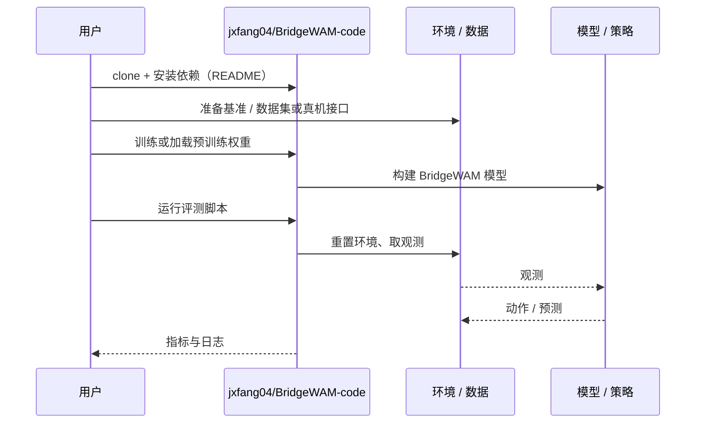

# BridgeWAM（arXiv:2610.14746）

**BridgeWAM**（*BridgeWAM: Bridging Video and Action Experts via Latent Bridge Queries*，[arXiv:2610.14746](https://arxiv.org/abs/2610.14746)，[代码](https://github.com/jxfang04/BridgeWAM-code)）来自 [具身智能小站 2026-10-14 盘点](../../sources/blogs/wechat_embodied_station_41_papers_streamingwam_2026-10-14.md)，属「世界模型与记忆」组。

## 一句话定义

**用潜在桥接查询汇聚视觉、语言与本体信息，动作专家按需读取，避免视频与动作专家逐层密集耦合。**

## 英文缩写速查

| 缩写 | 英文全称 | 简要说明 |
|------|----------|----------|
| WAM | World Action Model | 世界动作模型 |
| LBQ | Latent Bridge Query | 潜在桥接查询 |
| MoE | Mixture of Experts | 专家混合 |

## 为什么重要

- 视频专家与动作专家密集耦合代价高；只传递动作所需信息更省。
- 开源结论：**已开源**（步骤 2.5，2026-10-14）。仓库可达。
- 同期同组工作见 [流式动作块与世界模型记忆：具身智能小站 10-14 期 41 篇阅读坐标](../overview/embodied-station-2026-10-14-41-papers-technology-map.md)。

## 核心机制

| 项 | 内容 |
|----|------|
| **arXiv** | [2610.14746](https://arxiv.org/abs/2610.14746) |
| **开源** | **已开源** |
| **要点** | latent bridge queries；含泛化与延迟分析。轻量动作头不代表整体轻量。 |
| **文内指标** | 以原文为准。 |

## 源码运行时序图

以下为按仓库入口（`jxfang04/BridgeWAM-code`）推断的通用运行链路；入库日仅核实仓库可达，未逐文件阅读，具体脚本名以 README 为准。

## 实验与评测

- 以原文为准。
- **读法：** 本页为索引级摘要，依据公众号转述的官方摘要与仓库信息整理；逐项数字与 baseline 以原文 PDF 为准。

## 与其他工作对比

- 横向索引见 [流式动作块与世界模型记忆：具身智能小站 10-14 期 41 篇阅读坐标](../overview/embodied-station-2026-10-14-41-papers-technology-map.md)；同 arXiv 不重复造页。

## 结论

**WAM 的视频–动作接口应窄而可控：桥接查询是一种可行的信息瓶颈。**

1. 开源边界：**已开源** — 仓库可达。
2. 核心机制：latent bridge queries；含泛化与延迟分析。轻量动作头不代表整体轻量。
3. 复现与选型前核对任务协议、硬件与基准口径，勿直接横比公众号摘录数字。

## 关联页面

- [world-action-models](../concepts/world-action-models.md)
- [generative-world-models](../methods/generative-world-models.md)
- [vla](../methods/vla.md)
- [embodied-station-2026-10-14-41-papers-technology-map](../overview/embodied-station-2026-10-14-41-papers-technology-map.md)

## 参考来源

- [bridgewam_latent_bridge_queries_arxiv_2610_14746.md](../../sources/papers/bridgewam_latent_bridge_queries_arxiv_2610_14746.md)
- [wechat_embodied_station_41_papers_streamingwam_2026-10-14.md](../../sources/blogs/wechat_embodied_station_41_papers_streamingwam_2026-10-14.md)
- [arXiv:2610.14746](https://arxiv.org/abs/2610.14746)

## 推荐继续阅读

- [arXiv PDF](https://arxiv.org/pdf/2610.14746)
- [https://github.com/jxfang04/BridgeWAM-code](https://github.com/jxfang04/BridgeWAM-code)
