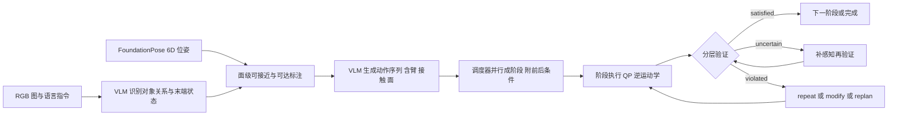

# Bridging Task Planning and Execution（arXiv:2611.12409）

**论文：** *Bridging Task Planning and Execution for Language-Conditioned Bimanual Manipulation*（[arXiv:2611.12409](https://arxiv.org/abs/2611.12409)，意大利技术研究院 HHCM 与热那亚大学；项目页标注 Humanoids 2026，[项目页](https://advrhumanoids.github.io/bridging-planning-execution/)）。原文归档见 [sources 归档](../../sources/papers/bridging-planning-execution-bimanual_arxiv_2611_12409.md)。文章未给代码，项目页也未见代码链接。

## 一句话定义

**零样本 VLM 双臂操作框架：把「每个物体面能否接近、能否可达」写进场景图，让规划同时决定做什么和怎么接触；动作并行成带前后条件的阶段，失败时由分层验证器先局部修复、不行再重规划。**

## 英文缩写速查

| 缩写 | 英文全称 | 简要说明 |
|------|----------|----------|
| VLM | Vision-Language Model | 视觉语言模型，本文用于场景理解、规划、验证（零样本，无训练） |
| VLA | Vision-Language-Action | 视觉语言动作策略；本文作为相关工作对照，不使用 |
| IK | Inverse Kinematics | 逆运动学，用来判断某接近位姿是否可达（III-B） |
| QP | Quadratic Programming | 二次规划，执行层的 IK 模块基于 QP（IV-A） |
| SR | Success Rate | 20 次执行中成功的百分比（表 III） |
| CENTAURO | 轮腿混合人形平台 | IIT 的轮腿混合双臂机器人，本文实验平台（IV-A） |
| 6D pose | 6D 物体位姿 | 位置加朝向，由 FoundationPose 估计（III-B） |

## 为什么重要

- 语义关系（如「在右边」）说不出末端能否伸进去；论文 IV-B.1 显示在物体并排的场景里，只靠符号关系的规划器成功率 0%，加上面级可接近 / 可达后升到 50% 到 85%（表 III）。
- 把前后条件挂在阶段上，使失败能对应到被违反的条件，从而选最小代价的恢复；论文称这主要带来效率（查询数）而非成功率（IV-B.1）。
- 对「何时局部修复、何时重规划」给出一套可复述的规则（repeat / modify / replan），可对照动作块（action chunk）类策略的重规划频率问题，但本文是符号阶段级，不是学习策略的动作块。

## 核心原理与流程总览

- **场景图（III-B）：** G = (V, R)，V 为物体与末端节点，R 为 on top of / right of / in front of / grasped by 等关系；物体用有向包围盒，六个面相对机器人坐标系命名；假设物体可由一对平行面夹持，需要特定把手抓取的物体（如马克杯）不在范围内（III-A）。
- **规划（III-C）：** 动作 a = (action, target, mode, contact, side)，原语 grasp / place / push / release；目标被挡时先考虑替代抓取方向，再生成搬移遮挡物的动作，搬移距离满足同一末端间隙阈值。
- **调度（III-D）：** 按物体交互、空间约束、末端分配判断兼容性，得到阶段序列 S；每阶段有局部目标和原子谓词前后条件。
- **验证与恢复（III-E，表 II）：** 条件三值；前条件被违反则直接 replan；后条件被违反则结合两张场景图和历史 L 选择：有进展但未完成选 repeat，可归因于动作参数选 modify（Action Revision VLM 改 mode / contact / side），阶段不再适用、证据不足或局部策略不支持选 replan；超过尝试次数 abort。三者重新调用的模块逐级变大。

## 工程实践

- **平台（IV-A）：** CENTAURO，双臂各 6 自由度，Dagana 末端；关节参考由 QP 逆运动学计算；基座全程静止；头载 RealSense D435 RGB。
- **VLM：** 默认 Gemini Robotics-ER 1.6；表 IV 换成 GPT-o3、GPT-5.2。
- **九个场景（图 3，表 III）：** 规划类（Stacked Boxes、Boxes Aside、Bottles on Box、Fragile Box、Long Horizon）、动态适应（Scene Update）、恢复类（Bottle Failure、Push Failure、Stacked Boxes w/ Failure），每场景 20 次，相同初始配置；恢复类的失败为人为注入（项目页）。
- **基线（IV-B.1）：** 非执行感知 + 二元验证、执行感知 + 二元验证、完整框架，三者共享骨干、指令、原语与底层执行。
- **关键数字（表 III）：** Boxes Aside 0% / 75% / 85%；Fragile Box 0% / 70% / 70%；Long Horizon 0% / 35% / 50%；Bottles on Box 70% / 90% / 95%；Push Failure 15% / 85% / 95%（依次为三种配置）。查询数：Bottle Failure 10 降到 8.1；Push Failure 10 降到 9.1（IV-B.1）。每次恢复决策平均查询：repeat 1、modify 2、replan 3（图 5）。
- **模块级（表 III 右）：** 执行调度 SR 在 9 个场景中 7 个为 100%；Long Horizon 的规划 SR 67%，延迟 31.78 s。
- **并行调度（图 6）：** 执行时间降 40%（Bottles on Box）与 11%（Long Horizon），阶段 5 到 3 与 9 到 8；论文说明这不是 20 次均值。
- **复现：** 无公开代码，提示词与完整实现细节本页不可核；本页未运行任何代码。

## 与文章说法的核对

对照公众号文章《机器人动作块太长，什么时候该重新规划？》（2026-11-11 的 53 篇论文速览）对本文的描述：「把场景语义、可行性约束和阶段前后条件带入双臂任务规划，执行失败时局部修复。真机桌面任务展示了闭环价值；机器人基座保持固定，不能外推为全身移动操作。」

| 文章说法 | 核对结果 |
|----------|----------|
| 场景语义、可行性约束、阶段前后条件进入规划 | 吻合：III-B（语义关系加面级可接近 / 可达）、III-D（阶段前后条件） |
| 执行失败时局部修复 | 吻合：III-E 的 repeat / modify 为局部，replan 为全局；局部优先 |
| 真机桌面任务 | 吻合：IV-A 为 CENTAURO 真机，九个桌面场景；论文无仿真实验 |
| 基座固定，不能外推全身移动操作 | 吻合：IV-A「基座全程静止」，V 把联合规划基座运动列为未来工作；可达性只在固定基座位姿下评估 |
| 「闭环价值」 | 部分吻合：闭环验证在恢复类场景有收益，但论文自述分层验证的主要贡献是效率（查询数），成功率提升主要来自执行感知表示（IV-B.1，如 Fragile Box 的 70% 两种执行感知配置相同） |
| 标题与导语谈「动作块」 | 本文不涉及动作块或学习策略，重规划单位是符号阶段；这是文章栏目主题与本文的间接关联（我的判断） |

文章对本文未给出结果数字，因此无数字可对。上表「吻合」均指论文原文能找到出处；未发现文章对本文的事实性错误。

## 局限

- **论文自述：** 假设物体可由一对平行面夹持，需特定把手抓取的物体超出范围（III-A）；可达性仅在固定基座位姿下评估，不可达的面直接丢弃，未来才联合规划基座运动；IK 控制不具备接触丰富的自适应行为，未来可换学习式操作策略；技能集有限（V）。
- **论文自述的失败来源：** 感知与验证的错误来自场景歧义、透视和头载相机视角不佳；Long Horizon 规划难（IV-B.2）。
- **我看到的未验证之处（判断）：** 每场景仅一种初始配置、20 次，未报置信区间；场景与物体种类少（箱子、瓶子、球）；只有一台机器人、一个固定相机；表 IV 只含 3 个场景且 GPT-5.2 仅 5.0%，说明对骨干的敏感性很强（对提示词调整的敏感度论文未说明）；恢复类失败为人为注入，非自然失败；图 6 的效率数字只是代表性样例；执行感知相对基线的比较只与自家消融基线，未与 LABOR、LLM+MAP 等方法做实验对比（表 I 仅为能力对比表）。
- **性质：** 零样本系统论文，无训练，故不涉及数据规模；代码未公开，难以复现。

## 关联页面

- [双臂操作](../tasks/bimanual-manipulation.md)
- [操作任务总览](../tasks/manipulation.md)
- [逆运动学](../formalizations/inverse-kinematics.md)
- [LLM 机器人控制接口](../concepts/llm-robotics-control-interfaces.md)
- [SayCan](../methods/saycan.md)
- [硬件感知 LLM-VLM 零样本任务规划](paper-hardware-aware-llm-vlm-zero-shot-task-planning.md)
- [SayPlan：LLM 场景图规划](paper-sayplan-llm-scene-graph-planning.md)
- [错误恢复与重规划](paper-err-replan-error-recovery.md)

## 参考来源

- [论文原文归档](../../sources/papers/bridging-planning-execution-bimanual_arxiv_2611_12409.md)（arXiv:2611.12409v1 全文通读）
- 项目页：<https://advrhumanoids.github.io/bridging-planning-execution/>

## 继续阅读

- [arXiv 摘要页](https://arxiv.org/abs/2611.12409)
- 论文引用的相关工作：SayCan、SayPlan、ExploreVLM、LABOR、LLM+MAP、DoReMi、REFLECT、AHA（见论文参考文献）
