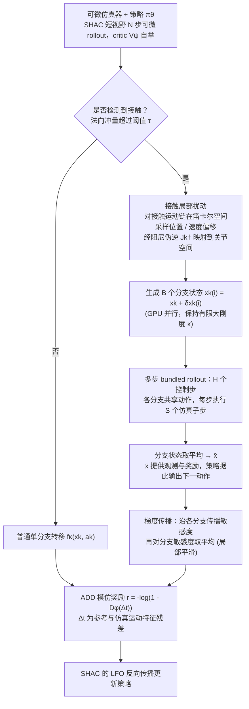

# Bundled Contact Gradients: Stabilizing Differentiable Simulation for Deployable Dynamic Tasks

该方法处理可微仿真强接触事件附近梯度不稳定的问题。

## 英文缩写速查

| 缩写 | 英文全称 | 简要说明 |
|---|---|---|
| RL | Reinforcement Learning | 利用交互反馈优化机器人策略。 |
| Sim2Real | Simulation-to-Real | 将仿真训练或验证迁移至实体机器人。 |
| WBC | Whole-Body Control | 协调机器人全身自由度与任务约束。 |

## 为什么重要

该方法处理可微仿真强接触事件附近梯度不稳定的问题。 评读时应将问题、观测条件与执行接口一并记录，避免从单个演示或指标外推能力。

## 流程总览

图依据：论文 §III-D、§IV-A 至 §IV-D / Alg.1、Fig.2

## 方法栈

只在强接触邻域聚合接触相关梯度，以改善轨迹优化中的梯度信号。

## 实验与评测

文章讨论数值稳定与动态任务部署；复现需分开核验梯度方差、偏差和最终任务效果。

## 与其他工作对比

不等于消除接触模型误差；稳定梯度不自动保证真实动力学正确。

## 工程实践

当前归档仅核实到arXiv入口，未核实可运行官方代码。

## 源码运行时序图

**不适用**：当前没有核实到该论文的可运行官方训练、推理或部署入口。

## 结论

**一句话总判：** 该方法处理可微仿真强接触事件附近梯度不稳定的问题。

1. 核对方法实际改变的是数据、表征、规划、控制还是评测。
2. 只把论文覆盖的任务、平台与扰动范围当作证据。
3. 复现前确认代码、权重、数据许可和硬件依赖状态。

## 局限与风险

不等于消除接触模型误差；稳定梯度不自动保证真实动力学正确。 当前导读以用户提供的文章和预印本题录为索引；详细配置与结果应核对论文全文。

## 关联页面

- [Day 6 导读](../overview/humanoid-motion-intelligence-day6-engineering-deployment.md)
- [Sim2Real](../concepts/sim2real.md)

## 参考来源

- [Day 6 原文归档](../../sources/blogs/humanoid_motion_intelligence_day6_engineering_deployment_2026_10_07.md)
- [arXiv:2609.30951](https://arxiv.org/abs/2609.30951)
- [arXiv PDF](https://arxiv.org/pdf/2609.30951)：已通读方法部分（实验与附录以略读为准）：§III-D SHAC、§IV Bundled Contact Gradients（A 至 D）

## 推荐继续阅读

- [Day 6 导读](../overview/humanoid-motion-intelligence-day6-engineering-deployment.md)
