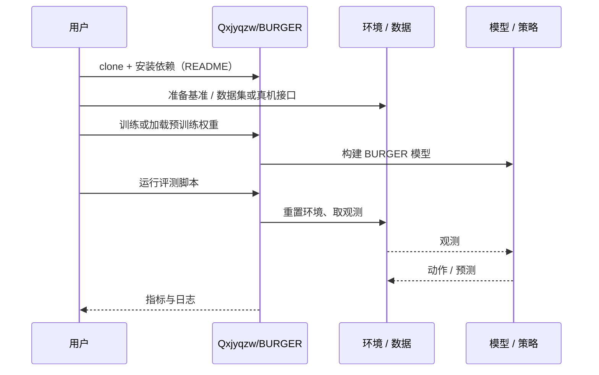

# BURGER（arXiv:2610.40532）

**BURGER**（*BURGER: Benchmarking and Understanding Robotic Generalization via Embodied dRawing*，[arXiv:2610.40532](https://arxiv.org/abs/2610.40532)，[项目页](https://siyingzhao.github.io/BURGER/)，[代码](https://github.com/Qxjyqzw/BURGER)）来自 [具身智能小站 2026-11-03 盘点](../../sources/blogs/wechat_embodied_station_49_papers_sacq_action_aware_quantization_2026-11-03.md)，属「评测、数据与基准」组。

## 一句话定义

**BURGER 用可扩展轨迹生成构建语言条件绘画任务，检验物体组合、空间关系与多解动作。**

## 英文缩写速查

| 缩写 | 英文全称 | 简要说明 |
|------|----------|----------|
| BURGER | BURGER: Benchmarking and Understanding Robotic Generalization via Embodied dRawing | 本文方法 / 基准的简称 |

## 为什么重要

- 用绘画观察语言与动作泛化。实机还展示人类干预下的响应，适合细分泛化失败来源。
- 开源结论：**已开源**（步骤 2.5，2026-11-03）。仓库可达（git ls-remote）。项目页 HTTP 200。
- 同期同组工作见 [动作感知量化、失败定位与可验证自主：具身智能小站 11-03 期 49 篇阅读坐标](../overview/embodied-station-2026-11-03-49-papers-technology-map.md)。

## 核心机制

| 项 | 内容 |
|----|------|
| **arXiv** | [2610.40532](https://arxiv.org/abs/2610.40532) |
| **开源** | **已开源** |
| **要点** | BURGER 用可扩展轨迹生成构建语言条件绘画任务，检验物体组合、空间关系与多解动作。 |
| **文内指标** | 公众号转述：实机还展示人类干预下的响应，适合细分泛化失败来源。 |

## 源码运行时序图

以下为按仓库入口（`Qxjyqzw/BURGER`）推断的通用运行链路；入库日仅核实仓库可达，未逐文件阅读，具体脚本名以 README 为准。

## 实验与评测

- 公众号转述：实机还展示人类干预下的响应，适合细分泛化失败来源。
- **读法：** 本页为索引级摘要，依据公众号转述的官方摘要与仓库信息整理；逐项数字与 baseline 以原文 PDF 为准。

## 与其他工作对比

- 横向索引见 [动作感知量化、失败定位与可验证自主：具身智能小站 11-03 期 49 篇阅读坐标](../overview/embodied-station-2026-11-03-49-papers-technology-map.md)；同 arXiv 不重复造页。

## 结论

**用绘画观察语言与动作泛化：实机还展示人类干预下的响应，适合细分泛化失败来源。**

1. 开源边界：**已开源** — 仓库可达（git ls-remote）。项目页 HTTP 200。
2. 核心机制：BURGER 用可扩展轨迹生成构建语言条件绘画任务，检验物体组合、空间关系与多解动作。
3. 复现与选型前核对任务协议、硬件与基准口径，勿直接横比公众号摘录数字。

## 关联页面

- [simulation-evaluation-infrastructure](../concepts/simulation-evaluation-infrastructure.md)
- [vla](../methods/vla.md)
- [manipulation](../tasks/manipulation.md)
- [embodied-station-2026-11-03-49-papers-technology-map](../overview/embodied-station-2026-11-03-49-papers-technology-map.md)
- [具身大模型评测基准选型闭环](../queries/embodied-eval-benchmark-selection-loop.md) — 本页可归入其 ③ 策略任务成功率评测层：用语言条件绘画拆分物体组合、空间关系与多解动作，防止把单一成功率当成「泛化能力」而不细分泛化失败来源。

## 参考来源

- [burger_arxiv_2610_40532.md](../../sources/papers/burger_arxiv_2610_40532.md)
- [wechat_embodied_station_49_papers_sacq_action_aware_quantization_2026-11-03.md](../../sources/blogs/wechat_embodied_station_49_papers_sacq_action_aware_quantization_2026-11-03.md)
- [arXiv:2610.40532](https://arxiv.org/abs/2610.40532)

## 推荐继续阅读

- [arXiv PDF](https://arxiv.org/pdf/2610.40532)
- [项目页](https://siyingzhao.github.io/BURGER/)
- [https://github.com/Qxjyqzw/BURGER](https://github.com/Qxjyqzw/BURGER)
