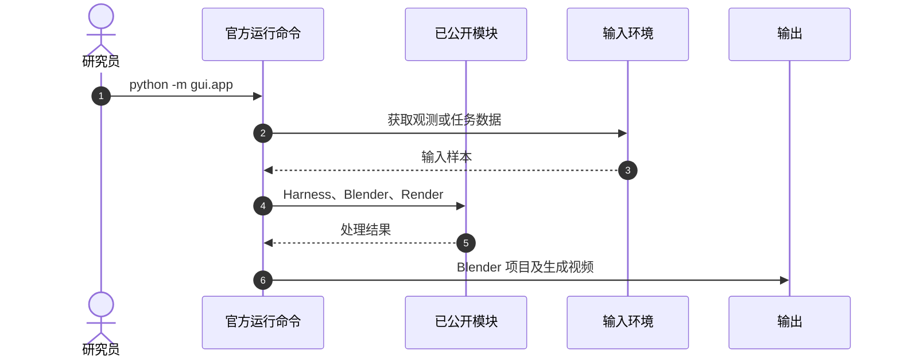

# BWM-Forge: Agentic World Programming for Embodied Intelligence｜BWM-Forge：基于可编辑场景程序的具身视频生成

## 一句话定义

**BWM-Forge：基于可编辑场景程序的具身视频生成**：先用智能体编写可修改的几何、机器人和运动程序，再用视频模型补充真实外观。

## 英文缩写速查

| 缩写 | 英文全称 | 简要说明 |
|---|---|---|
| URDF | Unified Robot Description Format | 统一机器人描述格式 |
| BWM | Behavior World Model | 机器人世界视频生成研究方向 |
| EEF | End Effector | 末端执行器 |

## 为什么重要

先用智能体编写可修改的几何、机器人和运动程序，再用视频模型补充真实外观。 需要结合任务边界、数据/算力条件及作者真实实现来判断，而不是只看展示视频。

## 核心信息

| 证据项 | 官方信息 |
|---|---|
| 论文 | [arXiv:2611.16221v1](https://arxiv.org/abs/2611.16221) |
| 项目页 | [原始页面](https://bwm-forge.github.io/) |
| 源码 | [作者仓库](https://github.com/Lcixs/BWM-Forge)；仅限已发布模块 |

## 核心原理

Preprocessing Agent 校验 URDF 资产与视频/Parquet 轨迹；Building Agent 生成 Blender 场景及动画；Review Agent 核查结构和运动一致性；Rendering Agent 使用代理渲染视频和条件视频模型生成高质量片段。

### 流程总览

该图为研究问题与方法/控制流，实际软件调用须看源码时序图及开放边界。

## 源码运行时序图

官方源仓仅静态核验如下已发布模块运行入口；未执行硬件和训练复现。

## 工程实践

1. 检查输入观察、动作/轨迹表示、数据来源和实验任务的部署条件是否一致。
2. 从[源码核查记录](../../sources/repos/bwm-forge-2611-16221.md)确认公开模块的真实入口、依赖与输出。
3. 将仿真指标、真机成功率、推理延迟与安全/碰撞检查分开汇报。

## 实验与评测

按视频质量、跨视角一致性和人工评审衡量生成；并未证明生成视频会提高机器人策略训练真实成功率。

## 结论

**先用智能体编写可修改的几何、机器人和运动程序，再用视频模型补充真实外观。**

1. 先复核指标口径与论文约束，再比较其他策略或系统。
2. 将作者验证的模块和尚未发布/未复现的模块分开记录。
3. 把误差、失败模式与传感器/真实场景分布偏移作为后续验收依据。

## 局限与风险

依赖 Blender 与独立的视频模型服务；资产与轨迹必须对齐；视频质量分数不能视为真实机器人策略复现。

## 关联页面

- [29 篇具身论文研究地图](../overview/embodied-frontier-29-papers-2026-11-16.md)
- [ManiLadder 操作任务难度分层](./paper-maniladder-manipulation-benchmark.md)

## 参考来源

- [论文原文归档](../../sources/papers/bwm-forge-2611-16221.md)
- [官方项目及开源状态](../../sources/sites/bwm-forge-2611-16221.md)
- [官方源码核对](../../sources/repos/bwm-forge-2611-16221.md)

## 推荐继续阅读

- [原始论文 HTML](https://arxiv.org/html/2611.16221v1)
- [代码仓库](https://github.com/Lcixs/BWM-Forge)
