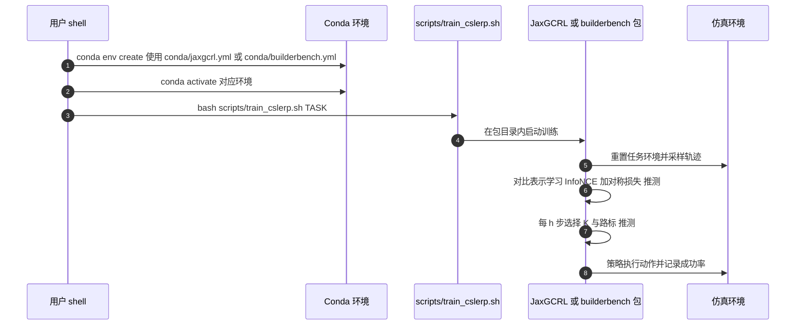

# C-Slerp：超球面对比表示上的规划与探索

**C-Slerp 是一种自监督目标条件强化学习方法：把对比表示当作可复用的构件，在超球面上用球面线性插值闭式生成通向目标的中间路标，无需额外的高层策略或图搜索。**

## 英文缩写速查

| 缩写 | 英文全称 | 简要说明 |
|------|----------|----------|
| CRL | Contrastive Reinforcement Learning | 用对比表示学习目标条件价值的 RL 基线 |
| InfoNCE | Noise-Contrastive Estimation loss | 对比学习常用损失，区分正样本与负样本 |
| Slerp | Spherical Linear Interpolation | 单位球面上的线性插值，沿最短大圆弧插值 |
| HER | Hindsight Experience Replay | 把失败轨迹的实际到达状态重标为目标的经验回放方法 |

## 为什么重要

目标条件 RL 在长程任务上常需要分层规划，而分层通常依赖额外的高层策略或图搜索，代价高、难调。C-Slerp 的想法是让表示本身承担规划：只要表示空间的几何结构设计得当，中间路标就可以用解析插值得到，并且路标数量还能反映目标难度。这对从零开始的自监督学习尤其有吸引力。

## 核心信息

| 项目 | 内容 |
|------|------|
| arXiv | [2610.20409](https://arxiv.org/abs/2610.20409) |
| 作者 | Jonghae Park, Sungil Son, Jonghun Shin, Junseo Lee, H. Jin Kim, Benjamin Eysenbach |
| 机构 | 未核实（arXiv 摘要页与项目页未列作者单位） |
| 数据/平台 | 仿真：BuilderBench（6 个操作任务，含 2/3/4/5/8 层塔与金字塔变体，带夹爪与不带夹爪两套）；JaxGCRL（6 个运动任务，Ant 迷宫与 Humanoid U 型迷宫）。论文称从零开始、无先验数据与奖励 |
| 开源状态 | **已开源**（2026-10-15 核查：仓库公开，MIT 许可；包含官方实现与训练脚本） |
| 代码仓库 | <https://github.com/jonghaepark/c-slerp> |
| 项目页 | <https://jonghaepark.github.io/c-slerp> |

## 核心原理

编码器把状态与状态-动作对映射到单位超球面，可学习的正交旋转建模非对称动力学；路标数 K 由对齐分数的 softmax 决定，每一步再按阈值 ε 选择具体路标，策略以路标为子目标执行。

要点：

- **表示：** 状态编码 ψ(s) 与状态-动作编码 φ(s,a) 都在单位超球面上；f_H 打分用于路标间转移，f_L 打分用于策略。
- **路标：** 均值沿 ψ(s) 到 R^{K+1}ψ(g) 的球面插值给出，方差由夹角解析确定，无需额外网络。
- **训练：** 表示损失为 backward InfoNCE 加对称 InfoNCE；策略以 ψ(g) 为条件最大化 φ(s,a)ᵀψ(g)，与 CRL 相同。

## 源码运行时序图

以下时序对齐仓库的 Conda 环境文件与各包的 `scripts/train_cslerp.sh`，内部函数级调用为推测。

复现路径：按包选择环境，例如 `ant_u5_maze`（JaxGCRL）或 `3-tower`（BuilderBench 带夹爪），在包目录下运行脚本。README 未列独立的评测命令。

## 工程实践

- **环境与依赖：** 两个 Conda 环境，`jaxgcrl` 对应 JaxGCRL，`builderbench` 为两个 BuilderBench 包共用。README 说明代码基于 JaxGCRL 与 BuilderBench（含其直接力变体）构建。
- **任务示例：** JaxGCRL 有 `ant_big_maze`、`ant_u4_maze`、`ant_extreme_maze`、`humanoid`、`humanoid_u_maze` 等；BuilderBench 有 `2-tower` 至 `8-tower`、`4-pyramid` 等。
- **关键超参数：** 路标数上限 K_max、softmax 温度 η、阈值 ε（实验取值未核实）、重规划间隔 h。
- **调试指标：** 成功率学习曲线；K 与路标索引随训练的变化（论文有可视化）。

## 实验与评测

论文以学习曲线为主，并给出消融。数值表未在本页核实，以下为定性结论。

- **主对比：** 与 CRL、RIS、Online HIQL、L3P、SAC+HER 比较；论文称 C-Slerp 是唯一在所有带夹爪叠方块任务上成功的方法。
- **单目标探索：** Ant Big Maze 与 Ant U4 Maze 上 C-Slerp 优于全部基线，除 CRL 与 L3P 外的基线均为 0。
- **消融：** 自适应 K 优于任何固定 K；自适应路标选择优于固定 i；网络深度、表示维度与 ε 也做了扫描。

## 结论

**一句话总判：表示的几何结构可以替代部分分层规划的工程代价，但收益主要出现在长程、多方块的任务上。**

1. **路标可以闭式计算** — 超球面参数化使 slerp 直接给出路标，省去高层策略与图搜索。
2. **自适应路标数比固定值更稳** — 消融显示固定 K 明显变差，路标数应随目标难度变化。
3. **收益随任务难度放大** — 方块数增加或使用夹爪时差距拉大；2-tower 与 Ant Big Maze 等较短任务上与部分基线相当。
4. **代码已经开源，便于验证** — 官方仓库含两套环境的训练脚本，可以直接核对论文结论。
5. **数值细节仍需对照正文表格** — 本页未核实具体成功率数字，引用时应回到论文原文。

## 与其他工作对比

| 方法 | 规划方式 | 与 C-Slerp 的差异 |
|------|----------|-------------------|
| CRL | 对比表示 + 直接策略 | C-Slerp 额外用表示组合生成路标 |
| HIQL 类分层方法 | 高层策略生成子目标 | C-Slerp 不需要单独的高层策略 |
| L3P、RIS | 不同的子目标或重标注机制 | 论文在相同基准上对照 |
| SAC+HER | 通用离策略 RL 加目标重标注 | 基线之一，在长程任务上多数失败 |

相关综述见 [目标条件学习类别](../overview/bfm-category-02-goal-conditioned-learning.md)。

## 局限与风险

- 评测集中在仿真的操作与运动基准，未包含真实机器人实验。
- 自适应 K 与阈值 ε 引入额外超参数，ε 的取值与敏感性在本页未核实。
- 对于较短、较简单的任务，方法优势不明显，不应期望全面超越。
- 论文中的表示几何假设（超球面、正交旋转）可能限制其对更复杂动力学的适用性（推测）。

## 关联页面

- [强化学习](../methods/reinforcement-learning.md)
- [SAC](../methods/sac.md)
- [分层强化学习](../methods/hierarchical-reinforcement-learning.md)
- [目标条件学习类别（BFM）](../overview/bfm-category-02-goal-conditioned-learning.md)

## 参考来源

- [C-Slerp 来源归档](../../sources/papers/c_slerp_arxiv_2610_20409.md)
- [公众号综述摘录（31 篇论文）](../../sources/raw/wechat_embodied_station_robot_31_papers_2026-10-15.md)

## 推荐继续阅读

- [arXiv:2610.20409 — Hyperspherical Contrastive Representations Unlock Planning and Exploration](https://arxiv.org/abs/2610.20409)
- [C-Slerp 官方代码](https://github.com/jonghaepark/c-slerp)
- [C-Slerp 项目页](https://jonghaepark.github.io/c-slerp)
