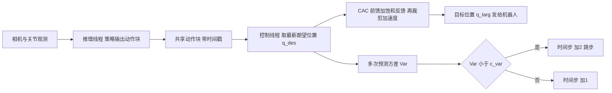

# CAC 异步执行：控制感知指令生成（arXiv:2611.11089）

**Control-Aware Command Generation for Asynchronous Control and Action Inference with Vision-Based Policies towards Fast Execution**（Osa、Ota，[arXiv:2611.11089](https://arxiv.org/abs/2611.11089)）。收录于公众号《机器人动作块太长，什么时候该重新规划？》（2026-11-11）第 17 条。

## 一句话定义

**不动策略训练，只改「策略输出到机器人指令」这一层：用带速度前馈、饱和反馈和加速度裁剪的 CAC 把异步到来的不连续动作块变成平滑目标位置，让推理线程与控制线程并行，再按多次预测的方差决定是否跳步加速。**

## 英文缩写速查

| 缩写 | 英文全称 | 简要说明 |
|------|----------|----------|
| CAC | Control-Aware Command Generation | 本文的指令生成：式 6、7，跟踪期望位置并限制加速度 |
| ACT | Action Chunking Transformer | 输出动作块的模仿学习策略，本文主要实验对象（84M 参数，§1） |
| OpenVLA-OFT | OpenVLA with Optimized Fine-Tuning | OpenVLA 的微调方案，本文用于第二组实验（§5） |
| VLA | Vision-Language-Action | 视觉-语言-动作模型 |
| Sync / Async | Synchronous / Asynchronous | 推理与控制串行 / 并行（多线程，§4.2） |

## 为什么重要

- 视觉策略的执行速度常被动作推理耗时卡住（摘要）；作者的论点是不改策略，只设计「策略输出到机器人指令」的执行层，就能同时拿到速度与平滑（§6，作者自述）。
- 与仅适用于扩散 / 流匹配策略的 Real-Time Chunking 互补：ACT 与 OpenVLA-OFT 都不是扩散或流匹配（§5），RTC 不适用（作者判断）。

## 核心原理与流程总览

- **CAC（§4.1）：** 期望位置序列 q_des 由模型推出，实际发给机器人的是 q_targ。更新为前馈项 (q_des(t+1) − q_des(t)) 加反馈项 k·sat(q_des(t) − q_targ(t), δ)，再把 Δq_targ 限制在上一步 Δq 加 [a_min, a_max] 内。附录 A.1：|e|>δ 时误差线性衰减，否则指数衰减（连续时间分析）。
- **异步（§4.2）：** 控制线程不等推理，有新块就用，没有就沿用旧块；延迟最多容忍 n_chunk 步。
- **自适应跳步（§4.3，式 8）：** 同一时间步被多次推理预测出的动作，逐维方差之和小于 c_var（固定 0.2，附录 A.2）就一步走两个时间步，否则走一个。
- **与 ACT 时序集成的关系：** ACT 本身用指数权重对多次预测加权平均（式 4）；异步 OpenVLA-OFT 实验也使用时序集成（§5.2）。

## 实验结果（作者报告）

| 项 | 数值 | 出处 |
|----|------|------|
| 设置 | 真机 ALOHA，3 任务，每任务 50 条示教，3 种子 × 10 次 | §5、附录 B.1 |
| ACT 成功率 box/case/pen | Sync 100/100/30%；Async 100/100/63.3%；CAC+Async 100/100/70%；+Skip 86.7/100/0%；+Adaptive 96.7/100/83.3% | 表 1 |
| ACT 执行时间 box/case/pen（s） | Sync 16.2/34.4/52.6；Async 11.0/21.8/33.4；Adaptive 8.6/19.2/34.4；Skip 7.2/12.9/- | 表 2 |
| 作者概括 | Adaptive 执行时间为 Sync 的 53–63% | §5.1 |
| OpenVLA-OFT（仅 pen storage） | 成功率 8/10、9/10、8/10；任务时间 49.0、52.6、44.7 s | 表 3 |
| OpenVLA-OFT 等待时间 | 约 18.5 s/episode 降到不足 0.8 s | §5.2 |
| 平滑性 | CAC 显著降低加速度与 jerk（图 7、8，仅图示） | §5.1、§5.2 |

要点：pen storage 上 Async 本身就把成功率从 30% 提到 63.3%，作者解释为动作变快后抓握更稳（§5.1，「plausible explanation」，未做对照验证）。

## 工程实践

- **源码开放：** 已开源，[TakaOsa/ACT_Async](https://github.com/TakaOsa/ACT_Async)（README 静态核对，2026-11-11）：`imitate_episodes_async.py` 放进 ACT 仓库与 `imitate_episodes.py` 同目录；`run_aloha_eval_async_cac.py` 放进 OpenVLA-OFT 的 `experiments/robot/aloha/`，需先起其 policy server。README 称自适应跳步只实现于 ACT；README 警告 OpenVLA-OFT 异步不带 CAC 可能不稳，需随时准备停机。
- **源码运行时序图：** 不适用于本页深度（未运行、未逐行读源码，仅读 README 入口）。
- **复现硬件：** ALOHA 双臂，Xeon w5-2455X + RTX A5000（附录 B.2）。
- **需要调的量（论文中出现）：** k、δ、a_min、a_max、c_var（0.2）、chunk 大小（ACT 的 README 示例 50，OpenVLA-OFT 25）。k、δ、a_min、a_max 的具体取值论文正文未给出（本页已通读正文与附录，未找到），推测在代码里。

## 与文章说法的核对

文章原文（第 17 条）：「用控制感知指令生成平滑异步更新的目标，再利用不确定性调整部分动作跳步。真机操作表明推理与控制解耦值得优化；跳步机制的验证范围主要针对 ACT。」

| 文章说法 | 核对 |
|----------|------|
| 控制感知指令生成平滑异步更新的目标 | 与 §4.1 一致 |
| 利用不确定性调整跳步 | 论文用的是多次预测的方差（式 8），作者称其反映动作可靠性；不是模型自带的不确定性估计，这是我的读法 |
| 真机操作 | 属实，ALOHA 真机，无仿真（§5） |
| 推理与控制解耦值得优化 | 作者结论即此（§6）；证据面窄：三个任务、一个机器人、两个简单任务成功率已 100%，拉开差距的只有 pen storage |
| 跳步验证主要针对 ACT | 属实：表 1、2 的 Skip / Adaptive 只在 ACT，OpenVLA-OFT 只测 Sync、CAC+Sync、CAC+Async（表 3），README 也只在 ACT 实现自适应跳步 |
| 文章未提及 | OpenVLA-OFT 部分只有一个任务、10 次试验，且 Async 并未提高成功率；论文未与 RTC 或通用平滑方法比（§6 自认） |

## 局限

- **作者承认（§6）：** 无与通用平滑方法、Real-Time Chunking 等的比较；OpenVLA-OFT 用默认参数、chunk 未调；更大模型未测。
- **我看到的未验证之处：** 
  - 表 2 中 pen storage 的 Skip 时间为「-」（该配置成功率 0%），正文「53–63%」区间按表算 pen storage Adaptive 为 34.4/52.6 约 65%，略超此区间（我的算术）。
  - 简单任务成功率饱和，成功率差异仅 pen storage 一项；3 种子 × 10 次的统计未给显著性检验。
  - 跳步方差阈值 c_var 固定 0.2，未做敏感性分析；单次均匀跳步（Skip）失败，Adaptive 在 box handover 上仍略低于不跳步（96.7% 对 100%）。
  - 式 8 中均值的求和下标与方差求和下标写法不一致（k=0..n−1 与 k=1..n），应是笔误（推测）。
  - OpenVLA-OFT 的 CAC+Sync 比 Sync 任务时间更长（52.6 对 49.0 s，表 3）。
  - 只有 ALOHA 一个平台，尚无仿真或其他机器人结果。
- 论文标注 Preprint；README 称为 NeurIPS 2026 Robot Learning Workshop 论文，未经我独立核实。

## 结论

**把执行层当成一个跟踪控制问题来设计，是一个低成本、可插拔的加速思路，但目前证据只覆盖一台 ALOHA、三个任务。**

1. 真正起作用的指标是任务执行时间与平滑性（加速度 / jerk），ACT 上执行时间降到 Sync 的约 53–65%（表 2，自算）。
2. 异步本身带来速度，CAC 负责让异步可用，尤其是 OpenVLA-OFT：无 CAC 时严重振荡（§5.2）。
3. 均匀跳步会掉点甚至失败，需要方差门控（表 1）；该机制只在 ACT 上验证。
4. 成功率结论除 pen storage 外信息量低（多数已 100%）。
5. 部署读法：先上异步加 CAC，再考虑跳步；跳步前先在自己任务上调 c_var。

## 关联页面

- [动作分块（Action Chunking）](../methods/action-chunking.md)
- [ACT](../entities/paper-act.md)
- [OpenVLA](../entities/paper-openvla.md)
- [Real-Time Chunking](../entities/paper-real-time-chunking.md)
- [ALOHA](../entities/aloha.md)
- [模仿学习](../methods/imitation-learning.md)
- [VLA](../methods/vla.md)

## 参考来源

- [论文归档：CAC 异步执行](../../sources/papers/cac-async-act_arxiv_2611_11089.md)
- [arXiv:2611.11089](https://arxiv.org/abs/2611.11089)
- [官方仓库 TakaOsa/ACT_Async](https://github.com/TakaOsa/ACT_Async)

## 推荐继续阅读

- [arXiv PDF](https://arxiv.org/pdf/2611.11089v1)
- [ACT 原论文与代码](https://github.com/tonyzhaozh/act)
- [OpenVLA-OFT 仓库](https://github.com/moojink/openvla-oft)
