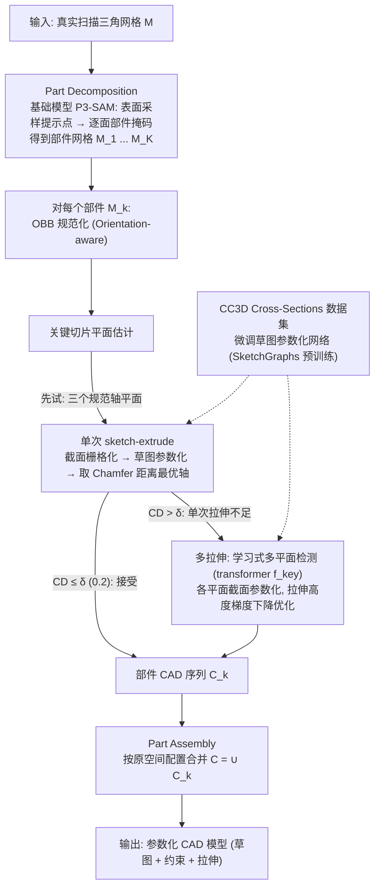

# CADonatello: Towards Real-World Multi-Part 3D CAD Reconstruction

**一句话定义：** 先对真实三维扫描分割部件，再用截面驱动草图参数化和拉伸重建各部件。

## 流程总览

图依据：论文 Proposed Method（Part Decomposition / Part Reconstruction / Part Assembly）/ Fig.2

## 英文缩写速查

| 缩写 | 英文全称 | 简要说明 |
|------|----------|----------|
| CAD | Computer-Aided Design | 计算机辅助设计 |
| 3D | Three-Dimensional | 三维 |
| CC3D | CC3D Cross-Sections | 论文提出的截面配对数据集 |

## 方法

先对真实三维扫描分割部件，再用截面驱动草图参数化和拉伸重建各部件。

## 评测与结果

论文引入 CC3D Cross-Sections，将真实扫描截面图与配准 CAD 的参数化草图配对，以适应扫描噪声。

## 结论

这项研究提供了多部件参数化 CAD 重建的一个具体方案。

- 复现时先对齐论文任务和评测条件。
- 将方法收益与实际应用条件分开验证。
- 对代码及数据的可用性持续跟踪。

## 与其他工作对比

- **vs [Zero-to-CAD](./zero-to-cad.md)：** Zero-to-CAD 从多视角图像生成 CadQuery 构造程序，依赖大规模合成程序数据；CADonatello 以 **真实三维扫描** 为输入，先分割部件再按截面草图与拉伸逐部件重建，更针对扫描噪声。
- **表示边界：** 二者都输出参数化 CAD，但 CADonatello 局限于截面–拉伸可表达的部件，自由曲面类形状需其他表示。

## 源码运行时序图

不适用：尚未核实可运行的官方实现。

## 局限与开放状态

结果依赖部件分割与截面、拉伸表示；未核实到官方代码或数据下载入口。

## 关联页面

- [相关方法](./zero-to-cad.md)
- [机器人仿真三层结构](../concepts/robot-simulation-three-layers.md)

## 参考来源

- [论文归档](../../sources/papers/cadonatello_arxiv_2610_33575.md)
- [arXiv PDF](https://arxiv.org/pdf/2610.33575)：已通读方法部分（实验与附录以略读为准）：摘要、Introduction、Problem Statement、Proposed Method 全部小节、CC3D Cross-Section Dataset、Experiments 起首的评测数据集设定

## 推荐继续阅读

- [论文原文](https://arxiv.org/abs/2610.33575)
