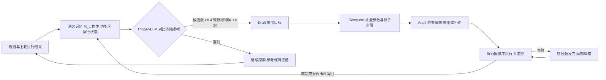

# CAFE：无实例指令的闭环自主任务构想与执行（arXiv:2611.12983）

**CAFE**（*Closed-Loop Autonomous Task Formulation and Execution without Instance-Specific Instructions*，[arXiv:2611.12983](https://arxiv.org/abs/2611.12983)，南京师范大学 / 天普大学）。原文归档见 [sources 归档](../../sources/papers/cafe-closed-loop-task-formulation_arxiv_2611_12983.md)。

## 一句话定义

在预定义的清洁、安全、收纳整理三类任务下，机器人不被告知目标物或动作序列，而是由共享的在线语义记忆驱动：规则触发的 Trigger-LLM 决定何时规划，Draft / Complete / Audit 三个 LLM 角色依次提出目标、补全执行细节、检查依赖，执行结果再写回记忆指导纠错与后续任务发现（摘要、III 节）。

## 英文缩写速查

| 缩写 | 英文全称 | 简要说明 |
|------|----------|----------|
| CAFE | Closed-Loop Autonomous Task Formulation and Execution | 本文框架 |
| Tri-LLM | Draft / Complete / Audit three-role LLM | 论文三段式规划管线 |
| Trigger-LLM | Trigger LLM | 对比当前记忆与冻结参考，决定是否放行规划 |
| UC | goal (subtask) coverage | 高层子任务覆盖率，式 8 |
| sUC | atomic-step coverage | 原子步骤覆盖率 |
| CUR | constraint satisfaction rate | 硬约束（先后、依赖、互斥）满足率 |
| SR | success rate | 成功执行动作数 / 计划动作数 |
| GCR | goal completion rate | 论文定义为 UC × SR |
| AI2-THOR | AI2 interactive household simulator | 评测仿真环境 |

## 为什么重要

- 多数 LLM 规划工作围绕「给定目标」展开（II-A）；CAFE 研究「观察到什么就该做什么」，把任务发现、计划成形、结果回写接成循环（I）。
- 作者自述的贡献：以记忆为中心的自主闭环、选择性准入 + 任务状态上下文 + Draft-Complete-Audit 的任务构想机制、含多组对照与真机演示的评测（I 贡献列表）。
- 机构：南京师范大学、天普大学（schema/institutions.json 中无对应 id，故 tags 未放机构）。

## 核心原理与流程总览

- **记忆（III-A）：** M_t = {O_t, Z_t, X_t}；功能区由地标包围体投影到地面得到矩形 B_z，区内物体归入该区，否则延后归属。
- **准入（III-B）：** 每个 heartbeat 比较 M_t 与冻结参考 M̂_t；Trigger 条件为估计的去重候选数 K̂_t ≥ 4 或新增物体 ≥ 20，触发后参考更新为 M_t；失败纠错不经过该门。
- **三段式（III-C）：** Draft 输出 ⟨动作, 目标, 区域, 前置, 优先级, 几何⟩；Complete 单次前向，只加原子步骤，不加新目标；Audit 检查语义一致、物体可得、安全、前置连贯，排序优先安全、完整、符合人类偏好。
- **执行与反馈（III-D）：** 目标缺失、前置违反或效果异常则中止该序列并请求纠错；完成任务上下文用于后续去重。
- **评测设定（IV-A）：** 12 个 AI2-THOR 场景（浴室、客厅、厨房），每任务重复 10 次，记忆从空开始，类别先验与技能固定，不训练不微调；DeepSeek-V3、Qwen3-Max、Gemini-2.5-Pro 三种骨干。

## 关键结果（均为仿真，Table II / III，Qwen3-Max）

| 项目 | 数值 | 出处 |
|------|------|------|
| Complex：Tri-LLM GCR | 0.789，Single-LLM 0.446，ProgPrompt（适配）0.464 | Table II，IV-B |
| Complex：Tri-LLM UC / CUR / sUC / SR | 0.922 / 0.815 / 0.892 / 0.856 | Table II |
| 去 Complete，Complex sUC | 0.892 → 0.194，UC 仍 0.905 | Table III(a)，IV-C |
| 去 Audit，Complex CUR | 0.815 → 0.515 | IV-C，Table III(b) |
| 去功能区，Complex sUC | 降至 0.375 | Table III(c) |
| Compound GCR：连续 / 仅失败 / 无反馈 | 0.889 / 0.802 / 0.684 | Table III(d) |
| Complex 触发：选择性 5 s 对穷举 5 s sUC | 0.892 对 0.618；规划轮数 6.5 → 3.1（降 52.3%） | IV-D，Table III(e) |
| 无示例 Complex sUC：Tri-LLM 对 Single-LLM | 0.634 对 0.392；加示例 Tri-LLM 0.892 | IV-D，Table III(f) |

## 工程实践

- **代码（静态读 README，未运行）：** 仓库自述为评审用匿名材料；入口 `CAFE/aithor2/main_with_depth.py`，依赖通过两份 requirements 安装，需自备 LLM API 凭据。仓库其余内容与项目页未核实。
- **复现要点（论文 IV-A）：** 所有变体共享观测接口、动作空间、输出格式、执行器、触发与反馈基础设施和步数预算；ProgPrompt 以语义记忆替换其显式任务指令。
- **提示词依赖：** 示例（demonstrations）显著抬高 sUC（Complex 0.634 → 0.892，IV-D），说明原子步骤展开部分依赖提示词示例，作者自己也这么解读。
- **真机（IV-E，Fig. 5）：** LimoCobot 上展示存放钥匙、优先清理水渍并收纳、丢垃圾、抓取失败后重试；仅有时间线 / 俯视图类定性呈现。

## 与文章说法的核对

对照公众号文章对该论文的描述（"通过语义记忆与任务准入检查，在预设任务类别内主动发现待办，再把规划、执行和复核接成闭环。仿真之外给出真机轨迹，但任务自主性仍受预定义类别约束"）：

| 文章说法 | 核对 | 出处 |
|----------|------|------|
| 语义记忆 + 任务准入检查 | 一致：在线语义记忆，Trigger-LLM 规则准入（候选 ≥ 4 或新增物体 ≥ 20） | III-A / III-B |
| 在预设任务类别内主动发现待办 | 一致：清洁、安全、收纳整理三类，固定发现提示词 | 摘要，III-A |
| 规划、执行、复核接成闭环 | 一致：Draft-Complete-Audit 后接执行监控并写回记忆；「复核」对应 Audit（规划前）与 Monitor（执行后）两处 | III-C / III-D |
| 仿真之外给出真机轨迹 | 一致，但应限定：真机为 LimoCobot 的三段定性轨迹，无真机成功率等量化指标；定量结果全部在 AI2-THOR | IV-E，Fig. 5 |
| 任务自主性受预定义类别约束 | 一致，作者在结论明确承认依赖预定义类别与已有机器人技能 | V |
| 文章未提的限定 | 评测对象是 LLM 规划（技能 / 动作空间固定，不训练）；骨干为 API 大模型；Audit 与 Complete 的提示词示例影响明显 | IV-A，IV-D |

文章未给具体数字，因此无数字对不上之处。

## 局限

**论文自己承认：**
- 只在预定义任务类别与已有的机器人技能下运作；泛化到更广场景与多机器人协作留作未来工作（V）。
- Table I 把自身与其他系统的能力比较限定为「报告的能力」，并注明 CAFE 使用预定义发现类别（Table I 注）。

**我看到的未验证 / 需谨慎之处（作者自述之外的判断）：**
- 定量评测全在 AI2-THOR 仿真，真机只有三条定性轨迹，真机成功率、失败率、重复次数均未报告。
- 参考子任务集、参考原子步骤集与硬约束由作者构造并对机器人隐藏（IV-A）；UC / sUC / CUR 的好坏取决于这些参考的完备性，论文未讨论参考集的构造与一致性。
- 基线较少：Single-LLM（作者自设）与适配版 ProgPrompt；Table I 中其他方法未在同一环境实验对比。ProgPrompt 在 Compound CUR 上高于 Tri-LLM，说明三段式并非全面占优（IV-B）。
- 摘要说 GCR「高于被评基线」，但对照实验（Table III）只用 Qwen3-Max 单一骨干，结论在其他骨干上是否成立论文未给出；Table III 未见方差或置信区间（我读到的文本中没有）。
- 提示词示例（few-shot）对 sUC 影响很大（IV-D），不同示例设计的敏感性未评估。
- 仓库为匿名评审材料，项目页与源码本次未核验，可复现性为「推测」尚待检验。

## 与其他工作对比

| 工作 | 关注点 | 与 CAFE 的区别 |
|------|--------|----------------|
| [SayCan](./paper-saycan.md) | 给定语言指令，用技能可行性给子任务打分 | 「供给目标」路线，任务来自人；CAFE 由语义记忆自己发现待办（II-A） |
| ProgPrompt（适配版，Table II 基线） | 以程序式提示生成计划 | 作者把其显式指令换成语义记忆；Complex GCR 0.464 对 CAFE 0.789，但 Compound CUR 0.757 高于 CAFE 的 0.725（IV-B） |
| [SayPlan](./paper-sayplan-llm-scene-graph-planning.md) | 大场景图子图检索 + 计划校验 | 同为结构化场景表示驱动规划，但目标仍由指令给出；CAFE 加了触发准入与执行结果回写 |
| [ERR](./paper-err-replan-error-recovery.md) | 具身 VLM 错误恢复评测与训练 | 专攻失败后恢复；CAFE 的纠错是绕过触发门的局部旁路，是闭环的一部分 |

## 结论

**CAFE 表明在预设类别内，「语义记忆 + 选择性触发 + Draft-Complete-Audit 三段式」能让 LLM 规划器在无实例指令时自己提出并执行任务，在 AI2-THOR 上明显优于单 LLM 与适配 ProgPrompt。**

1. Complex 场景 GCR 0.789，对 Single-LLM 0.446、ProgPrompt 0.464（Table II）。
2. 三个角色各管一块：去 Complete 使 sUC 0.892 → 0.194，去 Audit 使 CUR 0.815 → 0.515（Table III）。
3. 选择性触发把规划轮数从 6.5 降到 3.1，同时 sUC 更高（IV-D）。
4. 局限：定量结果全在仿真、真机只有定性轨迹，任务类别预定义，参考集由作者构造，消融只用单一骨干且对 few-shot 示例敏感。

## 关联页面

- [SayCan](../entities/paper-saycan.md)：给定指令下的技能可行性打分，CAFE 称其为「供给目标」路线的代表（II-A）。
- [PaLM-E](../entities/paper-palm-e-embodied-language-model.md)：同属 CAFE related work 中的「供给目标」路线。
- [Proactive AI 超级智能体](../entities/paper-proactive-ai-superintelligent-agents.md)：主动发现任务这一方向的相邻页面（关联为本页判断，非论文引用）。
- [错误恢复与重规划](../entities/paper-err-replan-error-recovery.md)：执行失败后的重规划，对照 CAFE 的失败纠错旁路。
- [SayPlan 场景图规划](../entities/paper-sayplan-llm-scene-graph-planning.md)：LLM + 场景图的规划，对照 CAFE 的记忆驱动规划。
- [具身语义认知地图](../concepts/embodied-semantic-cognitive-map.md)：语义记忆的背景概念。
- [具身三层控制架构](../concepts/embodied-three-layer-control-architecture.md)：高层任务构想与低层执行的分层视角。

## 参考来源

- [sources 归档：CAFE 论文](../../sources/papers/cafe-closed-loop-task-formulation_arxiv_2611_12983.md)
- [arXiv:2611.12983](https://arxiv.org/abs/2611.12983)
- 代码仓库 README（静态阅读）：https://github.com/submissionforpaper/CAFE-Closed-Loop-Autonomous-Task-Formulation-and-Execution-without-Instance-Specific-Instructions

## 继续阅读

- [arXiv PDF](https://arxiv.org/pdf/2611.12983v1)
- 论文项目页：https://submissionforpaper.github.io/CAFE-Closed-Loop-Autonomous-Task-Formulation-and-Execution-without-Instance-Specific-Instructions/ （未核实）
