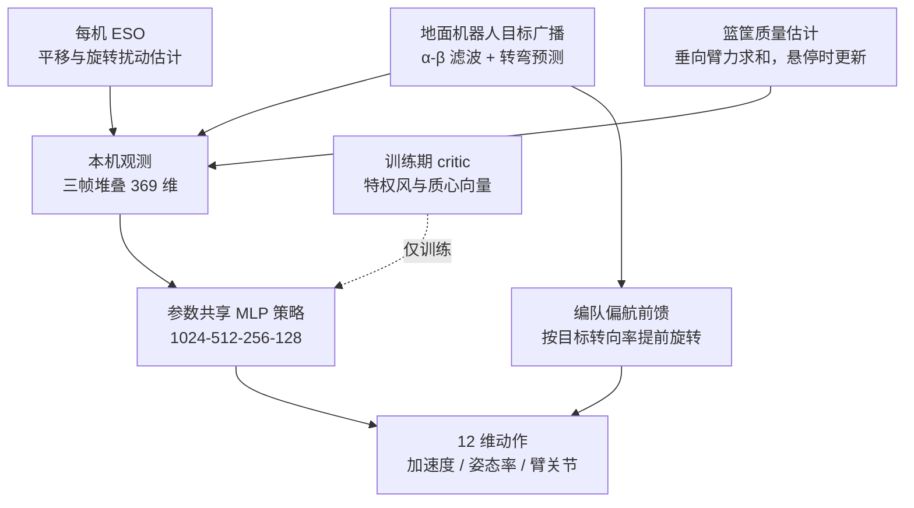

# CALM：多机空中操作的去中心化 MARL 控制

**CALM 为多架带机械臂的无人机共同搬运篮筐并跟踪移动地面机器人提供去中心化控制：参数共享的 MAPPO 策略接收扰动观测、质量估计与目标预测，再叠加按目标转向提前旋转编队的偏航前馈。**

论文 *CALM: Decentralized Control of Cooperative Aerial Manipulation with Multi-Agent Reinforcement Learning*（[arXiv:2610.18425](https://arxiv.org/abs/2610.18425)，[项目页](https://petreric.github.io/CALM/)）。注意：与本库 [paper-bfm-19-calm](./paper-bfm-19-calm.md) 的 CALM 同名不同文，互不相关。

## 英文缩写速查

| 缩写 | 英文全称 | 简要说明 |
|------|----------|----------|
| CALM | Cooperative Aerial Learned Manipulation | 本文控制器（仓库名所示展开） |
| MAPPO | Multi-Agent PPO | 集中训练、分散执行的多智能体 PPO，本文策略训练算法 |
| ESO | Extended State Observer | 每架 UAV 的扩展状态观测器，估计平移 / 旋转扰动 |
| CTDE | Centralized Training, Decentralized Execution | 训练期用带特权扰动信息的 critic，执行期只用本机观测 |
| CoM | Center of Mass | 载荷质心移动是被测扰动之一 |

## 为什么重要

- 多机共载的耦合来自共享载荷，风、质心移动与目标广播噪声会同时扰动全队；单靠模型控制器需精确载荷模型。
- 本文把「扰动估计 + 前馈」作为 RL 策略的输入 / 辅助而非替代，显式处理载荷偏航滞后。
- 对比对象包括缆绳悬吊版本与两种模型控制器，提供了「臂式抓取 vs 缆绳」的同口径比较。

## 核心信息

| 项 | 内容 |
|----|------|
| **机构** | Department of Mechanical and Aerospace Engineering, Politecnico di Torino（论文 HTML）；作者 Jiaxi Huo、Petre Ricioppo、Fausto Francesco Lizzio |
| **平台** | Isaac Lab / Isaac Sim，3 架 UAV，每架带七个驱动关节的双连杆臂（Agilicious 系 UAV 模型）；无硬件实验 |
| **任务** | 搬运篮筐并跟踪移动地面机器人；六类保留轨迹：boustrophedon、circle、figure-8、perimeter、contour、chevron |
| **开源** | **项目页列出代码仓库但无法访问**（2026-10-17 核查）：Code 链接指向 `HUOJIAXI/CALM-Cooperative-Aerial-Learned-Manipulation`，WebFetch 返回 404；项目页 Paper / arXiv 标注 coming soon（推测：页面早于论文上线）；机械臂 CAD 标"开发中" |

## 核心原理

### 流程总览

每架 UAV 以三帧堆叠的 123 维观测（共 369 维）输入共享 MLP 策略，输出 12 维动作（三个加速度参考、滚转 / 俯仰角速率参考、七个臂关节目标，UAV 偏航固定）。观测中包含 ESO 输出、篮筐质量估计、目标相对误差与 K=8 个预览特征。训练时 critic 额外看到 15 维风 / 质心特权向量。

- **前馈：** 偏航前馈使用约 0.15 s 的提前量与 3 s⁻¹ 的偏航率增益，分配零净力的切向加速度；论文 Lemma 1 给出等半径下的分配误差界 ε/r̂。
- **质量估计：** 剪裁到 [0.5, 2.0] kg，1 s 时间常数滤波；团队总线上只共享一个标量。

## 源码运行时序图

**不适用**：2026-10-17 项目页链接的仓库 404，无法核对训练 / 推理入口；论文只说明构建在 Aerial Manipulation Lab 的公开 MARL 协同空中操作代码之上，未给 CALM 自身代码的发布声明。

## 与其他工作对比

| 维度 | CALM（本文） | [Fly-by-Code](./paper-fly-by-code-aerial-manipulation.md) | [保平坦性编队残差学习](./paper-flatness-preserving-quadrotor-formation.md) | [CTDE vs 去中心化 MARL](../comparisons/ctde-vs-decentralized-marl.md) |
|------|------|------|------|------|
| 问题 | 3 架带臂 UAV 共搬篮筐并跟踪移动目标 | 单台空中机械臂的长程操作任务 | 多旋翼紧密编队飞行 | 多智能体 RL 训练范式选型 |
| 控制 / 决策方式 | 参数共享 MAPPO 策略 + ESO + 质量估计 + 偏航前馈 | 编码智能体写任务程序，并写 View / Probe 诊断程序修订 | 学习残差 + 反馈线性化与前馈，5 ms 控制周期 | 集中训练分散执行 vs 完全去中心化 |
| 学习成分 | 端到端 RL 策略，critic 训练期用特权风 / 质心信息 | 不训练策略，依赖 LLM 编码与执行反馈 | 仅学习气动残差，控制律为模型基 | — |
| 实机 | 无，仅 Isaac Lab 仿真 | 仿真程序免改迁移真机 | 有飞行数据（约 28 s） | — |

- **相对 Fly-by-Code：** 二者都在 Isaac Lab 做空中操作，但 Fly-by-Code 解决任务级程序与失败诊断，CALM 解决多机共载的连续低层控制。
- **相对保平坦性编队残差学习：** 后者保留模型基控制、只学干扰残差并有实机数据；CALM 让策略直接输出加速度 / 姿态率 / 关节目标，且尚无实机。
- **相对 CTDE vs 去中心化 MARL：** CALM 属 CTDE（训练期特权 critic、执行期本机观测），但执行时仍依赖团队总线共享目标与质量标量，并非完全去中心化。
- 各文任务与指标不同，数字不可横比；CALM 的 7.68 对 10.95 cm 仅与同平台臂式 Dec-MARL 可比。

## 工程实践

| 项 | 说明 |
|----|------|
| 源码运行时序图 | **不适用**（仓库不可访问） |
| 训练 | MAPPO，γ=0.99，GAE λ=0.95，clip 0.1，2048 并行环境；课程学习 + 域随机化（风、篮筐质量、移动质心、初值、目标运动） |
| 观测器带宽 | 平移 / 旋转 ESO 分别 20、15 rad/s |
| 部署前提 | 团队总线需传目标估计与质量标量，并非完全分布式；论文把动态平均一致性列为后续工作 |
| 硬件 | 无实机；SolidWorks 仅校核硬件设计，硬件验证为后续工作 |
| 开源状态 | 代码链接 404（2026-10-17）；后续恢复需重新核查 |

## 实验与评测

- **保留轨迹平均：** CALM 位置误差 7.68 cm、姿态误差 3.3°；匹配的臂式 Dec-MARL 为 10.95 cm、4.7°。
- **分轨迹（Table II）：** CALM 位置 6.5–8.5 cm、姿态 2.4°–4.4°；Dec-MARL（臂）8.9–13.4 cm、3.7°–6.1°；Dec-MARL（缆绳）约 18–20 cm、19.4°–26.5°（circle 例外为 123.2°）；抓取分配约 51–57 cm、73°–77°；RotorTM 约 72–77 cm、90°–92°（后两者用真值状态）。
- **风扫描：** 各档均低于臂式 Dec-MARL，95% 置信区间不含零；质心偏移 0.20 m 时臂式基线位置略优 0.08 cm。
- **倾角：** CALM 中位倾角在 10 m/s 等效风下由 7.5° 升到 9.5°；缆绳版本达 47°。
- **前馈效果：** 篮筐姿态中位误差降 10%–16%、p90 降 8%–18%，主要在转弯段，位置无一致影响。
- **关节消融：** 七个关节全部断电使位置误差 2.93 倍、姿态误差 5.52 倍。
- **信息链路退化：** 目标广播 / 团队总线降质（速率、延迟、丢包、离群值、0.05 m 定位误差）下，CALM 在位置 5/6、姿态 6/6 条轨迹上领先；摘要称与臂式基线统计持平或更优。

## 结论

**CALM 在仿真里证明了「共享策略 + 扰动观测 + 偏航前馈」能压低共载误差，但全部证据来自 3 机仿真，且代码入口当前不可访问。**

1. **同平台对比才是主结论** — 7.68 对 10.95 cm 是与自适配的臂式 Dec-MARL 比，不是与成熟工程控制器比。
2. **前馈主要改姿态** — 偏航前馈在转弯段降低 10%–16% 姿态误差，对位置无稳定增益。
3. **模型基线处于劣势口径** — 抓取分配与 RotorTM 误差极大，原因含对载荷模型的假设，不宜解读为模型方法一般无效（推测）。
4. **关节主动性很关键** — 断电关节误差成倍上升，说明臂的主动补偿是性能来源之一。
5. **部署前需补三件事** — 实机验证、真正的分布式状态共享、安全保证；论文均列为缺口。

## 局限与风险

- **仅仿真：** 无硬件实验，sim2real 未验证。
- **非完全分布式：** 前馈与质量估计依赖团队总线量。
- **无闭环安全保证：** 论文自述。
- **比较偏差：** 模型基线用真值状态；缆绳试验按种子使用不同回合，与臂式不成配对；风速等效为基于阻力的近似。
- **代码不可访问：** 项目页链接 404（2026-10-17），复现路径不明。

## 关联页面

- [MARL](../methods/marl.md) — 多智能体强化学习总览
- [CTDE 与去中心化 MARL](../comparisons/ctde-vs-decentralized-marl.md) — 集中训练分散执行的取舍
- [PPO](../methods/ppo.md) — MAPPO 的单智能体基础
- [域随机化](../concepts/domain-randomization.md) — 风与载荷随机化的训练背景
- [同名 CALM（人形）](./paper-bfm-19-calm.md) — 同缩写不同论文，避免混淆

## 参考来源

- [calm_arxiv_2610_18425.md](../../sources/papers/calm_arxiv_2610_18425.md) — 论文摘录与开源核查
- [calm-aerial-project.md](../../sources/sites/calm-aerial-project.md) — 项目页归档
- [arXiv:2610.18425](https://arxiv.org/abs/2610.18425) — 原文

## 推荐继续阅读

- [CALM 项目页](https://petreric.github.io/CALM/)
- [CALM 论文 HTML](https://arxiv.org/html/2610.18425v1)
