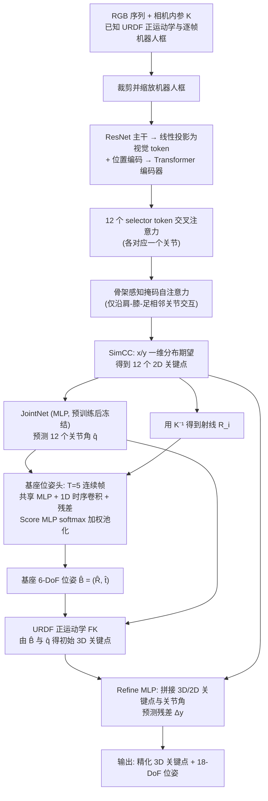

# 相机到四足位姿估计：基于序列图像的外部相机—四足机器人姿态估计

**相机到四足位姿估计**（*Camera-to-Quadruped Robot Pose Estimation from Sequential Images*，[arXiv:2610.36599](https://arxiv.org/abs/2610.36599)）收录于 senlanke「具身运控lab」10-26–10-30 前沿论文动态（人形/四足）。本页依据**周报条目 + arXiv 摘要页**整理，流程图依据论文方法部分（见参考来源），未逐页核对实验数字；指标与结论以论文为准。

## 一句话定义

**相机到四足位姿估计：基于序列图像的外部相机—四足机器人姿态估计——QuadPose 从视频估计六自由度基座位姿和 12 个关节角，并构建首个外部相机四足姿态基准 QuadSyn；推理速度约 33 FPS。**

## 英文缩写速查

| 缩写 | 英文全称 | 简要说明 |
|------|----------|----------|
| RL | Reinforcement Learning | 强化学习 |
| WBC | Whole-Body Control | 全身控制 |

## 为什么重要

- 周报所述待解决的问题：外部单目相机观察四足机器人时，腿部对称、自遮挡和关节持续运动会造成关键点匹配歧义。

## 流程总览

图依据：论文 §3.1–3.3 / Fig.2–4（QuadPose 框架）

## 核心机制

| 项 | 内容 |
|----|------|
| **arXiv** | [2610.36599](https://arxiv.org/abs/2610.36599) · [PDF](https://arxiv.org/pdf/2610.36599) |
| **作者（arXiv）** | Hwang, Seobin, Beom, Ji-Seong, Cho, Yeong-Jun |
| **机构（周报所述，未逐条核实）** | 韩国全南大学 |
| **arXiv 评论栏** | （无） |
| **开源** | arXiv 摘要页与评论未见代码或项目页链接（仅核对 arXiv 摘要页，不代表未发布）（2026-11-02） |
| **周报所述创新点** | QuadPose 从视频估计六自由度基座位姿和 12 个关节角，并构建首个外部相机四足姿态基准 QuadSyn；推理速度约 33 FPS。 |

### arXiv 摘要节选（英文原文）

> Quadruped robots are increasingly deployed in hazardous environments such as disaster response and facility inspection, where external-camera monitoring is essential for safe operation. This setting is challenging because quadrupeds are articulated systems with time-varying leg joints, leg symmetry, and frequent self-occlusions, which make keypoint correspondence ambiguous.

## 源码运行时序图

**不适用**：arXiv 摘要页与评论未见代码或项目页链接（仅核对 arXiv 摘要页，不代表未发布），无可对齐的官方代码流程。

## 实验与评测

- 周报与摘要给出的数字/场景已写入上表「创新点」与摘要节选；其余实验细节、基线与成功率定义请回到论文正文。
- 读法：先对齐任务设定、传感器与成功定义（仿真/真机），再解读 headline 数字，勿跨论文直接比较。

## 与其他工作对比

| 维度 | 读法 |
|------|------|
| **同周对照** | 见 [人形/四足周报技术地图](../overview/senlanke-weekly-2026-10-26-30-humanoid-quadruped-technology-map.md)，按方向浏览同期论文 |
| **开源状态** | arXiv 摘要页与评论未见代码或项目页链接（仅核对 arXiv 摘要页，不代表未发布） |

## 结论

**相机到四足位姿估计：基于序列图像的外部相机—四足机器人姿态估计。**

1. 本页是入库级摘要，复现前请核对论文正文、附录与代码仓库。
2. 指标须连同实验条件解读。
3. 关注 arXiv 版本更新与代码发布。

## 关联页面

- [senlanke-weekly-2026-10-26-30-humanoid-quadruped-technology-map](../overview/senlanke-weekly-2026-10-26-30-humanoid-quadruped-technology-map.md)
- [locomotion](../tasks/locomotion.md)
- [reinforcement-learning](../methods/reinforcement-learning.md)

## 参考来源

- [camera-to-quadruped-pose-estimation_arxiv_2610_36599.md](../../sources/papers/camera-to-quadruped-pose-estimation_arxiv_2610_36599.md)
- [wechat_senlanke_weekly_humanoid_quadruped_2026-10-26_30.md](../../sources/blogs/wechat_senlanke_weekly_humanoid_quadruped_2026-10-26_30.md)
- [arXiv:2610.36599](https://arxiv.org/abs/2610.36599)
- [arXiv PDF](https://arxiv.org/pdf/2610.36599)：已通读方法部分（实验与附录以略读为准）：§1–§6（§3 QuadPose 方法与损失、§4 QuadSyn 数据集、§5 实验含 Harper 真实数据）

## 推荐继续阅读

- [arXiv PDF](https://arxiv.org/pdf/2610.36599)
