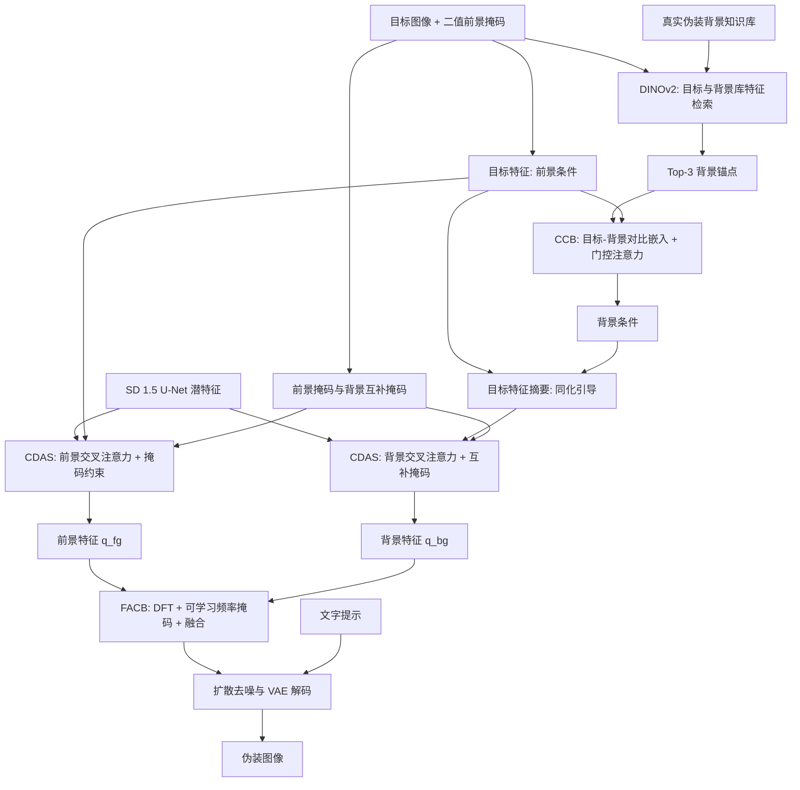

# CamoDreamer：先解耦、后融合的伪装图像生成 / To Blend In, First Decouple: Rethinking Camouflage Image Generation via Context-Decoupled Representations

## 一句话定义

**CamoDreamer** 是一种基于 Stable Diffusion 的**上下文解耦伪装图像生成**方法：用双条件与双潜空间控制流先分别处理物体和背景，再以频域自适应融合实现背景同化，尽量保留目标结构。

## 英文缩写速查

| 缩写 | 英文全称 | 简要说明 |
|---|---|---|
| CIG | Camouflage Image Generation | 生成目标和环境视觉相融的伪装图像 |
| CCB | Contrast-aware Contextual Bridge | 建立物体与背景差异感知的双条件引导 |
| CDAS | Context-Decoupled Assimilation Streams | 分别控制前景和背景潜特征的两路生成 |
| FACB | Frequency-Adaptive Contextual Blend | 可学习高低频权重的双流融合模块 |
| COD | Camouflaged Object Detection | 伪装目标识别/分割下游任务 |
| FID | Fréchet Inception Distance | 生成样本与真实样本特征分布距离 |
| KID | Kernel Inception Distance | 生成样本分布差异指标 |
| DFT | Discrete Fourier Transform | FACB 的频域分解操作 |

## 为什么重要

传统背景引导的风格迁移容易破坏前景形状；以前景为引导的背景补全则可能让背景被目标特征“污染”，出现纹理伪影或颜色失配。CamoDreamer 把问题重新表述为**跨上下文表征泄漏**：不应把两种控制信号直接混入同一条件空间。

对机器人视觉数据工程，本文提供了**掩码约束的合成图像增强**思路，适合研究困难背景下的感知鲁棒性，但没有验证机器人控制与 Sim2Real。

## 核心信息

| 字段 | 已核对事实 |
|---|---|
| 论文 | [arXiv:2607.17768v2（2026-09-13）](https://arxiv.org/html/2607.17768v2)，ACM Multimedia 2026 |
| 报告身份 | 作者仓库 README 标注 **Oral**；作者实验室网站证实 ACM MM 收录，Oral 依据作者 README |
| 作者 | Wenzhuang Wang（王文状）、Yifan Zhao（赵一凡）、Mingcan Ma（马明灿）、Yunlong Che（车云龙）、Haoran Chen（陈浩然）、Ming Liu（刘明）、Jia Li（李甲） |
| 通讯作者 | 赵一凡、李甲 |
| 机构 | 北京航空航天大学（Beihang University）；吉利汽车研究院（Geely Automobile Research Institute）AI Center |
| 论文 DOI | [10.1145/3767308.3835357](https://dl.acm.org/doi/10.1145/3767308.3835357)（用户提供；出版社 PDF 在本次读取环境中未成功打开） |
| 项目仓库 | [fayewong666999/CamoDreamer](https://github.com/fayewong666999/CamoDreamer) |
| 代码开放 | **尚未开放训练/推理源码**；截至 2026-11-11，默认分支只有 README 与图片，README 有合成结果外链 |

## 核心原理

### 输入与背景条件：不是“任意无掩码文生图”

输入为目标图像、目标二值掩码、简短文字提示以及背景知识库。DINOv2 特征对目标和知识库候选进行余弦检索，选择 Top-3 真实伪装背景锚点。接下来，**CCB** 用 ConvNeXt-Tiny 的目标/背景表示差与门控跨注意力构建背景条件，前景仍由目标特征独立引导。

### CDAS：掩码约束的前景/背景双流

前景路让潜特征通过与目标引导的交叉注意力得到 `q_fg`；背景路先将目标摘要与背景条件叠加，再由背景交叉注意力得到 `q_bg`。两路分别由前景掩码与其互补掩码施加空间约束。这样**背景可以“知道目标”但不会直接共用未经区分的引导**。

### FACB：学会在哪里保留纹理与结构

将 `q_fg` 与 `q_bg` 投影后作 DFT，通过可学习高低频掩码、逆变换和注意力获得两路融合权重：

$$
q^f = \beta_1 \odot q^{fg} + \beta_2 \odot q^{bg}.
$$

作者用目标面积相关的权重修正扩散噪声预测损失，减轻小目标被背景像素占比压制的问题；融合表示进入扩散解码端，生成最终伪装图像。

## 流程总览

以下是依据原文 §3.2–3.6、Fig. 2 绘制的**论文方法数据流**，并非上游仓库已经实现的函数图：

## 源码运行时序图

**不适用（截至 2026-11-11）**。作者仓库 `fayewong666999/CamoDreamer@159921e` 只公开 README 和 `asset.jpg`；没有可读取的训练/推理入口、模块源码或权重。README 的预告与合成图片下载不等于可运行代码。因而不能编造 `train.py`、`inference.py` 或虚假的调用时序；代码公布后再核对并补充真正的 Mermaid sequenceDiagram。

## 实验与评测

论文在 LAKE-RED（4,040 张训练图；三类各 6,473 张评估图）上与 11 个方法比较。作者在总体评估上报告：

| 方法 | Overall FID ↓ | Overall KID ↓ |
|---|---:|---:|
| LAKE-RED | 64.27 | 0.0355 |
| FACIG | 52.87 | 0.0229 |
| CT-CIG | 52.88 | 0.0169 |
| **CamoDreamer** | **37.33** | **0.0159** |

相对前述 FID 最佳基线 FACIG，FID 下降 **15.54**（原文 Table 1）。作者又使用合成的 4,040 张图训练 ZoomNet，在 CAMO / COD10K / NC4K 上得到 S-measure **0.702 / 0.757 / 0.795**，比采用 Syn.LAKE-RED 数据训练高 **0.053 / 0.081 / 0.049**（Table 4）。

消融表明去掉 CCB、FACB、目标先验加权后 Overall FID 分别为 **51.60 / 46.52 / 46.84**，对比完整模型 **37.33**。这些仅是作者实验，尚无开放源码的独立复测。

## 结论

**核心收益来自把目标/背景的条件控制先隔离再对齐，而不是直接拼接特征或单纯增加扩散模型容量。**

1. **优先保留物体掩码：** 本文依赖明确的前景区域；“无掩码生成”不是已验证能力。
2. **检索背景要针对伪装域：** DINOv2 + 对比嵌入的 CCB 利用背景知识库减少伪影。
3. **双路注意力不是完全割裂：** 背景分支仍通过目标摘要获取受控同化信号。
4. **融合频段要自适应：** 去掉 FACB 后 FID 由 37.33 升至 46.52。
5. **判断数据增强价值还要看下游：** 作者报告 ZoomNet 增益，但不能代替机器人真机感知评估。
6. **复现仍待源码：** 文中给出超参数不等于已发布训练/推理工程。

## 工程实践

原文 §4 / 附录 A 提供的**论文参数**：SD v1.5、512×512、AdamW（1e-4）、300 epochs、总 batch 320、前景重权 λ=3、50 步 EulerDiscreteScheduler、CFG 7.5；用 Qwen2-VL 为输入图生成简短描述。模块插入 U-Net 中间 8×8 与解码 16×16/32×32/64×64 特征层，作者称 FP16 可以单卡 RTX 3090 24GB 训练。

完整模型 **172.22M 可训练参数、1,238.45M 总参数**，作者表 6 报 **6.1872 s/图**；CT-CIG 可训练参数为 106.22M，因此不要把它称作所有基线中“最小”模型。暂无官方依赖锁定、训练命令、推理脚本与权重；上述参数不能直接拼出可验证复现命令。

## 局限与风险

- 原文附录 B.3 明示：开放域特别显眼或结构复杂的目标，可能出现局部失真或细节缺损。
- 掩码、检索库与图像提示质量可能限制跨场景泛化；FID/KID 不是物理真实性或隐藏效果的完整评价。
- 下游仅用作者设定的 ZoomNet 与 COD 数据协议验证；不应直接推断自动驾驶、机器人导航或真机感知性能。
- 尚不能按官方代码运行训练、推理或验证性能，开放状态可能随后改变。

## 与其他工作对比

| 方法 | 生成思路 | CamoDreamer 区别 |
|---|---|---|
| LAKE-RED | 潜空间背景知识检索辅助扩散 | 不只检索和直接融合背景特征，还用 CCB 对比差异与 CDAS 双流 |
| FACIG | 前景条件引导的生成保真 | 更强调背景与目标的条件隔离、频域协调 |
| CT-CIG | 文字条件控制扩散 | 额外显式分离前景/背景空间控制，但也依赖掩码与背景知识库 |
| [生成式数据增强](../methods/generative-data-augmentation.md) | 面向罕见视觉场景合成 | CamoDreamer 是伪装图片的特定合成模型，不输出机器人轨迹 |

## 关联页面

- [目标检测](../methods/object-detection.md) — 该论文以 ZoomNet 的伪装目标识别/分割指标验证合成数据价值。
- [生成式数据增强](../methods/generative-data-augmentation.md) — 合成困难背景训练样本的思路。
- [扩散模型](../concepts/diffusion-model.md) — SD v1.5 潜空间扩散基础。

## 参考来源

- [arXiv v2 全文与附录精读归档](../../sources/papers/camodreamer_arxiv_2607_17768v2.md)
- [作者项目仓库及开源状态](../../sources/repos/fayewong666999-camodreamer.md)
- [arXiv 官方 HTML v2](https://arxiv.org/html/2607.17768v2)
- [北航 CVTEAM 已收录论文列表](https://cvteam.buaa.edu.cn/papers.html)

## 推荐继续阅读

- [作者 CamoDreamer 项目/README](https://github.com/fayewong666999/CamoDreamer)
- [ACM 出版社条目（用户提供）](https://dl.acm.org/doi/10.1145/3767308.3835357)
