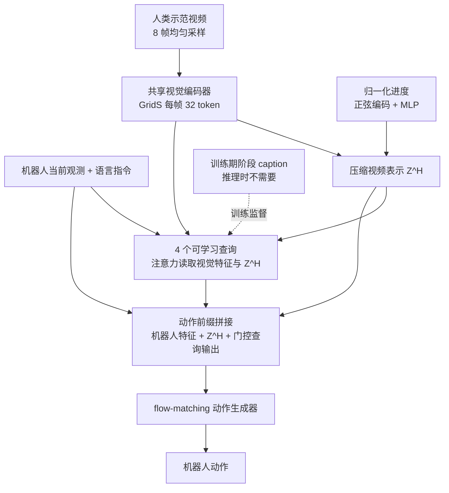

# CapPro：单段人类视频引导的 VLA 新任务适配

**CapPro**（论文 *One-shot Human Video-Guided Adaptation for Vision-Language-Action Models*，[arXiv:2610.19746](https://arxiv.org/abs/2610.19746)，[项目页](https://chenqi20020226.github.io/cappro-project/)）是一种让预训练 VLA 只凭一段人类示范视频适配未见任务的方法：视频被压缩为阶段感知的紧凑表示，再经视频条件模块注入动作生成的上下文。

## 英文缩写速查

| 缩写 | 英文全称 | 简要说明 |
|------|----------|----------|
| VLA | Vision-Language-Action | 视觉-语言-动作策略；本文在其上做视频条件适配 |
| LoRA | Low-Rank Adaptation | 本文对基座 VLM 主干与动作专家做低秩适配 |
| VLM | Vision-Language Model | 基座策略的视觉语言主干（约 2B） |
| GridS | Grid Sampler（论文命名） | 可学习视觉 token 采样器，每帧保留 32 个空间 token；全称以论文为准，未核实 |
| CapPro | — | 本文方法名；阶段描述（caption）监督的视频提示适配 |

## 为什么重要

- **降低新任务的示范成本：** 传统 VLA 适配需要目标任务机器人遥操作数据与微调；只看人类视频就能适配，若成立则把「示范」从机器人数据转向人类数据。
- **把视频当作指导而非轨迹：** 作者主张人类视频提供任务执行要点，不要求逐帧复现人手轨迹，这与直接模仿视频的路线不同。
- **需要谨慎读数字：** 仿真提升明显，但真机结果与 zero-shot 边界仍需更多证据。

## 核心信息

| 项 | 内容 |
|----|------|
| **机构** | 未核实（arXiv 与项目页均未列机构） |
| **作者** | Qi Chen, Yuwei Wu, Quan Chen, Kunpeng Gao, Jin Chen, Che Sun, Zhi Gao, Yunde Jia |
| **平台 / 数据** | 仿真 RoboTwin（39 任务）；真机 7 任务（机器人型号未核实）；输入为一段人类 egocentric 视频 |
| **基座** | 预训练 π0.5，LoRA 适配 |
| **开源** | **待发布**（截至 2026-10-15，项目页 Paper / Code / Demo 均为 "Coming soon"，未列仓库） |

## 核心原理

### 流程总览

### 机制要点

- **阶段感知视频表示：** 每帧 token 加入归一化进度编码；训练时用阶段 caption 监督查询输出，结构化 mask 防止查询直接读取 caption token。
- **视频条件适配：** 查询输出经可学习标量门控后拼入动作前缀，原动作生成器不改结构。
- **训练损失：** 动作损失 + 0.1 × caption 损失；推理只需视频与当前观测。

## 工程实践

| 项 | 建议 |
|----|------|
| 复现入口 | 代码未发布；先关注项目页更新，不要依赖未公开实现 |
| 数据准备 | 目标任务只需一段人类视频；训练阶段需要阶段 caption 与进度标签 |
| 适配评估 | 同时报告源任务与未见目标任务，避免只看目标任务提升 |
| 任务难度 | 物体、交互或组合变化大时效果明显下降（A2 29.0%、B 20.7%），规划时预留更多示范 |
| 源码运行时序图 | **不适用**（截至 2026-10-15 代码标注为待发布，无可运行仓库） |

## 实验与评测

- **仿真（RoboTwin，每设定 100 次 rollout）：** 成功率 %（据 arXiv HTML v1 摘录，数值待与原表复核）

| 方法 | Source | A1 | A2 | B | Overall |
|------|--------|----|----|---|---------|
| π0.5 | 64.4 | 34.5 | 2.5 | 4.0 | 28.4 |
| Direct Video Prefix | 43.5 | 25.2 | 1.5 | 1.4 | 19.1 |
| CapPro | 68.9 | 44.8 | 29.0 | 20.7 | 42.6 |

- **消融：** 摘录中组件消融（GridS、阶段 caption、caption 损失、查询引导、进度嵌入、直接视频路径）的逐项数值未核实。
- **真机：** 7 个任务各 5 次试验；摘录中逐方法列无法可靠区分，真机对比数值未核实。

## 结论

**一句总判：视频提示适配在仿真未见任务上有明显增益，但证据仍是单一基准、代码未发布，不宜当作通用 one-shot 能力。**

1. **增益主要来自未见目标任务** — RoboTwin 上 overall 由 28.4% 提到 42.6%，源任务仅小幅提升（64.4% → 68.9%）。
2. **直接拼接视频 token 不够** — Direct Video Prefix 整体低于 π0.5（19.1%），说明阶段压缩与查询机制是必要的（以论文消融为准）。
3. **增益随任务偏移变大而收窄** — A2 与 B 两组即便相对提升较大，绝对成功率仍低（29.0%、20.7%）。
4. **依赖预训练的视频条件模块** — 新任务不需要机器人示范，但前提是视频条件模块已在大规模数据上训练，这部分成本需要单独计入。
5. **真机结论待核实** — 7 个真机任务中部分任务为 0/5，逐方法数据未能可靠核对，选型前应以项目页更新为准。

## 与其他工作对比

| 对照 | 差异读法 |
|------|----------|
| [VLA 方法总览](../methods/vla.md) | CapPro 不改动作生成器结构，只改视频条件输入；属于适配层而非新 VLA 架构 |
| [Robot In-Context Learning](../concepts/robot-in-context-learning.md) | 同样用示范提示改变行为，但 CapPro 用人类视频且不做推理期上下文拼接示范，而是注入动作前缀 |
| [PACE 阶段进度 VLA](./paper-pace-phase-progress-vla.md) | 都利用阶段/进度信号；CapPro 把进度用于视频 token 编码，并以 caption 辅助监督 |

## 局限与风险

- **代码与权重未发布：** 无法复现，结论只能基于论文报告。
- **单一仿真基准为主：** RoboTwin 之外的泛化与真机细节未充分公开。
- **人类视频域差：** 人手外观、视角与物体差异对视频编码器的影响未在摘录中讨论。
- **阶段 caption 依赖：** 训练需要带阶段描述的数据，标注成本与质量会影响适配效果。

## 关联页面

- [VLA](../methods/vla.md) — 本文的基座范式
- [Robot In-Context Learning](../concepts/robot-in-context-learning.md) — 示范提示适配的相关问题
- [PACE 阶段进度 VLA](./paper-pace-phase-progress-vla.md) — 阶段/进度信号的另一条路线
- [Foundation Policy](../concepts/foundation-policy.md) — 预训练策略适配的背景

## 参考来源

- [cappro_arxiv_2610_19746.md](../../sources/papers/cappro_arxiv_2610_19746.md) — 论文摘录与开源核查
- [arXiv:2610.19746](https://arxiv.org/abs/2610.19746) — 原文（v1，2026-10-14）

## 推荐继续阅读

- [CapPro 项目页](https://chenqi20020226.github.io/cappro-project/) — 方法与演示（代码待发布）
- [arXiv HTML v1](https://arxiv.org/html/2610.19746v1) — 方法与实验细节
