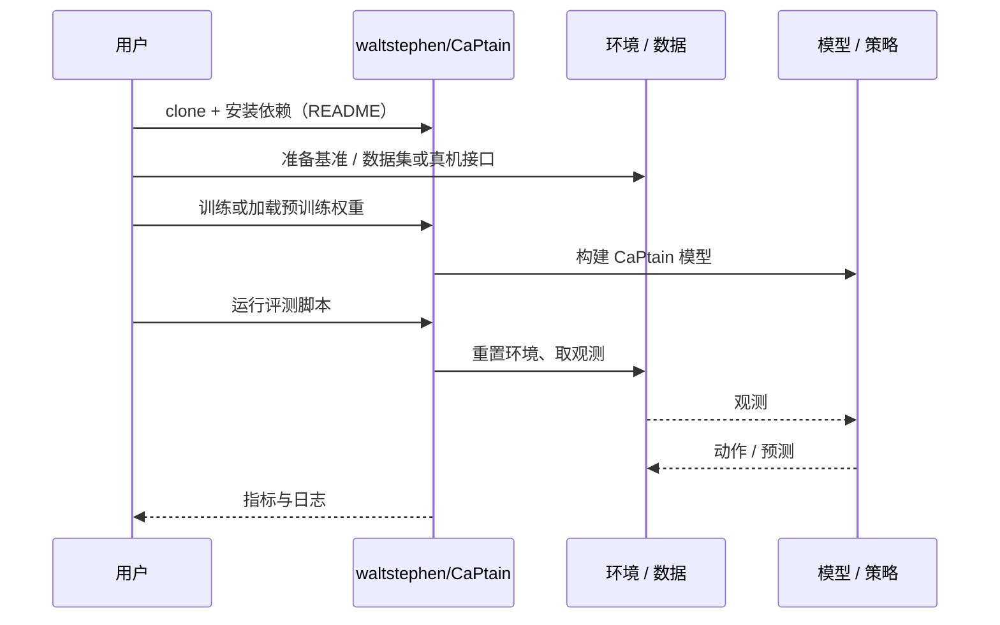

# CaPtain（arXiv:2610.40799）

**CaPtain**（*CaPtain: A Pipeline for Post-Training Code-as-Policy Robot Agents*，[arXiv:2610.40799](https://arxiv.org/abs/2610.40799)，[项目页](https://waltstephen.github.io/captain/)，[代码](https://github.com/waltstephen/CaPtain)）来自 [具身智能小站 2026-11-03 盘点](../../sources/blogs/wechat_embodied_station_49_papers_sacq_action_aware_quantization_2026-11-03.md)，属「策略学习与部署」组。

## 一句话定义

**CaPtain 将监督微调与多轮强化学习用于代码策略智能体，使小型视觉语言模型学习调用机器人接口。**

## 英文缩写速查

| 缩写 | 英文全称 | 简要说明 |
|------|----------|----------|
| CaPtain | CaPtain: A Pipeline for Post-Training Code-as-Policy Robot Agents | 本文方法 / 基准的简称 |

## 为什么重要

- 训练能写控制代码的机器人智能体。需区分训练阶段特权信息与测试时可用观测。
- 开源结论：**已开源**（步骤 2.5，2026-11-03）。仓库可达（git ls-remote）。项目页 HTTP 200。
- 同期同组工作见 [动作感知量化、失败定位与可验证自主：具身智能小站 11-03 期 49 篇阅读坐标](../overview/embodied-station-2026-11-03-49-papers-technology-map.md)。

## 核心机制

| 项 | 内容 |
|----|------|
| **arXiv** | [2610.40799](https://arxiv.org/abs/2610.40799) |
| **开源** | **已开源** |
| **要点** | CaPtain 将监督微调与多轮强化学习用于代码策略智能体，使小型视觉语言模型学习调用机器人接口。 |
| **文内指标** | 公众号转述：需区分训练阶段特权信息与测试时可用观测。 |

## 源码运行时序图

以下为按仓库入口（`waltstephen/CaPtain`）推断的通用运行链路；入库日仅核实仓库可达，未逐文件阅读，具体脚本名以 README 为准。

## 实验与评测

- 公众号转述：需区分训练阶段特权信息与测试时可用观测。
- **读法：** 本页为索引级摘要，依据公众号转述的官方摘要与仓库信息整理；逐项数字与 baseline 以原文 PDF 为准。

## 与其他工作对比

- 横向索引见 [动作感知量化、失败定位与可验证自主：具身智能小站 11-03 期 49 篇阅读坐标](../overview/embodied-station-2026-11-03-49-papers-technology-map.md)；同 arXiv 不重复造页。

## 结论

**训练能写控制代码的机器人智能体：需区分训练阶段特权信息与测试时可用观测。**

1. 开源边界：**已开源** — 仓库可达（git ls-remote）。项目页 HTTP 200。
2. 核心机制：CaPtain 将监督微调与多轮强化学习用于代码策略智能体，使小型视觉语言模型学习调用机器人接口。
3. 复现与选型前核对任务协议、硬件与基准口径，勿直接横比公众号摘录数字。

## 关联页面

- [vla](../methods/vla.md)
- [imitation-learning](../methods/imitation-learning.md)
- [reinforcement-learning](../methods/reinforcement-learning.md)
- [llm-robotics-control-interfaces](../concepts/llm-robotics-control-interfaces.md)
- [embodied-station-2026-11-03-49-papers-technology-map](../overview/embodied-station-2026-11-03-49-papers-technology-map.md)

## 参考来源

- [captain_arxiv_2610_40799.md](../../sources/papers/captain_arxiv_2610_40799.md)
- [wechat_embodied_station_49_papers_sacq_action_aware_quantization_2026-11-03.md](../../sources/blogs/wechat_embodied_station_49_papers_sacq_action_aware_quantization_2026-11-03.md)
- [arXiv:2610.40799](https://arxiv.org/abs/2610.40799)

## 推荐继续阅读

- [arXiv PDF](https://arxiv.org/pdf/2610.40799)
- [项目页](https://waltstephen.github.io/captain/)
- [https://github.com/waltstephen/CaPtain](https://github.com/waltstephen/CaPtain)
