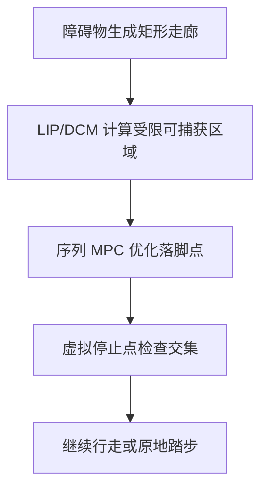

# 可捕获性约束的安全走廊足步规划（Capturability-Aware Footstep Planning in Cluttered Environments: A Recursively Feasible Sequential MPC on Axis-Aligned Safe Corridors）

**机构：** 雅典国家技术大学、加州大学伯克利分校、特拉华大学、Athena 研究中心  
**论文：** [arXiv:2611.10169](https://arxiv.org/abs/2611.10169)

## 一句话定义

**基于 LIP 的 COM 与 DCM 推导多步 capture region，由障碍物生成轴对齐矩形安全走廊，利用相交区域中当前足步、COM 和虚拟停止点作为切换许可，再求解递归可行的序列足步 MPC。虚拟停止点是可行证书，不等于实际每次必须停止。**

## 英文缩写速查

| 缩写 | 英文全称 | 简要说明 |
|---|---|---|
| LIP | Linear Inverted Pendulum | 固定高度倒立摆 |
| DCM | Divergent Component of Motion | 发散运动分量 |
| MPC | Model Predictive Control | 预测时域优化足步 |

## 为什么重要

几何路线能避障，却可能无法让人形机器人停稳；论文要求相邻走廊切换时保留可捕获的未来状态。

## 核心原理

基于 LIP 的 COM 与 DCM 推导多步 capture region，由障碍物生成轴对齐矩形安全走廊，利用相交区域中当前足步、COM 和虚拟停止点作为切换许可，再求解递归可行的序列足步 MPC。虚拟停止点是可行证书，不等于实际每次必须停止。

### 流程总览

以下根据论文方法整理，箭头表示控制/数据流向。

## 实验与评测

IV-A 比较多种障碍布局的 MPC 可行性和运行开销；IV-B 使用 Digit 穿过带两道动态门的办公室环境。闭门时减速并原地踏步，打开后继续通过。结果限于 LIP 规划模型和文中场景，不代表全身非线性动力学通用安全保证。

## 与其他工作对比

基于 LIP 的 COM 与 DCM 推导多步 capture region，由障碍物生成轴对齐矩形安全走廊，利用相交区域中当前足步、COM 和虚拟停止点作为切换许可，再求解递归可行的序列足步 MPC。虚拟停止点是可行证书，不等于实际每次必须停止。 与传统同方向方法的主要区别见以上控制接口及研究动机；跨论文统计结果不具有相同测试协议。

## 结论

**可捕获性约束的安全走廊足步规划 的实际价值在于明确研究对象与实验边界，而非脱离原文场景比较单个成功率。**

1. 安全走廊不仅要几何相交，还必须满足可捕获性。
2. 堵门时保持原地踏步是失败回退，不等于到达目标。
3. 递归可行的理论前提不应扩大到真实机体所有扰动。

## 工程实践

实际验证时先检查任务接口与坐标系，再按论文试验复现主指标；记录 LIP / DCM / MPC 相关状态、控制采样与异常回退路径，不能以论文中的概念图代替可执行模块证明。

**源码开放状态：** 本次核对的论文未发现可核实的作者算法运行入口，不臆测代码接口。

## 源码运行时序图

**不适用**：尚无可确认的官方完整算法运行入口；以上主干流程是论文方法图，不是虚构源码调用。

## 局限与风险

依赖 LIP 固定质心高度、矩形避障和有限步长假设；缺少复杂真实环境长时成功率。未在论文中发现已公开的官方可运行规划源码。

## 关联页面

- [humanoid locomotion](../tasks/humanoid-locomotion.md)
- [whole body control](../concepts/whole-body-control.md)
- [classical control](../../roadmap/depth-classical-control.md)
- [11.09–11.13 29 篇总览](../overview/humanoid_quadruped_2026_11_09_13_29_papers.md)

## 参考来源

- [arXiv v1 原文核对归档](../../sources/papers/capturability-footstep-mpc_arxiv_2611_10169.md)
- [arXiv v1 HTML 全文](https://arxiv.org/html/2611.10169v1)

## 推荐继续阅读

- [论文 PDF](https://arxiv.org/pdf/2611.10169v1)
