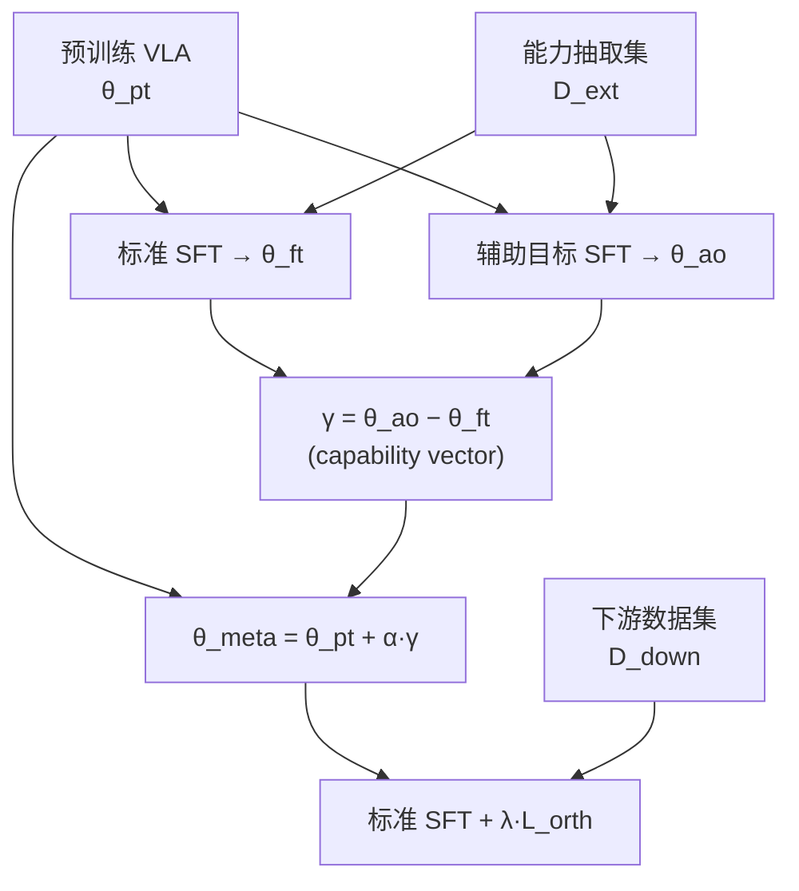
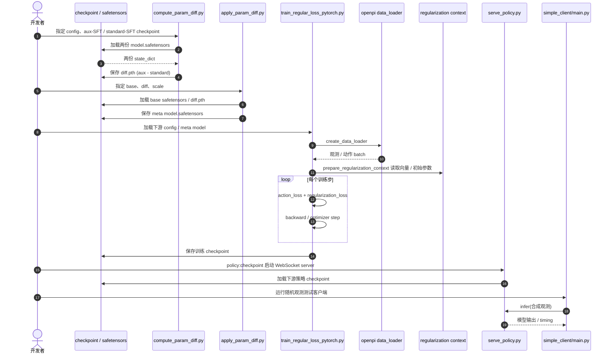

# CapVector（VLA 参数空间可迁移能力向量）

**CapVector** 是 HKUST（广州）、浙江大学、西湖大学、清华大学与北京智源等合作者的论文工作（arXiv:2605.10903，项目页 [capvector.github.io](https://capvector.github.io/)）：针对 **预训练 Vision-Language-Action（VLA）** 在下游 **标准监督微调（SFT）** 上 **增益有限、收敛偏慢**，而 **带辅助目标的 SFT**（如空间对齐、潜式链式思维）虽能改善 **基础能力与步数效率** 却 **显著增加训练时计算** 的矛盾，提出在 **同一参数空间** 内把两类训练写成的 **checkpoint 差分** 解释为 **capability vector**，再与 **预训练权重算术合并** 得到 **能力增强的 meta 初始化**；下游任务仅用 **常规 SFT** 并加一项 **轻量正交正则**，使更新方向尽量不与已注入的能力向量 **逐元素共线干扰**，从而在 **开销接近纯 SFT** 的前提下 **复现辅助微调级别的性能与训练效率**。

## 一句话定义

**用两次同分布微调（标准 SFT 与辅助目标 SFT）的参数差当「能力向量」，离线合并进预训练权重，再用正交正则保护该方向，让下游标准微调继承辅助训练的好处而不长期背负辅助前向。**

## 英文缩写速查

| 缩写 | 英文全称 | 简要说明 |
|------|----------|----------|
| SFT | Supervised Fine-Tuning | 用监督数据将通用模型适配到特定任务分布 |
| VLA | Vision-Language-Action | 视觉-语言-动作多模态基础策略方向 |
| LoRA | Low-Rank Adaptation | 低秩增量微调，低成本适配大模型 |
| Manipulation | Robot Manipulation | 抓取、移动、操作物体的任务总称 |
| Sim2Real | Simulation to Real | 把仿真中学到的策略迁移落地真机的工程主线 |

## 为什么重要

- **成本结构：** 把 **Spatial Forcing、LaRA-VLA** 等路线里 **持续在线的辅助对齐 / 额外分支** 转成 **一次性的双 checkpoint 抽取 + 合并**，适合 **多下游、反复微调** 的工程节奏。
- **与 VLA 主线的关系：** 不替换动作头或预训练目标，而是 **显式处理「通用能力提升」与「任务动作拟合」在参数更新中的可分性假设**；对 **OpenVLA 系、StarVLA、\(\pi_{0.5}\)** 等不同动作参数化给出 **横向证据**。
- **可对照概念：** 与 **task vector / model editing** 传统里「合并 specialist」不同，论文强调面向 **任意下游继续微调时的 generalist 友好初始化** 与 **防遗忘正则**。

## 核心结构

| 阶段 | 内容 |
|------|------|
| **能力抽取集 \(\mathcal{D}_{\text{ext}}\)** | 小规模多任务数据；目的不是刷下游榜，而是 **诱导** 辅助目标下的参数变化（论文示例含 LIBERO 子集、RoboTwin 子任务等）。 |
| **双路径微调** | 同设置下训练 **\(\theta_{\text{ft}}\)**（仅任务损失）与 **\(\theta_{\text{ao}}\)**（任务 + 辅助）；假设 **任务相关增量** 近似相同，取 **\(\gamma=\theta_{\text{ao}}-\theta_{\text{ft}}\)**。 |
| **合并** | **\(\theta_{\text{meta}}=\theta_{\text{pt}}+\alpha\gamma\)**，\(\alpha\) 为标量或向量权重（论文有消融）。 |
| **下游标准 SFT** | 从 \(\theta_{\text{meta}}\) 初始化，在 \(\mathcal{D}_{\text{down}}\) 上最小化动作损失，并加 **\(\mathcal{L}_{\text{orth}}\)** 约束 **\(\gamma\)** 与当前增量 **\(\Delta'_{\text{ft}}\)** 的 **逐参数乘积和**（LoRA 时论文聚焦 **A 矩阵**）。 |

### 流程总览

## 源码运行时序图

下面依据官方 `capvector-pi05/README.md` 以及公开 Python 入口，描述**已发布的 Pi0.5 实现路径**。两个抽取 checkpoint 可由作者提供的现成权重准备；不表示本次执行了训练。

- **实际复现入口：** [`capvector-pi05/README.md`](https://github.com/OpenHelix-Team/CapVector/blob/main/capvector-pi05/README.md)；主要逻辑与限制参见[源码归档](../../sources/repos/openhelix_team_capvector.md)。
- **不能误读：** 官方 `simple_client/main.py` 使用随机生成的输入测 WebSocket API，真实机器人必须另行接入相机、状态和动作执行链。
## 局限与风险

- **误区：** 把 \(\gamma\) 当成 **与任务无关的万能插件** 而不做 **下游正交正则**；论文在 **长步数训练** 上展示 **无正则时能力被冲掉** 的现象。
- **局限：** **\(\Delta_{\text{ft}}\approx\delta_{\text{ao}}\)** 是 **工作假设**，抽取集设计、学习率与权重衰减等 **任一不一致** 都会污染 \(\gamma\)；论文 §3 讨论 **何种下游更易抽到高质量向量**。
- **工程：** 需 **存两份全参或 LoRA checkpoint** 与 **合并系数调参**；超大模型上 **存储与版本管理** 仍是成本。
- **适用限制：** 原文附录 §11 只研究 SFT 环境下的能力向量，RL 抽取尚未验证。

## 关联页面

- [VLA（Vision-Language-Action）](../methods/vla.md) — CapVector 作用的 **模型族与微调语境**。
- [StarVLA](../methods/star-vla.md) — 论文 **多骨干** 实验之一（与 LaRA-VLA 组合）。
- [RoboTwin 2.0](./robotwin.md) — **跨域迁移** 与 **能力抽取任务** 涉及的仿真基准之一。
- [Manipulation（任务总览）](../tasks/manipulation.md) — LIBERO / 桌面操作 **评测语义** 背景。

## 方法栈

见上文 **核心结构** 与 **流程总览**（`###` 小节）；完整机制与模块分工以原文为准。

## 实验与评测

论文 [arXiv HTML v1 §3](https://arxiv.org/html/2605.10903) 的作者实测（本次未独立复现）：

| 评测配置 | 标准 SFT | 辅助目标 SFT | CapVector |
|---|---:|---:|---:|
| LIBERO 4 suites，OpenVLA-OFT，5k steps 平均成功率 | 82.1% | Spatial Forcing 87.5% | **91.7%** |
| LIBERO 4 suites，OpenVLA-OFT，150k steps | 92.7% | Spatial Forcing 96.9% | **97.1%** |
| RoboTwin 2.0，10 个任务，OpenVLA-OFT，LIBERO-Spatial 抽取 | 6.7% | Spatial Forcing 33.1% | **31.8%** |
| LIBERO 4 suites，StarVLA，LaRA-VLA 辅助 SFT | 94.5% | LaRA-VLA 97.9% | **97.1%** |

- **解读：** CapVector 在 LIBERO 部分配置优于辅助目标完整训练，但在 RoboTwin/StarVLA 对照中略低于辅助目标基线；不能笼统称每个场景都更好。
- **正交损失与合并系数：** 论文正文 λ=1e-4，附录 §7 的特定消融中 α=1.1 最优；不应把论文推荐值写成所有数据集或所有骨干的普适最优。
- **实际成本：** 附录 §8–9 的 OpenVLA-OFT LoRA 训练，基线 17.9T FLOPs/62.8G 显存；Spatial Forcing 额外 5.0T/10.9G，CapVector 正则额外 0.3G/0.5G。**不包含前置双 checkpoint 抽取训练成本。**
- **真机验证：** 论文 §3.6 / 附录 §10 含 UR3、ARX Lift 2 和 AgileX Cobot 案例；外部试管搬运任务的成功率 0.36→0.53（作者报告）。

## 结论

**CapVector 做的是成本结构置换：把辅助目标微调的好处从「训练时持续在线的额外分支」变成参数空间里一次性抽取的资产，下游只跑标准 SFT。**

- 真正的机制是两次同分布微调的 checkpoint 差 \(\gamma=\theta_{\text{ao}}-\theta_{\text{ft}}\) 与预训练权重算术合并成 \(\theta_{\text{meta}}\)，再靠轻量 \(\mathcal{L}_{\text{orth}}\) 让下游增量不与 \(\gamma\) 逐元素共线干扰。
- 成立前提是 **「任务相关增量在两条路径上近似相同」这一工作假设**：抽取集设计、学习率、权重衰减任一不一致都会污染 \(\gamma\)。
- 主要失败模式是 **不加正交正则的长步数训练**——论文展示注入的能力会被逐步冲掉，所以 \(\gamma\) 不是即插即用的万能插件。
- 成本从在线搬到了离线：需存 **两份全参或 LoRA checkpoint** 并调合并系数 \(\alpha\)，超大模型上存储与版本管理仍是真实开销。
- 与 **task vector / model editing** 的差别在目标：不是合并已完成的 specialist，而是为 **任意下游继续微调** 提供 generalist 友好初始化 + 防遗忘正则；量化对比见原文。

## 工程实践

| 阶段 | 实际操作要点 |
|---|---|
| 原始权重 | 用相同的抽取数据与设置取得标准 SFT、辅助目标 SFT 两份同架构 checkpoint；Pi0.5 README 也链接了现成模型资源 |
| 能力向量 | `uv run capvector/compute_param_diff.py` 加载两份 `model.safetensors`，输出 `diff.pth`；`--only-vlm` 用于限制在视觉语言部分 |
| 合并权重 | `uv run capvector/apply_param_diff.py` 执行 `base + scale * diff`；确认 key/shape 匹配，且分清论文消融最优 α=1.1 与 README 示例 `--scale 1.0` |
| 下游训练 | `uv run scripts/compute_norm_stats.py` 生成归一化统计，再运行 `scripts/train_regular_loss_pytorch.py`；将正则向量路径、系数在训练 config 中明确指定 |
| 训练监控 | 同时观察 `action_loss`、`regularization_loss`、总 loss、成功率和更长训练下的能力保留，不只看初始收敛 |
| 推理验证 | `scripts/serve_policy.py` 加载 checkpoint 并起 WebSocket server；`examples/simple_client/main.py` 为**模拟观测接口测试**，真实部署需实现机器人 IO |

**复现前提：** 仓库包含 `capvector-oft/` 与 `capvector-pi05/` 两套代码入口；本次只静态核查后者，未下载权重、运行 GPU 任务或部署实机。
## 与其他工作对比

| 方法 | 主要目标与代价 |
|---|---|
| 标准 SFT | 直接拟合动作监督，训练开销低；复杂下游的学习效率可能不足 |
| Spatial Forcing / LaRA-VLA | 用空间监督或潜在推理辅助目标提升性能，但训练时需承担额外分支或损失 |
| **CapVector** | 离线双 checkpoint 差分 + meta 初始化，再以轻量正交损失做标准 SFT；前置抽取成本需摊销 |
| [OptiMer](./paper-optimer-optimal-distribution-vector-merging.md) | 在文本语言模型的多个分布 CPT checkpoint 上做后验向量权重搜索；**不是 CapVector 的 VLA 实验基线** |

研究动机相似在于利用参数差分，区别在训练阶段、能力来源和下游目标。

## 相关研究

- [OptiMer：持续预训练的最优分布向量合并](./paper-optimer-optimal-distribution-vector-merging.md) — 同属 checkpoint 差分向量范式，但 OptiMer 在文本 LLM 上针对多分布 CPT 做后验权重搜索，**尚无 VLA 验证**。

- [Weight-Space Programming](weight-space-programming.md) 研究由 LLM 直接分析和编辑权重，可与依赖微调差分的能力向量方法对照。

## 参考来源

- [CapVector 论文原文复核（arXiv:2605.10903v1）](../../sources/papers/capvector_arxiv_2605_10903.md)
- [capvector.github.io 项目页归档](../../sources/sites/capvector-github-io.md)
- [OpenHelix-Team/CapVector 仓库归档](../../sources/repos/openhelix_team_capvector.md)

## 推荐继续阅读

- 论文 PDF：<https://arxiv.org/pdf/2605.10903>
- 项目主页：<https://capvector.github.io/>
- 官方代码：<https://github.com/OpenHelix-Team/CapVector>
- 权重集合（HF）：<https://huggingface.co/haofuly/capvector_models_collection>
- Task vectors 经典参考：Ilharco et al., *Editing Models with Task Arithmetic*（arXiv:2212.04089，概念脉络对照用）
