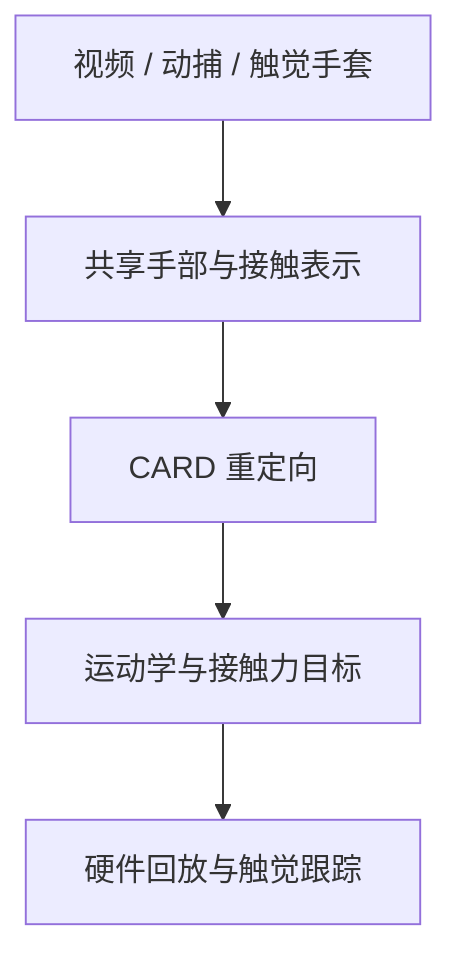

# CARD（接触锚定的灵巧操作重定向）

**CARD**（Contact-Anchored Retargeting for Dexterous Manipulation，[arXiv:2610.36539](https://arxiv.org/abs/2610.36539)）通过保留接触力目标，将人类示范映射为机器人动作；作者将重定向框架描述为无需仿真器和物体模型。

## 英文缩写速查

| 缩写 | 英文全称 | 简要说明 |
|------|----------|----------|
| CARD | Contact-Anchored Retargeting for Dexterous Manipulation | 接触锚定的灵巧操作重定向 |
| Vid-HACO | Video-to-contact model | 从视频估计接触的模型；全称待核实 |
| MoCap | Motion Capture | 人体动作捕捉 |

## 方法与流程

共享手部–接触表示把视频、动捕、触觉手套等输入接入同一重定向框架。对于视频，Vid-HACO 提供接触估计；重定向同时生成运动学及接触力目标。硬件回放时，触觉跟踪控制器用于维持接触目标。

与 [SPIDER](../methods/spider-physics-informed-dexterous-retargeting.md) 的物理仿真采样优化相比，CARD 的摘要强调无需仿真器和物体模型的重定向及显式接触力目标。两者的实验设置不同，不宜直接以数字比较优劣。

## 源码运行时序图

不适用：截至 2026-10-28，项目主页访问失败，未能核实可运行的官方实现及其入口。

## 实验与评测

论文摘要报告，在视频、手套、动捕及 GRAB 数据上，CARD 的接触帧保持比例为 **43%–78%**，运动学基线低于 **10%**，物体感知基线为 **22.5%**。将该方法融入基于物理的重定向后，GRAB 严格任务成功率由 **12% 提升至 32%**。这些数字仅适用于论文的评测设置，指标细节须以全文为准。

## 结论

CARD 把接触力目标作为跨人手和机器人手迁移的显式信号。

1. 选择输入时区分视频推断接触与手套等直接触觉数据。
2. 硬件部署需要检查触觉反馈与目标力跟踪能力。
3. 接触帧保持率与严格任务成功率衡量不同结果，不能混用。
4. 代码状态、指标细节和硬件配置须在项目页及全文可访问后复核。

## 与其他工作对比

- **vs [SPIDER](../methods/spider-physics-informed-dexterous-retargeting.md)：** SPIDER 在物理仿真中采样优化以获得可执行轨迹；CARD 摘要强调 **无需仿真器与物体模型**，直接输出运动学与接触力目标，再靠触觉跟踪控制器在硬件上维持接触。两者实验设置不同，数字不宜直接比较。
- **vs 纯运动学重定向：** 论文报告运动学基线接触帧保持比例低于 10%、物体感知基线 22.5%，CARD 为 43%–78%——显式接触目标是主要差异来源（详见 [动作重定向](../concepts/motion-retargeting.md)）。

## 局限与风险

- 本页依据 arXiv 摘要整理；方法公式、实验细节与传感器要求尚待全文核实。
- 项目页本次无法访问，代码及数据是否开放尚未确认。

## 关联页面

- [FLoRe](./paper-flore.md) — 面向人形移动操作的力反应策略与全身控制。

- [动作重定向](../concepts/motion-retargeting.md)
- [SPIDER：物理感知灵巧重定向](../methods/spider-physics-informed-dexterous-retargeting.md)

## 推荐继续阅读

- [CARD 论文原文](https://arxiv.org/abs/2610.36539)
- [项目主页](https://card-retargeting.github.io/)

## 参考来源

- [CARD 论文归档](../../sources/papers/card_arxiv_2610_36539.md)
- [CARD 项目页索引](../../sources/sites/card-retargeting.md)
