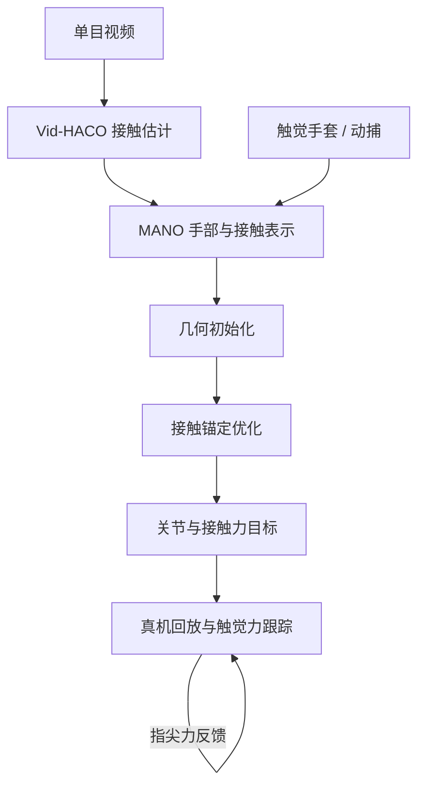

# CARD（接触锚定的灵巧操作重定向）

**CARD**（Contact-Anchored Retargeting for Dexterous Manipulation，[arXiv:2610.36539](https://arxiv.org/abs/2610.36539)）通过保留接触力目标，将人类示范映射为机器人动作；作者将重定向框架描述为无需仿真器和物体模型。

## 英文缩写速查

| 缩写 | 英文全称 | 简要说明 |
|------|----------|----------|
| CARD | Contact-Anchored Retargeting for Dexterous Manipulation | 接触锚定的灵巧操作重定向，本页主体方法 |
| Vid-HACO | Video-to-contact model（论文用语） | 从单目视频逐帧估计 MANO 顶点接触的模型；以 HACO 为基线 |
| HACO | 原文未展开（引用 [30]：Learning dense hand contact estimation from imbalanced data） | Vid-HACO 的基线，其 10 mm 接触规则与 0.52 阈值被沿用 |
| MANO | 论文引用 Embodied Hands [61] | 人手参数化网格模型，统一各类示范的手部表示 |
| CEM | Cross-Entropy Method | 交叉熵方法；论文采用退火版本做零阶采样优化 |
| GRAB | GRAB: A dataset of whole-body human grasping of objects | 带真值物体网格的抓取数据集，用于接触与穿透评测 |

## 为什么重要

- 人类示范是灵巧操作最可扩展的数据来源之一，但遥操作、可穿戴外骨骼和运动示教都要求人通过机器人本体动作，限制了人手本身的灵巧性。
- 仅做运动学重定向（匹配指尖位置或关节角）会忽略接触动力学；论文指出毫米级的本体偏差就决定回放是悬空、打滑还是压碎物体。
- 多数接触保持类重定向需要物体网格、仿真器或学习的跟踪器。CARD 的目标是只用示范自身的手与接触信息完成重定向，从而不依赖物体模型。

## 核心原理

- **输入：** 单目视频（接触由 Vid-HACO 估计）、触觉手套（直接测压），或贴有触觉手套的动作捕捉。三者统一为 MANO 手部网格，并且每个语义手部区域（每指 3 个区域，加掌部等，共 18 个共享区域）至多对应一个接触力目标 $C_f=(c_f,\hat d_f,F_f)$，即压力中心、推向物体的单位方向和力大小。
- **关键机制：** 先用闭式几何初始化给出确定性起点，再逐帧求解优化问题，使机器人指垫与接触力目标对齐，并让推力方向落在摩擦锥内：

$$
q^\star=\arg\min_{q\in\mathcal Q}\;E_{\text{contact}}(q)+E_{\text{style}}(q)+E_{\text{smooth}}(q)+E_{\text{collision}}(q)
$$

- **输出：** 关节轨迹 $q^\star$ 以及每根手指沿推力方向的期望法向力，交给触觉跟踪控制器在真机上回放。

## 方法与流程

论文 [arXiv v1 全文](https://arxiv.org/html/2610.36539v1) 将每个语义手部区域的接触表示为压力中心、推力方向和力大小。Vid-HACO 以连续 8 帧为输入，预测 MANO 的 778 个顶点接触及帧级接触指示；其训练沿用 HACO 的 10 mm 距离规则和 0.52 概率阈值，并在约 155 万帧、12 个数据集上训练。视频和 GRAB 不测量力，其力目标通过整段抓取的净力矩平衡估计，不能当作实测值。触觉手套则提供逐 taxel 的压力测量。

几何初始化之后，每帧以退火 CEM 优化接触位置、推力方向、接触稳定性及自由手指姿态，并约束平滑和碰撞。无物体网格时（视频、手套与 GRAB 的碰撞检测），由当前片段接触力目标的凸包构造伪物体作为碰撞代理。输出关节与接触力目标，硬件的触觉反馈调节手指闭合，并加入力前馈。论文所称开环指没有物体位姿估计和学习策略，但触觉力跟踪仍是闭环。

与 [SPIDER](../methods/spider-physics-informed-dexterous-retargeting.md) 的物理仿真采样优化相比，CARD 的摘要强调无需仿真器和物体模型的重定向及显式接触力目标。两者的实验设置不同，不宜直接以数字比较优劣。

## 源码运行时序图

**不适用**（截至 2026-11-06，项目主页的 Code 按钮处于禁用状态并标注 "Link to come"，未列出可访问的官方仓库；论文正文也未给出代码链接，因此无可对齐的运行入口）。

## 工程实践

| 项目 | 论文中的设置 | 备注 |
|------|--------------|------|
| 求解速度 | 单张 RTX 5090 上约 10 FPS | 逐帧求解，结果经 Savitzky–Golay 滤波（15 帧）平滑 |
| 采样器 | 每轮 N=1024 个候选，K=16 轮，精英比例 5%，温度 η=0.1 | 初始噪声为 2 mm、0.016 rad、0.05 rad；速度上限 0.25 rad/关节、20 mm/帧 |
| 碰撞阈值 | 穿透硬限 3 mm；自碰撞间隙 6 mm | 无物体网格时用伪物体 SDF |
| 接触判定 | 接触力目标位于连杆表面 2 mm 内，且最近采样点在掌面 | 仅为评测口径，不等于任务成功 |
| 触觉回放 | 每指 100 Hz 回路；0.05 N 进入接触、0.01 N 持续 0.6 s 退出；前馈系数 kff=0.3 | 论文附录 F |
| 跨本体迁移 | 只替换语义映射，权重不变；Dex3-1 无触觉，抓取指令放大 1.2 倍 | 论文做法，迁移到其他本体需逐一验证 |

调试顺序建议：先检查输入接触来源（视频推断还是手套测压），再看接触率、正确区域率、锥内率、接触间距（mm）和穿透（mm），最后在真机上对比有无触觉跟踪的开环回放。这些指标的定义见论文附录 G。

## 实验与评测

论文表 1 对 SHARPA Wave（22 自由度）测试：视频 20 段、手套与动捕 66 段、GRAB 100 段，接触率分别为 **61.4%、77.7%、43.1%**；同一 GRAB 设置下依赖物体网格的 ReGrind 为 **22.5%**，运动学基线 DexPilot 与 AnyTeleop 为 3%–10%。接触率按接触锚点帧统计：锚点位于指定连杆内，或距离表面不超过 2 mm 且满足掌面条件，不等于任务成功率。

Vid-HACO 的视频接触估计（表 2）在 12 数据集验证集上 vertex F1 为 **84.3**（原版 HACO 为 57.1），在未参与训练的 HRDexDB 上为 **67.2**（HACO 为 63.3）。

真机开环回放（表与图 6）：三项任务各 10 次，同一轨迹的位置回放分别成功 1/10、3/10、0/10；加入触觉跟踪后为 8/10、10/10、7/10，合计由 4/30 提升至 25/30。

仿真对比 CARD-physics（表 3）：在 48 段动捕示范上严格任务成功率由 SPIDER 的 40% 提升至 52%；在 50 段 GRAB 片段上由 12% 提升至 32%。该变体需要仿真和物体网格及位姿信息。

## 结论

CARD 的主要价值在于把接触力目标作为跨人手与机器人手迁移的显式信号，并用触觉跟踪把它在硬件上复现出来。

1. 选择输入时区分视频推断接触与手套测压等直接触觉数据；论文中接触率分别约为视频 61%、手套与动捕 78%、GRAB 43%（均按接触锚点帧统计）。
2. 硬件部署需要触觉反馈：同一轨迹的位置回放在三项任务中共 4/30 成功，加入触觉跟踪后为 25/30。
3. 接触帧保持率与严格任务成功率衡量不同结果，不能混用；论文的任务成功率仅出现在 CARD-physics 的仿真对比中。
4. 截至 2026-11-06 项目页未开放代码入口，复现需等待官方发布；真机结果每项任务仅 10 次试验。

## 与其他工作对比

- **vs [SPIDER](../methods/spider-physics-informed-dexterous-retargeting.md)：** SPIDER 在物理仿真中采样优化以获得可执行轨迹；CARD 摘要强调 **无需仿真器与物体模型**，直接输出运动学与接触力目标，再靠触觉跟踪控制器在硬件上维持接触。论文将 CARD 的初始化与接触目标接入 SPIDER 形成 CARD-physics，但该对比使用不同的接触信号与种子设置（见附录 I），两者数字不宜直接比较。
- **vs 纯运动学与物体感知重定向：** 表 1 中 DexPilot 与 AnyTeleop 的接触率为 3%–10%，依赖物体网格的 ReGrind 为 22.5%，CARD 为 43%–78%（详见 [动作重定向](../concepts/motion-retargeting.md)）。论文的消融（表 6、表 7）只针对 CARD 内部各项，未把运动学基线与接触项的贡献逐项分离，因此差距应理解为整体方法对比。

## 局限与风险

- 视频接触由 Vid-HACO 估计，视频和 GRAB 的力目标由整段抓取平衡合成而非实测；输入信号误差会直接传递到重定向结果。论文指出，过度预测接触会把手指拉向空处，因此帧级接触判别同样重要。
- 论文指出，大幅物体位移无法由开环回放恢复；真机结果不包含策略学习，也未测试闭环策略。作者计划用 CARD 生成的数据训练闭环策略（未在本文验证）。
- 接触率与锥内率不等于任务成功率。CARD-physics 依赖 SPIDER 的仿真和物体网格及位姿轨迹，不属于 object-free 的部署路径。
- 代码与数据：截至 2026-11-06 项目页的 Code 按钮禁用（"Link to come"），论文未给出仓库链接，因此无法复现 Vid-HACO 或 CARD 管线。
- 本体迁移：Dex3-1 等无触觉手依赖指令放大（1.2 倍）等经验修正，迁移到新本体需逐一标定与实测。

## 关联页面

- [FLoRe](./paper-flore.md) — 面向人形移动操作的力反应策略与全身控制。

- [动作重定向](../concepts/motion-retargeting.md)
- [SPIDER：物理感知灵巧重定向](../methods/spider-physics-informed-dexterous-retargeting.md)

## 推荐继续阅读

- [CARD 论文原文（arXiv 摘要页）](https://arxiv.org/abs/2610.36539)
- [CARD 论文 PDF](https://arxiv.org/pdf/2610.36539)
- [CARD 项目主页](https://card-retargeting.github.io/)

## 参考来源

- [CARD 论文归档](../../sources/papers/card_arxiv_2610_36539.md)
- [CARD 项目页索引](../../sources/sites/card-retargeting.md)
