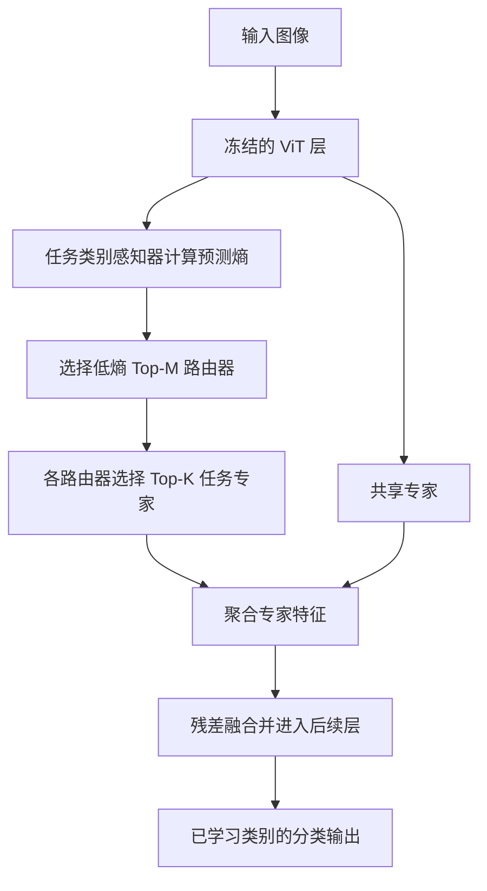
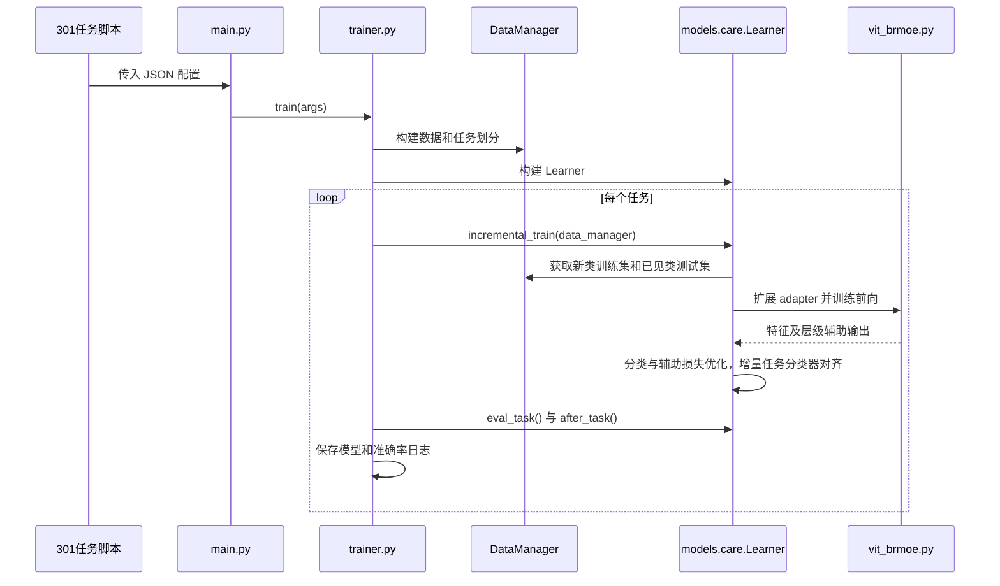

# Scaling Continual Learning to 300+ Tasks with Bi-Level Routing Mixture-of-Experts / 双层路由专家混合：扩展至 300 余项任务的持续学习

## 一句话定义

CaRE 在预训练视觉 Transformer 的各层加入双层路由专家模块，按输入检索历史任务的相关知识，以解决图像分类中的长序列类别增量学习。

## 英文缩写速查

| 缩写 | 英文全称 | 简要说明 |
|---|---|---|
| CIL | Class-Incremental Learning | 类别增量学习 |
| BR-MoE | Bi-Level Routing Mixture-of-Experts | 先选路由器再选专家 |
| ViT | Vision Transformer | 预训练视觉骨干 |
| EMA | Exponential Moving Average | 共享专家的指数滑动更新 |

## 方法流程

每个增量任务在每层增加类别感知器、路由器和 adapter 专家。训练时强制选当前任务路由器，并按熵选其余路由器；推理时均按熵选择。每个路由器对可访问的专家计算门控权重，选 Top-K 加权聚合，另加始终启用的共享专家。默认 M=2、K=3；共享专家首任务训练，后续通过 EMA 更新。层内类别感知器同时接受分类和末层预测的 KL 蒸馏监督。

## 实验与评测

论文 v2 的 OmniBenchmark-1K 来源于 OmniBenchmark-V2，含 1,000 类；使用 ViT-B/16-IN21K 和单张 H800，报告任务平均准确率和最后任务后准确率。301 任务为初始 100 类、之后每任务 3 类，并非 301 种机器人技能。

| 设置 | 平均准确率 | 最终准确率 | 对照最终准确率 |
|---|---:|---:|---:|
| 100 任务 | 78.54% | 68.27% | MOS 64.27% |
| 301 任务 | 77.18% | 68.51% | MOS 64.37% |

100 任务消融中，去掉逐层动态路由选择后最终准确率降至 58.29%；去掉共享专家为 67.84%。结果依赖具体数据划分、预训练模型和评测设置。

## 结论

论文表明双层路由在所测长序列图像类别增量设置中优于所列基线，不能直接推断同等机器人控制效果。

- 对比持续学习方法时同时记录平均和最终准确率，以及任务数与每任务类别数。
- 逐层动态选择和门控专家的消融收益较明显；共享专家带来较小增益。
- 规划长期部署时评估持续新增模块的存储、计算和延迟，而非只看单任务可训练参数。
- 迁移到机器人前需另行检验动作分布、闭环安全和旧技能遗忘。

## 源码运行时序图

对应 [官方 301 任务脚本](https://github.com/LMMMEng/CaRE/blob/main/scripts/omnibenchmark1k/run_ob1k_301task_b100inc3.sh)；运行前需配置数据和依赖。图描述代码路径，并非已执行复现。

## 局限与开放状态

论文指出新增模块随任务数线性增长，未评估无限长任务序列；实验限于图像分类基准。官方公开了训练代码及 OmniBenchmark-1K 下载入口；实际权重、数据许可及依赖以官方页面为准。

## 与其他工作对比

| 维度 | CaRE（本页） | L2P | MOS | TUNA | MoE-Adapter |
|------|--------------|-----|-----|------|-------------|
| 历史知识载体 | 每任务每层的类别感知器 + 路由器 + adapter 专家，另有共享专家 | 可学习 prompt 池，检索任务 prompt | 任务 adapter，经合并与自修正检索 | 通用 adapter 与任务 adapter 协同 | 每任务一个路由器和一组专家 |
| 选择方式 | 逐层按熵选 Top-M 路由器，再选 Top-K 专家 | prompt 检索 | 按检索到的任务在各层绑定 adapter | 推理时协调两类 adapter | 路由器门控专家 |
| 骨干 | 冻结 ViT-B/16-IN21K | 同一实验设置 | 同一实验设置 | 同一实验设置 | 预训练视觉-语言模型 |
| 301 任务最终准确率 | 68.51% | 9.03% | 64.37% | 62.21% | 未参与本文实验 |
| 100 任务每任务可训练参数 / 推理延迟 | 3.27M / 70.89 s | 0.82M / 25.06 s | 16.14M / 1116.54 s | 16.82M / 820.19 s | — |

数字取自论文表 1（OmniBenchmark-1K，B100 Inc3）与表 6（100 任务，B0 Inc10）；各基线均用官方实现在 LAMDA-PILOT 同一设置下复跑。

- **从「绑定」到「逐层检索」：** 论文认为 MOS、TUNA 等在每层绑定任务 adapter，而 CaRE 让每层按各自抽象层级挑选并聚合多个任务的知识；去掉逐层动态选择后 100 任务最终准确率降至 58.29%。
- **长序列才拉开差距：** 论文指出 SEMA、MoAL 等在短序列表现尚可，但长序列显著退化：MoAL 约前 20 个任务仍有竞争力，301 任务时两者最终准确率分别仅 33.01%、19.33%；先前方法多在 5–20 任务上评估。
- **效率口径：** 论文报告 CaRE 相对 MOS 每任务可训练参数约少 80%、推理延迟约低 95%；但 100 任务学完后的总新增参数 Pa（90.99M）高于 MOS（32.27M），且随任务线性增长。

## 关联页面

- [人形机器人动作持续学习](./paper-continual-humanoid-motion-learning.md)：同属持续学习，但任务、模型与评测对象不同。
- [多感官持续学习](./paper-muse-multisensory-continual-learning.md)：关注机器人策略新传感模态与遗忘。

## 参考来源

- [论文来源与版本](../../sources/papers/care_arxiv_2602_03473.md)
- [官方代码与数据入口](../../sources/repos/care-continual-learning.md)

## 推荐继续阅读

- [论文全文 v2](https://arxiv.org/html/2602.03473v2)
- [官方 CaRE 代码](https://github.com/LMMMEng/CaRE)
