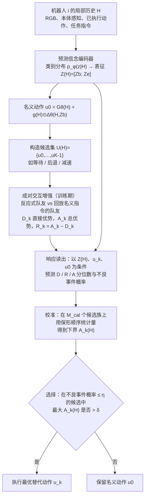

# CARE（arXiv:2610.14551）

**CARE**（*Before We Act: Learning Action-Conditioned Team-Response Beliefs for Decentralized Multi-Robot Manipulation*，[arXiv:2610.14551](https://arxiv.org/abs/2610.14551)，[项目页](https://jeong-zju.github.io/care/)）来自 [具身智能小站 2026-10-14 盘点](../../sources/blogs/wechat_embodied_station_41_papers_streamingwam_2026-10-14.md)，属「多机器人协作与评测」组。

## 一句话定义

**从局部历史学习团队响应信念，把候选动作的直接收益与队友适应收益分开建模，选择性修正名义策略。**

## 英文缩写速查

| 缩写 | 英文全称 | 简要说明 |
|------|----------|----------|
| CARE | aCtion-conditioned teAm-REsponse beliefs | 本文方法缩写 |
| MARL | Multi-Agent RL | 多智能体强化学习 |
| Dec | Decentralized | 去中心化 |

## 为什么重要

- 去中心化协作中队友响应会改变最佳动作，需显式预测。
- 开源结论：**项目页未列 GitHub**（步骤 2.5，2026-10-14）。项目页入库日未列 GitHub。
- 同期同组工作见 [流式动作块与世界模型记忆：具身智能小站 10-14 期 41 篇阅读坐标](../overview/embodied-station-2026-10-14-41-papers-technology-map.md)。

## 流程总览

图依据：论文 §II–§III（II-B 编码器、II-C 成对增强、III-A 读出、III-B 校准选择）/ Fig.2

## 核心机制

| 项 | 内容 |
|----|------|
| **arXiv** | [2610.14551](https://arxiv.org/abs/2610.14551) |
| **开源** | **项目页未列 GitHub** |
| **要点** | 动作条件信念 + 选择性修正。 |
| **文内指标** | 以原文为准。 |

## 源码运行时序图

**不适用（项目页未列 GitHub）** — 项目页入库日未列 GitHub。 不编造运行脚本；代码公开后再补。

## 实验与评测

- 以原文为准。
- **读法：** 本页为索引级摘要，依据公众号转述的官方摘要与仓库信息整理；逐项数字与 baseline 以原文 PDF 为准。

## 与其他工作对比

- 横向索引见 [流式动作块与世界模型记忆：具身智能小站 10-14 期 41 篇阅读坐标](../overview/embodied-station-2026-10-14-41-papers-technology-map.md)；同 arXiv 不重复造页。

## 结论

**多机器人操作先预测「我动之后队友怎么动」，再修正自身动作。**

1. 开源边界：**项目页未列 GitHub** — 项目页入库日未列 GitHub。
2. 核心机制：动作条件信念 + 选择性修正。
3. 复现与选型前核对任务协议、硬件与基准口径，勿直接横比公众号摘录数字。

## 关联页面

- [marl](../methods/marl.md)
- [humanoid-multi-robot-coordination](../concepts/humanoid-multi-robot-coordination.md)
- [manipulation](../tasks/manipulation.md)
- [paper-akule-sparse-interaction-diffusion](./paper-akule-sparse-interaction-diffusion.md)
- [embodied-station-2026-10-14-41-papers-technology-map](../overview/embodied-station-2026-10-14-41-papers-technology-map.md)

## 参考来源

- [care_team_response_beliefs_multi_robot_arxiv_2610_14551.md](../../sources/papers/care_team_response_beliefs_multi_robot_arxiv_2610_14551.md)
- [wechat_embodied_station_41_papers_streamingwam_2026-10-14.md](../../sources/blogs/wechat_embodied_station_41_papers_streamingwam_2026-10-14.md)
- [arXiv:2610.14551](https://arxiv.org/abs/2610.14551)
- [arXiv PDF](https://arxiv.org/pdf/2610.14551)：已通读方法部分（实验与附录以略读为准）：§I 引言、§II 学习预测团队信念（A–E）、§III 从信念到动作（A–C）、§IV-A 基准与协议；其余实验略读

## 推荐继续阅读

- [arXiv PDF](https://arxiv.org/pdf/2610.14551)
- [项目页](https://jeong-zju.github.io/care/)
