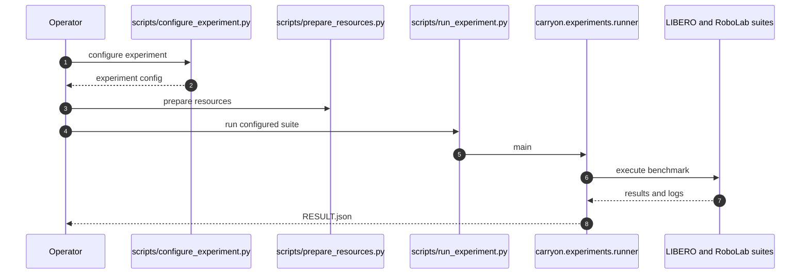

# CarryOn：具备记忆、安全与失败恢复的双循环机器人 Harness

## 一句话定义

**以持久用户/场景记忆驱动规划循环，并在执行循环对冻结 VLA 的接触风险施加屏蔽、失败后调用可迭代恢复技能。**

## 英文缩写速查

| 缩写 | 英文全称 | 简要说明 |
|------|----------|----------|
| VLA | Vision-Language-Action | 冻结的基础执行策略 |
| OOD | Out-of-Distribution | 分布外场景 |
| P/S | Position and Stiffness | 恢复技能可调控制参数 |

## 为什么重要

围绕冻结 VLA 的规划与执行双循环，关注现有控制、数据或机器人学习方法在复杂任务中的失效点。这里单独建论文实体，避免与其他论文共用详情页；已通读原始论文 HTML 的可用正文和附录；源码执行效果仍需复现。

## 核心机制

规划循环基于用户偏好、场景观察与对话更新记忆，输出子任务；执行循环监视策略动作，对高风险接触进行主动 shielding，执行失败时调用控制式 recovery skill，复盘后修订下一版技能。

## 方法流程

该流程依据原文方法描述，不等价于源码调用时序。

## 源码运行时序图

依据官方仓库 README 与实际执行入口静态核查，尚未部署运行：

## 实验与评测

论文分别评估个性化、接触安全与恢复；在对应设置中，违反率从 52.6% 降至 6.1%，恢复成功率从 13% 升至 80%。各指标属于不同实验，不能合称端到端成功率。

## 局限与工程实践

- 安全屏蔽仍依赖风险估计和接触建模；系统增益来自外部规划、屏蔽与恢复机制，不表示冻结 VLA 权重本身改善。
- **源码状态：** 官方仓库 README 标注 2026-10-25 已发布代码；本次无法直接加载项目页，开源状态以仓库 README 为依据。
- **原文状态：** 已通读 arXiv HTML 的可用正文和附录；具体复现及跑通情况尚未独立验证。

## 结论

**有用的补强是双闭环组合：长期偏好影响做什么，在线屏蔽和恢复解决怎么持续做。**

1. 使用与论文一致的任务、硬件和评测协议复验，不跨实验口径比较数据。
2. 把方法改善的指标与额外的数据、计算或控制成本分开记录。
3. 对未经独立核查的复现入口，暂不声称完成验证。

## 与相关方法对比

| 对照方法 | 关键区别 | 局限或适用条件 |
|---|---|---|
| 冻结 VLA 单独执行 | 缺少独立偏好更新和异常恢复闭环 | CarryOn 增加规划记忆与风险屏蔽、恢复 |
| 只做动作安全屏蔽 | 能减少部分危险接触，但不积累用户偏好和恢复技能 | CarryOn 将规划与执行双循环结合 |

不同基准和硬件的结果不能直接排序。

## 关联页面

- [HDH：冻结 VLA 的低延迟动作验证](./paper-hdh-action-verifier.md)
- [亚毫秒反射：连续人机物理交互的无锁控制切换](./paper-submillisecond-reflex-engine.md)

## 参考来源

- [论文归档](../../sources/papers/carryon-dual-loop_arxiv_2610_21453.md)
- [官方项目页归档](../../sources/sites/carryon-dual-loop.md)
- [官方仓库归档](../../sources/repos/carryon-dual-loop.md)

## 推荐继续阅读

- [arXiv 原文](https://arxiv.org/abs/2610.21453)
- [官方项目页](https://vincent2311.github.io/Projects/CarryOn/)
- [公开仓库](https://github.com/JIA-Lab-research/CarryOn)
