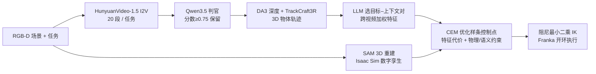
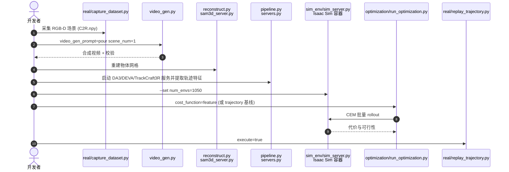

# CASTER：把生成视频当作约束优化的初值

**CASTER**（*Formalizing Zero-Shot Manipulation from Synthetic Videos as Constrained Optimization*，[arXiv:2610.12567](https://arxiv.org/abs/2610.12567)，[项目页](https://collab.me.vt.edu/CASTER)，[代码](https://github.com/VT-Collab/CASTER)）由 **Virginia Tech（Collab 实验室）与 Johns Hopkins University** 提出：用视频生成器在机器人自己的场景里合成任务视频，提取物体轨迹特征当作初值，再在数字孪生中施加物理可行与语义一致约束做优化，得到零样本可执行的机器人轨迹。

## 一句话定义

**视频只提供「搜索起点和任务特征」，可执行性由数字孪生里的约束优化负责。**

## 英文缩写速查

| 缩写 | 英文全称 | 简要说明 |
|------|----------|----------|
| CASTER | （论文题名中的方法名） | 合成视频到约束优化轨迹的框架 |
| CEM | Cross-Entropy Method | 在样条控制点上采样、取精英迭代的无梯度优化器 |
| VLM | Vision-Language Model | 本文用 Qwen3.5 筛选生成视频 |
| IK | Inverse Kinematics | 执行阶段用阻尼最小二乘微分 IK |
| I2V | Image-to-Video | 以首帧场景图条件生成视频 |

## 为什么重要

- 免去真人示教：视频生成器可直接在机器人场景中「想象」任务，门槛是把想象变成物理上可执行的动作。
- 把「视频好看」与「轨迹能做」分开验证：论文的视频生成器对比显示，有效视频数量并不单独决定下游成功率（见实验）。
- 给出统一视角：直接重定向（Retarget）与基于物理仿真的模仿（Mimic）被视为该约束优化的简化特例。

## 方法栈 / 流程总览

## 方法

- **形式化：** 变量是机器人动作轨迹 ξa（诱导物体轨迹 ξo）；目标最小化 ‖ϕ(ξo) − ϕ(ftrack(v))‖，匹配任务特征而非逐点路标；约束为语义与物理可行的概率下界。数字孪生中另加安全裕度。
- **语义吸引域：** 定义 𝒮ρϕ，Markov 不等式给出 P[z∈𝒮ρϕ] ≥ 1 − σvid²/ρ²；含义是生成器应概率性地把搜索放入语义吸引域，使轨迹能局部调整而不丢任务。
- **实用目标（Eq. 19）：** Σt wt‖ϕ(ξot) − ξ̄τt‖，约束接触力上限与关节限位。
- **视频与特征：** HunyuanVideo-1.5 480P-I2V Step-Distilled，每任务 20 段（121 帧、24 fps）；Depth Anything 3 + TrackCraft3R 提取 3D 点轨迹；特征用跨视频中位数/均值，权重随方差指数衰减。
- **数字孪生优化：** Isaac Sim 6.0.1 / Isaac Lab，SAM 3D 重建物体，120 Hz 物理、60 Hz 控制、1050 个并行环境；CEM 样条 (Kpos, Krot) = (15, 5)，种群 1024、10 代、精英 10%。
- **执行：** 阻尼最小二乘微分 IK，开环；机器人为 Franka Emika，Orbbec Femto Mega RGB-D 相机。

## 源码运行时序图

官方仓库 [VT-Collab/CASTER](https://github.com/VT-Collab/CASTER)（MIT，归档见 [vt-collab-caster](../../sources/repos/vt-collab-caster.md)）入口与 README 一致（本次仅核对结构，未实际运行）：

- 最短路径：`git submodule update --init` → `uv sync` → 准备 Isaac Sim 容器与 `.env` 密钥 → 按上图顺序执行。
- 需要 Gemini Robotics ER 与一个 OpenAI 兼容文本端点（任务特征解析）。

## 工程实践

| 项 | 建议 |
|----|------|
| 视频筛选 | 先用 VLM 判官过滤，但别只看有效率：Wan 2.2 有效 71/80 却不如 Hunyuan 成功率高 |
| 代价函数 | 仓库里 `feature` 与 `trajectory` 一键切换，可复现论文对照 |
| 资源 | 需 GPU 容器跑 Isaac Sim，外部模型多（SAM 3D 需单独环境并申请权重） |
| 执行 | 开环，标定误差直接影响结果 |

## 实验与评测

- **总成功率（12 任务）：** Retarget 32.1%，Mimic 42.5 ± 4.5%，CASTER 76.6 ± 3.9%。摘要的 34.1% 是对 Mimic 的绝对差（百分点），不是相对提升。
- **典型任务（Retarget / Mimic / CASTER）：** 香蕉入锅 0.0/66.7/100.0；叠碗 14.3/28.6/100.0；烤面包 28.6/14.3/90.5；堆方块 0.0/9.5/57.1；合盖 14.3/4.8/57.1。
- **CASTER 未领先的任务：** 倒水壶 61.9（Mimic 66.7）；盖桶 33.3（Retarget 42.9）；白板画线仅 28.6。
- **视频生成器对比（4 任务、80 段）：** HunyuanVideo-1.5 有效 55/80、成功 79.8%；Wan 2.2 71/80、76.2%；LTX-2.3 52/80、47.6%；CogVideoX1.5 1/80、0.0%。
- **试验数：** Retarget 每任务 7 次，Mimic/CASTER 每任务 21 次（7 次 CEM × 3 条轨迹），基线统计量更少。
- **数字不一致：** 附录称 70.4% 视频通过校验，表内 55/80 = 68.75%；本页只引表内数。

## 结论

**合成视频适合作为约束优化的初值而不是可执行轨迹；在数字孪生里满足物理与语义约束后，Franka 12 任务总成功率从 42.5% 提到 76.6%。**

1. 把视频当初值、把可行性交给优化器，比直接重定向（32.1%）和纯轨迹拟合的 Mimic 都更稳。
2. 匹配任务特征（目标–上下文关系）而不是逐点轨迹，给优化器留出局部调整空间。
3. 评估视频生成器要看下游成功率，不只看视频有效率。
4. 数字孪生质量是上限：壶柄、桶把手等关节缺失会直接拉低对应任务。
5. 全程开环、依赖标定与重型外部模型栈，部署前要评估自己的场景重建能力。

## 与其他工作对比

| 对照 | 差异读法 |
|------|----------|
| Retarget 类（论文基线，类似 RIGVid） | 直接把视频物体轨迹转机器人动作，无物理校正 |
| Mimic 类（论文基线，类似 PhysWorld） | 在仿真中拟合视频轨迹；CASTER 改为匹配特征并带约束 |
| [Mimic-video](../methods/mimic-video.md) | 同样利用视频先验做操作，但走策略学习路线（站内页，细节不在本论文范围） |
| [视频即仿真](../concepts/video-as-simulation.md) | 概念背景：视频生成作为仿真替代 |

## 局限与风险

- **开源状态：** 截至 2026-10-12 代码已公开（MIT，8 次提交），项目页「Experiments」仍是占位，数据集链接来自项目页。
- 仿真到真机差距（壶柄旋转、桶手柄关节缺失）；全程开环；生成器对比仅 4 任务、每任务 7 段视频。
- 假设跟踪器与相机–机器人标定准确；视频生成器冻结，吸引域只是分析假设。
- 机构信息见 arXiv HTML；方法依赖 Gemini Robotics ER 等外部服务。

## 关联页面

- [34 篇论文空间落地技术地图（汇总页）](../overview/embodied-station-34-papers-spatial-grounding-technology-map.md)
- [操作任务](../tasks/manipulation.md)
- [视频即仿真](../concepts/video-as-simulation.md)
- [生成式世界模型](../methods/generative-world-models.md)
- [Sim2Real](../concepts/sim2real.md)
- [Isaac Lab](./isaac-lab.md)

## 参考来源

- [34 篇论文盘点（具身智能小站，2026-10-12）](../../sources/blogs/wechat_embodied_station_34_papers_spatial_grounding_2026-10-12.md)
- [caster_arxiv_2610_12567.md](../../sources/papers/caster_arxiv_2610_12567.md) — 论文摘录
- [caster-vt-collab-project.md](../../sources/sites/caster-vt-collab-project.md) — 项目页核查
- [vt-collab-caster.md](../../sources/repos/vt-collab-caster.md) — 仓库核查
- [arXiv:2610.12567](https://arxiv.org/abs/2610.12567)

## 推荐继续阅读

- [CASTER 项目页](https://collab.me.vt.edu/CASTER)
- [CASTER GitHub](https://github.com/VT-Collab/CASTER)
- [CASTER-scenes 数据集](https://huggingface.co/datasets/JiecaoBoy/CASTER-scenes)
- [HunyuanVideo-1.5 Diffusers 480p I2V](https://huggingface.co/hunyuanvideo-community/HunyuanVideo-1.5-Diffusers-480p_i2v_step_distilled)
