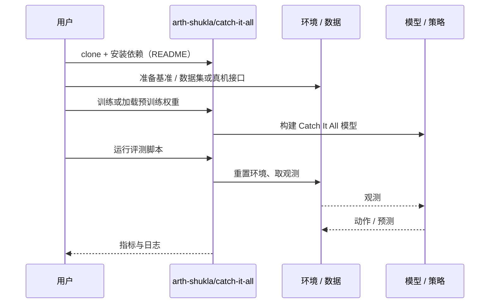

# Catch It All（arXiv:2610.39044）

**Catch It All**（*Catch It All!: Generalizable Dynamic Catching with a Dexterous Hand*，[arXiv:2610.39044](https://arxiv.org/abs/2610.39044)，[项目页](https://arth-shukla.github.io/catch-it-all/)，[代码](https://github.com/arth-shukla/catch-it-all)）来自 [具身智能小站 2026-10-30 盘点](../../sources/blogs/wechat_embodied_station_28_papers_event2reward_progress_rewards_2026-10-30.md)，属「灵巧操作与抓取」组。

## 一句话定义

**Catch It All! 用抓握奖励和安全课程训练动态接物，再零样本部署到 G1。**

## 英文缩写速查

| 缩写 | 英文全称 | 简要说明 |
|------|----------|----------|
| Catch It All | Catch It All!: Generalizable Dynamic Catching with a Dexterous Hand | 本文方法 / 基准的简称 |

## 为什么重要

- 让灵巧手接住形状和弹性不同的飞来物。单个自视角相机处理未见物体，重点在视觉噪声、接触变化与硬件约束的共同设计。
- 开源结论：**部分开源**（步骤 2.5，2026-10-30）。项目页链接 arth-shukla/catch-it-all，但 git ls-remote 失败（仓库不存在或私有），不能当作已开源。
- 同期同组工作见 [进度奖励、接触监督与规划验证：具身智能小站 10-30 期 28 篇阅读坐标](../overview/embodied-station-2026-10-30-28-papers-technology-map.md)。

## 核心机制

| 项 | 内容 |
|----|------|
| **arXiv** | [2610.39044](https://arxiv.org/abs/2610.39044) |
| **开源** | **部分开源** |
| **要点** | Catch It All! 用抓握奖励和安全课程训练动态接物，再零样本部署到 G1。 |
| **文内指标** | 公众号转述：单个自视角相机处理未见物体，重点在视觉噪声、接触变化与硬件约束的共同设计。 |

## 源码运行时序图

以下为按仓库入口（`arth-shukla/catch-it-all`）推断的通用运行链路；入库日仅核实仓库可达，未逐文件阅读，具体脚本名以 README 为准。

## 实验与评测

- 公众号转述：单个自视角相机处理未见物体，重点在视觉噪声、接触变化与硬件约束的共同设计。
- **读法：** 本页为索引级摘要，依据公众号转述的官方摘要与仓库信息整理；逐项数字与 baseline 以原文 PDF 为准。

## 与其他工作对比

- 横向索引见 [进度奖励、接触监督与规划验证：具身智能小站 10-30 期 28 篇阅读坐标](../overview/embodied-station-2026-10-30-28-papers-technology-map.md)；同 arXiv 不重复造页。

## 结论

**让灵巧手接住形状和弹性不同的飞来物：单个自视角相机处理未见物体，重点在视觉噪声、接触变化与硬件约束的共同设计。**

1. 开源边界：**部分开源** — 项目页链接 arth-shukla/catch-it-all，但 git ls-remote 失败（仓库不存在或私有），不能当作已开源。
2. 核心机制：Catch It All! 用抓握奖励和安全课程训练动态接物，再零样本部署到 G1。
3. 复现与选型前核对任务协议、硬件与基准口径，勿直接横比公众号摘录数字。

## 关联页面

- [manipulation](../tasks/manipulation.md)
- [dexterous-kinematics](../concepts/dexterous-kinematics.md)
- [contact-rich-manipulation](../concepts/contact-rich-manipulation.md)
- [sim2real](../concepts/sim2real.md)
- [embodied-station-2026-10-30-28-papers-technology-map](../overview/embodied-station-2026-10-30-28-papers-technology-map.md)

## 参考来源

- [catch_it_all_arxiv_2610_39044.md](../../sources/papers/catch_it_all_arxiv_2610_39044.md)
- [wechat_embodied_station_28_papers_event2reward_progress_rewards_2026-10-30.md](../../sources/blogs/wechat_embodied_station_28_papers_event2reward_progress_rewards_2026-10-30.md)
- [arXiv:2610.39044](https://arxiv.org/abs/2610.39044)

## 推荐继续阅读

- [arXiv PDF](https://arxiv.org/pdf/2610.39044)
- [项目页](https://arth-shukla.github.io/catch-it-all/)
- [https://github.com/arth-shukla/catch-it-all](https://github.com/arth-shukla/catch-it-all)
