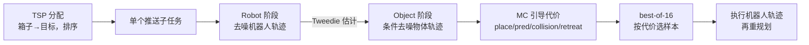
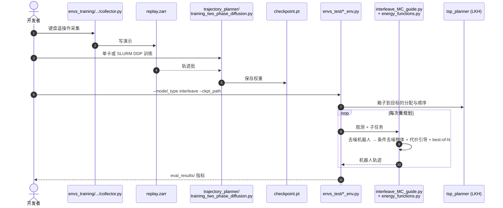

# Causal Diffusion Planner：移动机器人精确推放多个物体

**Causal Diffusion Planner**（论文 *Non-Prehensile Multi-Object Placement with Mobile Robots via Diffusion-Based Trajectory Planning*，[arXiv:2610.12684](https://arxiv.org/abs/2610.12684)，[匿名代码](https://anonymous.4open.science/r/Causal_Diffusion_Planner-0181)）来自 University of Waterloo（Pharand、Ramesh、Chiu、Pant、Smith）。它把移动机器人推多个箱子进小容差目标区的问题，分解为“先机器人、后物体”的因果扩散，并用推物专用代价引导采样。

## 一句话定义

**把 p(机器人轨迹, 物体轨迹) 因果分解为 p(机器人) · p(物体 | 机器人)，用同一个 Transformer 先后去噪，并用过冲感知的推物代价做引导与 best-of-N 选择。**

## 英文缩写速查

| 缩写 | 英文全称 | 简要说明 |
|------|----------|----------|
| DPS | Diffusion Posterior Sampling | 以代价梯度引导采样；本文用蒙特卡洛（MC）估计版 |
| TSP | Traveling Salesman Problem | 为箱子分配目标并排序，仓库用 LKH 求解 |
| BPF | Box Placement Fraction | 多箱环境中成功放置箱子的比例 |
| CC | Contact Consistency | 无接触步中出现“无因物体运动”的步数占比，越低越好 |
| DDIM | Denoising Diffusion Implicit Models | 采样步数设置（50 / 100） |
| DiT | Diffusion Transformer | 去噪网络骨架 |

## 为什么重要

- **移动平台的精确非抓取：** 机械臂 Push-T 上很多，移动机器人要绕物体重定位，小误差代价大。
- **联合去噪的两个问题：** 联合模型容易生成机器人未触及却自行移动的“不合理物体运动”；因果分解让物体预测显式依赖机器人动作，并支持对同一机器人计划采样多个物体结果。
- **可部署：** 真机上不微调、对未见形状泛化，且有可用代码。

## 方法栈 / 流程总览

## 方法

- **问题设定：** 每个物体有“占地 + 余量 δ”的方形目标区（δ∈{4, 2} cm，箱边长 8 cm）；物体入区且机器人不再接触才算放置，已放置物体不可被扰动。
- **因果结构：** 共享一个 DiT 风格解码器，分离时空注意力；掩码阻止干净机器人 token 关注带噪物体；v-prediction；机器人条件 token 按信号比例 ᾱ_t 门控。Push-T 模型约 17.8M 参数，移动机器人模型约 75–90M。
- **五项引导代价：** C_place（沿推方向过冲惩罚为欠冲的 25 倍，加横向误差）；C_pred（预测落点）；物体与机器人各一项碰撞屏障代价；C_retreat（需撤离时惩罚靠近目标物体）。使用 K=16 样本的 MC 估计与 softmax 权重，逐项梯度归一化。
- **数据：** Push-T 用 pusht_keypoints；移动机器人约 500 条 δ=2 cm 遥操作演示（撞到已放置箱的回合剔除）。

## 实验与评测

- **Push-T（75 回合/行）：** Causal[100 DDIM] 54.7% 成功率，Causal[50] 53.3%，Diffusion Forcing 44.0%，Joint 40.0%；CC：Causal 10.8–11.6%，Diffusion Forcing 29.3%，Joint 18.3%。延迟中位数 Causal[50] 2008 ms，基线约 2300 ms，Causal[100] 4257 ms。
- **三个多箱环境（U-Shape / Pallet Staging / Cross-Dock Staging）：** Causal Best-of-16 比无引导 DP 平均多放 21.5 点（最高 30.9）；重规划 2812 ms，联合 Best-of-16 为 5088 ms（1.8 倍）；仅引导（Causal + MC DPS）相对 DP 平均 +8.1 点。Pallet Staging 中，超 1 cm 过冲的计划占比由 3.6% 降到 2.6%，超 2 cm 由 0.64% 降到 0.20%。
- **TurtleBot 3 Burger：** 不微调，4 种未见形状、10 次试验/方法、3 cm 容差；Causal + MC DPS 放置 85.0%（60% 回合全部完成），DP 为 37.5%（0%）。头顶相机 AprilTag 20 Hz，位姿控制器 30 Hz。

## 源码运行时序图

匿名仓库 [Causal_Diffusion_Planner-0181](https://anonymous.4open.science/r/Causal_Diffusion_Planner-0181) 可用（归档见 [repos 页](../../sources/repos/causal_diffusion_planner.md)）：

- 依赖 Python 3.10+、PyTorch、IvanIZ/spfa 与 LKH；`envs_test/eval_scripts/` 下有各方法评测脚本（interleave 即因果分解）。权重与演示视频在 Dropbox（未下载核对）。

## 工程实践

- 精度敏感时开启引导并用 best-of-16：延迟约 2.8 s/次重规划，需要更快时可用 50 步 DDIM。
- 全局定位依赖头顶相机；换机载相机需另解标签遮挡问题。
- 演示中剔除撞到已放置箱的回合，会影响分布。
- 先跑 `tsp_planner/test_planner.py` 确认 LKH 安装。

## 结论

**因果分解加上推物专用引导，在移动机器人精确推放上比联合去噪更准也更快，但整体成功率仍不高。**

1. 因果分解让物体轨迹显式依赖机器人，Push-T 成功率 54.7%，比最近基线高 10.7 点。
2. 引导减少过冲：Pallet Staging 超 1 cm 过冲占比 3.6%→2.6%。
3. best-of-16 带来大部分收益：相对无引导 DP +21.5 点，纯引导为 +8.1 点。
4. 重规划比联合 best-of-16 快 1.8 倍。
5. 真机放置 85.0%，但仅 10 次试验/方法。
6. 全回合二值成功率只有 7%–37%，多箱累积扰动是主要失败源。

## 局限与风险

- **开源：** 匿名审稿版仓库已可读（含训练、评测、基线），权重在 Dropbox，署名正式仓库尚无；审稿后链接可能变化。
- 依赖头顶相机的全局位姿；机载感知未解决。
- 任一已放置箱被扰动即判失败，难度随箱数累积。
- 真机样本小；预测时域和多箱环境的箱数原文正文未给出。

## 与其他工作对比

| 对照 | 读法 |
|------|------|
| [Diffusion Policy](./paper-diffusion-policy.md) | 真机主要基线；动作序列直接回归，无物体动力学预测 |
| 联合去噪（本文基线） | 同网络同时去噪机器人与物体，易出现无接触物体运动，重规划更慢 |
| Diffusion Forcing | Push-T 基线，成功率 44.0% |
| [TurtleBot3](./turtlebot3.md) | 真机平台同类（本文用 TurtleBot 3 Burger） |

## 关联页面

- [34 篇空间落地技术图谱（汇总页）](../overview/embodied-station-34-papers-spatial-grounding-technology-map.md)
- [操作任务总览](../tasks/manipulation.md)
- [Diffusion Policy（方法）](../methods/diffusion-policy.md)
- [Diffusion Policy（论文）](./paper-diffusion-policy.md)
- [TurtleBot3](./turtlebot3.md)

## 参考来源

- [公众号盘点：具身智能小站 34 篇](../../sources/blogs/wechat_embodied_station_34_papers_spatial_grounding_2026-10-12.md)
- [causal_diffusion_planner_arxiv_2610_12684.md](../../sources/papers/causal_diffusion_planner_arxiv_2610_12684.md)
- [causal_diffusion_planner.md](../../sources/repos/causal_diffusion_planner.md)
- [arXiv:2610.12684](https://arxiv.org/abs/2610.12684)

## 推荐继续阅读

- [匿名代码仓库](https://anonymous.4open.science/r/Causal_Diffusion_Planner-0181)
- [arXiv HTML 全文](https://arxiv.org/html/2610.12684v1)
